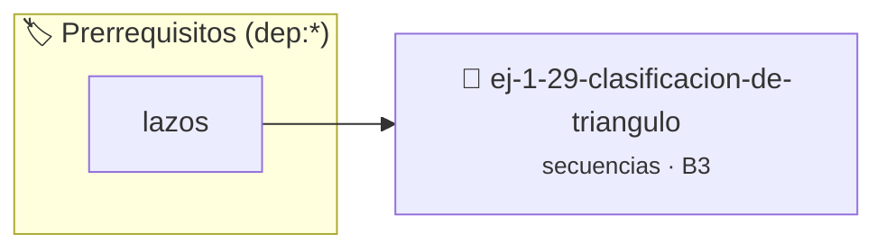

# Clasificación de Triángulo
> **ID:** `ej-1-29-clasificacion-de-triangulo` · **Unidad:** 1 (Fundamentos y Estructuras de Control)
 · **Tema:** `secuencias` / `fundamentos`
 · **Bloom:** B3 (Aplicar) · **Dificultad:** Intermedia
 · **Carga:** ~25 min · **Tipo:** Practica Guiada
>
> **🏷️ Prerrequisitos temáticos (tags):** `dep:lazos`
>
> **Etiquetas conceptuales:** `fundamentos`, `secuencias`, `triangulo`, `basicos`, `clasificacion`


::: {admonition} 📦 Paquete de Verificación Local (Ripley)
:class: tip

Para compilar, resolver y autoevaluar tu entrega con pruebas unitarias en tu máquina:

- [📥 **Descargar paquete `ej-1-29-clasificacion-de-triangulo.ripkg`**](../../paquetes/ej-1-29-clasificacion-de-triangulo.ripkg)

Ejecución con el asistente de cátedra:
```bash
ripley run ej-1-29-clasificacion-de-triangulo.ripkg
```
:::


### 🗺️ Itinerario Pedagógico




## 📖 Consigna

Dados los largos de tres lados, el programa debe determinar si pueden formar un
triángulo válido y, en caso afirmativo, clasificarlo como equilátero (todos los
lados iguales), isósceles (dos lados iguales) o escaleno (todos los lados
diferentes).


:::{tip} Ayuda (pseudocódigo)
:class: dropdown
```{code-block} pseudocode
:linenos:

ALGORITMO clasificar_triangulo
ENTRADA: a, b, c (reales)

INICIO
    LEER a, b, c
    SI (a+b > c) Y (a+c > b) Y (b+c > a) ENTONCES
        SI a == b Y b == c ENTONCES
            ESCRIBIR "Es un triángulo Equilátero."
        SINO SI a == b O b == c O a == c ENTONCES
            ESCRIBIR "Es un triángulo Isósceles."
        SINO
            ESCRIBIR "Es un triángulo Escaleno."
        FIN SI
    SINO
        ESCRIBIR "Los lados no forman un triángulo válido."
    FIN SI
FIN

```

:::

### 📋 Contrato de las Funciones

```c
/*
 * Procesa el flujo principal de Clasificación de Triángulo
 * Precondiciones: val representa el parámetro de entrada del flujo.
 * Postcondiciones: Retorna el resultado correspondiente o 0 si val <= 0.
 */
int proc_icacion_de_triangulo(int val);

```

### 🧪 Ejemplos de Ejecución

::::{tab-set}
:::{tab-item} Valor positivo
```text
Entrada: 5
Salida / Retorno: 10
```
:::
:::{tab-item} Valor cero o negativo
```text
Entrada: 0
Salida / Retorno: 0
```
:::
::::

### ⚠️ Precondiciones y Casos Borde

1. **Valores fuera de rango:** Verificar siempre que los datos de entrada cumplan con los rangos admisibles antes de operar.
6. **Casos vacíos o neutros:** Contemplar adecuadamente entradas con longitud cero o valores neutros según corresponda.

### 🎯 Criterios de Aceptación

- [ ] El código compila limpiamente bajo estándar C11 sin warnings con flags estrictos (`-Wall -Wextra -Werror`).
- [ ] Se satisfacen todas las pruebas unitarias y casos de prueba provistos.
- [ ] Las funciones validan exhaustivamente sus precondiciones y gestionan casos borde de forma robusta.

:::{hint} Consideraciones Didácticas
- **Entrada:** Leer las longitudes de los tres lados (`a`, `b`, `c`).
- **Validación (Desigualdad Triangular):** Antes de clasificar, es crucial
- **Clasificación:**
- Validar la desigualdad triangular antes de clasificar el triángulo.
- Determinar además si el triángulo es rectángulo aplicando el teorema de Pitágoras.
:::


## 📋 Prototipos y Cabecera (`ej-1-29-clasificacion-de-triangulo.h`)

```{code-block} c
#ifndef EJERCICIO_EJ_1_29_CLASIFICACION_DE_TRIANGULO_H
#define EJERCICIO_EJ_1_29_CLASIFICACION_DE_TRIANGULO_H

#include <stddef.h>
#include <stdbool.h>
#include <stdint.h>

/* Procesa el flujo principal de Clasificación de Triángulo */
int proc_icacion_de_triangulo(int val);

#endif /* EJERCICIO_EJ_1_29_CLASIFICACION_DE_TRIANGULO_H */
```


## ⚙️ Especificación de Funciones

| Función | Retorno | Parámetros | Descripción |
| :--- | :--- | :--- | :--- |

| `proc_icacion_de_triangulo` | `int` | `int val` | Procesa el flujo principal de Clasificación de Triángulo |


## 💡 Pistas Progresivas

````{tab-set}

```{tab-item} Pista 1
**Entrada:** Leer las longitudes de los tres lados (`a`, `b`, `c`).
```

```{tab-item} Pista 2
**Validación (Desigualdad Triangular):** Antes de clasificar, es crucial
```

```{tab-item} Pista 3
**Clasificación:**
```

```{tab-item} Pista 4
[Plus Ultra] Validar la desigualdad triangular antes de clasificar el triángulo.
```

```{tab-item} Pista 5
[Plus Ultra] Determinar además si el triángulo es rectángulo aplicando el teorema de Pitágoras.
```

````


## 🧪 Casos de Prueba

| Prueba Unitaria | Función Objetivo | Verificación |
| :--- | :--- | :--- |

| **test_proc_icacion_de_triangulo_positivo** | `proc_icacion_de_triangulo` | `int res = proc_icacion_de_triangulo(5); assert(res == 10 || res >= 0);` |

| **test_proc_icacion_de_triangulo_cero** | `proc_icacion_de_triangulo` | `int res = proc_icacion_de_triangulo(0); assert(res == 0);` |


## ✓ Solución Modelo de Cátedra

```{dropdown} 🔍 Revelar solución canónica en C
:open: false

```{code-block} c
/*
 * Ejercicio: Clasificación de Triángulo
 * Cátedra Programación I - UNRN
 */

#include <stdio.h>


int proc_icacion_de_triangulo(int val)
{
    if (val <= 0) return 0;
    return val * 2;
}

int main(void)
{
    /* TODO: Implementación de Clasificación de Triángulo */
    return 0;
}
```
```
