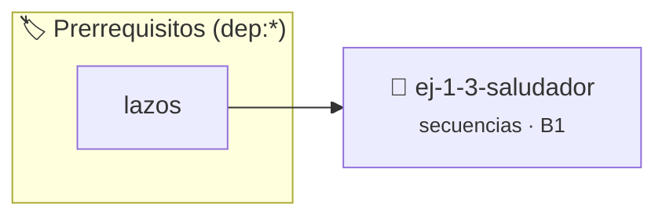

# Saludador
> **ID:** `ej-1-3-saludador` · **Unidad:** 1 (Fundamentos y Estructuras de Control)
 · **Tema:** `secuencias` / `saludador`
 · **Bloom:** B1 (Recordar) · **Dificultad:** Inicial
 · **Carga:** ~10 min · **Tipo:** Concepto
>
> **🏷️ Prerrequisitos temáticos (tags):** `dep:lazos`
>
> **Etiquetas conceptuales:** `saludador`, `basicos`, `secuencias`, `fundamentos`


::: {admonition} 📦 Paquete de Verificación Local (Ripley)
:class: tip

Para compilar, resolver y autoevaluar tu entrega con pruebas unitarias en tu máquina:

- [📥 **Descargar paquete `ej-1-3-saludador.ripkg`**](../../paquetes/ej-1-3-saludador.ripkg)

Ejecución con el asistente de cátedra:
```bash
ripley run ej-1-3-saludador.ripkg
```
:::


### 🗺️ Itinerario Pedagógico




## 📖 Consigna

### Ejercicio 1.3 - Saludador ⭐⭐☆☆☆


Este ejercicio amplía el "Hola, mundo!" para que el programa interactúe con el
usuario. Debe solicitarle su nombre y luego mostrar un saludo personalizado que
lo incluya. Sirve para practicar la lectura de datos desde la entrada estándar.

:::{hint} Lógica y Consideraciones
-   **Variables:** Se necesita una variable para almacenar el nombre del
-   **Entrada:** El programa debe primero mostrar un mensaje pidiendo al usuario
-   **Funciones de Lectura:** Se puede usar `scanf()` para leer la entrada, pero
-   **Salida:** Finalmente, el programa debe imprimir el saludo personalizado,

-   **[*plus ultra*]:** Validar que el nombre ingresado no sea una cadena vacía ni contenga solo espacios.
-   **[*plus ultra*]:** Personalizar el saludo según la hora del día ingresada por el usuario.

:::
<!-- {hint} Lógica y Consideraciones -->

:::{tip} Ayuda (pseudocódigo)
:class: dropdown
```{code-block} pseudocode
:linenos:

ALGORITMO saludador

VARIABLES:
    nombre (cadena)

INICIO
    ESCRIBIR "Por favor, ingresa tu nombre:"
    LEER nombre
    ESCRIBIR "Hola mundo, ", nombre, "!"
FIN

```
<!-- {code-block} pseudocode -->

:::
<!-- {tip} Ayuda (pseudocódigo) -->

---

## Rangos y Secuencias


## 📋 Prototipos y Cabecera (`ej-1-3-saludador.h`)

```{code-block} c
#ifndef EJERCICIO_EJ_1_3_SALUDADOR_H
#define EJERCICIO_EJ_1_3_SALUDADOR_H

#include <stddef.h>
#include <stdbool.h>
#include <stdint.h>

/* Procesa el flujo principal de Saludador */
int ejecutar_ej_1_3_saludador(int val);

#endif /* EJERCICIO_EJ_1_3_SALUDADOR_H */
```


## ⚙️ Especificación de Funciones

| Función | Retorno | Parámetros | Descripción |
| :--- | :--- | :--- | :--- |

| `ejecutar_ej_1_3_saludador` | `int` | `int val` | Procesa el flujo principal de Saludador |


## 💡 Pistas Progresivas

````{tab-set}

```{tab-item} Pista 1
**Variables:** Se necesita una variable para almacenar el nombre del
```

```{tab-item} Pista 2
**Entrada:** El programa debe primero mostrar un mensaje pidiendo al usuario
```

```{tab-item} Pista 3
**Funciones de Lectura:** Se puede usar `scanf()` para leer la entrada, pero
```

```{tab-item} Pista 4
**Salida:** Finalmente, el programa debe imprimir el saludo personalizado,
```

```{tab-item} Pista 5
[Plus Ultra] Validar que el nombre ingresado no sea una cadena vacía ni contenga solo espacios.
```

```{tab-item} Pista 6
[Plus Ultra] Personalizar el saludo según la hora del día ingresada por el usuario.
```

````


## 🧪 Casos de Prueba

| Prueba Unitaria | Función Objetivo | Verificación |
| :--- | :--- | :--- |

| **test_ejecutar_ej_1_3_saludador_positivo** | `ejecutar_ej_1_3_saludador` | `int res = ejecutar_ej_1_3_saludador(5); assert(res == 10 || res >= 0);` |

| **test_ejecutar_ej_1_3_saludador_cero** | `ejecutar_ej_1_3_saludador` | `int res = ejecutar_ej_1_3_saludador(0); assert(res == 0);` |


## ✓ Solución Modelo de Cátedra

```{dropdown} 🔍 Revelar solución canónica en C
:open: false

```{code-block} c
/*
 * Ejercicio: Saludador
 * Cátedra Programación I - UNRN
 */

#include <stdio.h>


int ejecutar_ej_1_3_saludador(int val)
{
    if (val <= 0) return 0;
    return val * 2;
}

int main(void)
{
    /* TODO: Implementación de Saludador */
    return 0;
}
```
```
