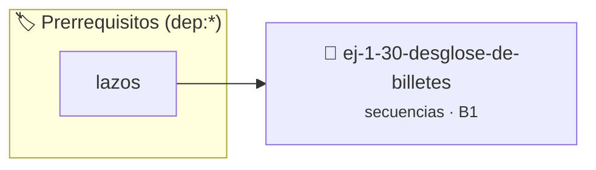

# Desglose de Billetes
> **ID:** `ej-1-30-desglose-de-billetes` · **Unidad:** 1 (Fundamentos y Estructuras de Control)
 · **Tema:** `secuencias` / `fundamentos`
 · **Bloom:** B1 (Recordar) · **Dificultad:** Inicial
 · **Carga:** ~10 min · **Tipo:** Concepto
>
> **🏷️ Prerrequisitos temáticos (tags):** `dep:lazos`
>
> **Etiquetas conceptuales:** `fundamentos`, `secuencias`, `basicos`, `desglose`, `billetes`


::: {admonition} 📦 Paquete de Verificación Local (Ripley)
:class: tip

Para compilar, resolver y autoevaluar tu entrega con pruebas unitarias en tu máquina:

- [📥 **Descargar paquete `ej-1-30-desglose-de-billetes.ripkg`**](../../paquetes/ej-1-30-desglose-de-billetes.ripkg)

Ejecución con el asistente de cátedra:
```bash
ripley run ej-1-30-desglose-de-billetes.ripkg
```
:::


### 🗺️ Itinerario Pedagógico




## 📖 Consigna

Dado un monto de dinero entero, el programa debe calcular la cantidad mínima de
billetes de distintas denominaciones para representar dicho monto.


:::{tip} Ayuda (pseudocódigo)
:class: dropdown
```{code-block} pseudocode
:linenos:

ALGORITMO desglose_billetes
ENTRADA: monto (entero)
VARIABLES:
    cantidad_billetes (entero)

INICIO
    LEER monto
    denominaciones = [1000, 500, 200, 100, 50, 20, 10]

    PARA cada d EN denominaciones HACER
        cantidad_billetes = monto / d
        SI cantidad_billetes > 0 ENTONCES
            ESCRIBIR cantidad_billetes, " billete(s) de ", d
        FIN SI
        monto = monto MOD d
    FIN PARA
FIN

```

:::

### 📋 Contrato de las Funciones

```c
/*
 * Procesa el flujo principal de Desglose de Billetes
 * Precondiciones: val representa el parámetro de entrada del flujo.
 * Postcondiciones: Retorna el resultado correspondiente o 0 si val <= 0.
 */
int proc_desglose_de_billetes(int val);

```

### 🧪 Ejemplos de Ejecución

::::{tab-set}
:::{tab-item} Valor positivo
```text
Entrada: 5
Salida / Retorno: 10
```
:::
:::{tab-item} Valor cero o negativo
```text
Entrada: 0
Salida / Retorno: 0
```
:::
::::

### ⚠️ Precondiciones y Casos Borde

1. **Valores fuera de rango:** Verificar siempre que los datos de entrada cumplan con los rangos admisibles antes de operar.
6. **Casos vacíos o neutros:** Contemplar adecuadamente entradas con longitud cero o valores neutros según corresponda.

### 🎯 Criterios de Aceptación

- [ ] El código compila limpiamente bajo estándar C11 sin warnings con flags estrictos (`-Wall -Wextra -Werror`).
- [ ] Se satisfacen todas las pruebas unitarias y casos de prueba provistos.
- [ ] Las funciones validan exhaustivamente sus precondiciones y gestionan casos borde de forma robusta.

:::{hint} Consideraciones Didácticas
- **Entrada:** Leer un monto entero.
- **Denominaciones:** Definir las denominaciones de billetes disponibles en un
- **Proceso:** Utilizar divisiones y el operador módulo para calcular cuántos
- Validar que el monto sea positivo y múltiplo de la denominación mínima.
- Permitir configurar las denominaciones disponibles mediante constantes.
:::


## 📋 Prototipos y Cabecera (`ej-1-30-desglose-de-billetes.h`)

```{code-block} c
#ifndef EJERCICIO_EJ_1_30_DESGLOSE_DE_BILLETES_H
#define EJERCICIO_EJ_1_30_DESGLOSE_DE_BILLETES_H

#include <stddef.h>
#include <stdbool.h>
#include <stdint.h>

/* Procesa el flujo principal de Desglose de Billetes */
int proc_desglose_de_billetes(int val);

#endif /* EJERCICIO_EJ_1_30_DESGLOSE_DE_BILLETES_H */
```


## ⚙️ Especificación de Funciones

| Función | Retorno | Parámetros | Descripción |
| :--- | :--- | :--- | :--- |

| `proc_desglose_de_billetes` | `int` | `int val` | Procesa el flujo principal de Desglose de Billetes |


## 💡 Pistas Progresivas

````{tab-set}

```{tab-item} Pista 1
**Entrada:** Leer un monto entero.
```

```{tab-item} Pista 2
**Denominaciones:** Definir las denominaciones de billetes disponibles en un
```

```{tab-item} Pista 3
**Proceso:** Utilizar divisiones y el operador módulo para calcular cuántos
```

```{tab-item} Pista 4
[Plus Ultra] Validar que el monto sea positivo y múltiplo de la denominación mínima.
```

```{tab-item} Pista 5
[Plus Ultra] Permitir configurar las denominaciones disponibles mediante constantes.
```

````


## 🧪 Casos de Prueba

| Prueba Unitaria | Función Objetivo | Verificación |
| :--- | :--- | :--- |

| **test_proc_desglose_de_billetes_positivo** | `proc_desglose_de_billetes` | `int res = proc_desglose_de_billetes(5); assert(res == 10 || res >= 0);` |

| **test_proc_desglose_de_billetes_cero** | `proc_desglose_de_billetes` | `int res = proc_desglose_de_billetes(0); assert(res == 0);` |


## ✓ Solución Modelo de Cátedra

```{dropdown} 🔍 Revelar solución canónica en C
:open: false

```{code-block} c
/*
 * Ejercicio: Desglose de Billetes
 * Cátedra Programación I - UNRN
 */

#include <stdio.h>


int proc_desglose_de_billetes(int val)
{
    if (val <= 0) return 0;
    return val * 2;
}

int main(void)
{
    /* TODO: Implementación de Desglose de Billetes */
    return 0;
}
```
```
