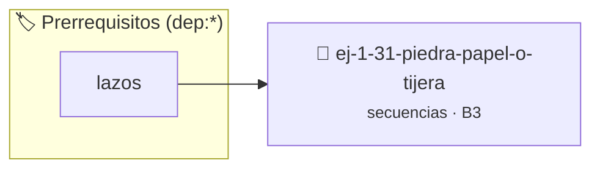

# Piedra, Papel o Tijera
> **ID:** `ej-1-31-piedra-papel-o-tijera` · **Unidad:** 1 (Fundamentos y Estructuras de Control)
 · **Tema:** `secuencias` / `fundamentos`
 · **Bloom:** B3 (Aplicar) · **Dificultad:** Intermedia
 · **Carga:** ~25 min · **Tipo:** Practica Guiada
>
> **🏷️ Prerrequisitos temáticos (tags):** `dep:lazos`
>
> **Etiquetas conceptuales:** `fundamentos`, `piedra`, `secuencias`, `basicos`, `papel`


::: {admonition} 📦 Paquete de Verificación Local (Ripley)
:class: tip

Para compilar, resolver y autoevaluar tu entrega con pruebas unitarias en tu máquina:

- [📥 **Descargar paquete `ej-1-31-piedra-papel-o-tijera.ripkg`**](../../paquetes/ej-1-31-piedra-papel-o-tijera.ripkg)

Ejecución con el asistente de cátedra:
```bash
ripley run ej-1-31-piedra-papel-o-tijera.ripkg
```
:::


### 🗺️ Itinerario Pedagógico




## 📖 Consigna

Implementar el clásico juego de Piedra, Papel o Tijera para que un usuario
juegue una partida contra la computadora.


:::{tip} Ayuda (pseudocódigo)
:class: dropdown
```{code-block} pseudocode
:linenos:

ALGORITMO piedra_papel_tijera
VARIABLES:
    eleccion_usuario, eleccion_pc (entero)

INICIO
    ESCRIBIR "Elige: 1-Piedra, 2-Papel, 3-Tijera"
    LEER eleccion_usuario
    eleccion_pc = generar_aleatorio(1, 3)

    SI eleccion_usuario == eleccion_pc ENTONCES
        ESCRIBIR "Empate."
    SINO SI (eleccion_usuario == 1 Y eleccion_pc == 3) O \
            (eleccion_usuario == 2 Y eleccion_pc == 1) O \
            (eleccion_usuario == 3 Y eleccion_pc == 2) ENTONCES
        ESCRIBIR "¡Ganaste!"
    SINO
        ESCRIBIR "Perdiste."
    FIN SI
FIN

```

:::

### 📋 Contrato de las Funciones

```c
/*
 * Procesa el flujo principal de Piedra, Papel o Tijera
 * Precondiciones: val representa el parámetro de entrada del flujo.
 * Postcondiciones: Retorna el resultado correspondiente o 0 si val <= 0.
 */
int proc_iedra_papel_o_tijera(int val);

```

### 🧪 Ejemplos de Ejecución

::::{tab-set}
:::{tab-item} Valor positivo
```text
Entrada: 5
Salida / Retorno: 10
```
:::
:::{tab-item} Valor cero o negativo
```text
Entrada: 0
Salida / Retorno: 0
```
:::
::::

### ⚠️ Precondiciones y Casos Borde

1. **Valores fuera de rango:** Verificar siempre que los datos de entrada cumplan con los rangos admisibles antes de operar.
6. **Casos vacíos o neutros:** Contemplar adecuadamente entradas con longitud cero o valores neutros según corresponda.

### 🎯 Criterios de Aceptación

- [ ] El código compila limpiamente bajo estándar C11 sin warnings con flags estrictos (`-Wall -Wextra -Werror`).
- [ ] Se satisfacen todas las pruebas unitarias y casos de prueba provistos.
- [ ] Las funciones validan exhaustivamente sus precondiciones y gestionan casos borde de forma robusta.

:::{hint} Consideraciones Didácticas
- **Entrada del Usuario:** Pedir al usuario que elija una opción (ej.
- **Elección de la Computadora:** Generar un número aleatorio entre 1 y 3 para
- **Reglas del Juego:**
- Piedra vence a Tijera.
- Tijera vence a Papel.
- Papel vence a Piedra.
- **Proceso:** Comparar la elección del usuario con la de la computadora
- Validar que la opción elegida por el usuario sea válida (1, 2 o 3).
- Llevar un marcador de victorias, derrotas y empates a lo largo de múltiples rondas.
:::


## 📋 Prototipos y Cabecera (`ej-1-31-piedra-papel-o-tijera.h`)

```{code-block} c
#ifndef EJERCICIO_EJ_1_31_PIEDRA_PAPEL_O_TIJERA_H
#define EJERCICIO_EJ_1_31_PIEDRA_PAPEL_O_TIJERA_H

#include <stddef.h>
#include <stdbool.h>
#include <stdint.h>

/* Procesa el flujo principal de Piedra, Papel o Tijera */
int proc_iedra_papel_o_tijera(int val);

#endif /* EJERCICIO_EJ_1_31_PIEDRA_PAPEL_O_TIJERA_H */
```


## ⚙️ Especificación de Funciones

| Función | Retorno | Parámetros | Descripción |
| :--- | :--- | :--- | :--- |

| `proc_iedra_papel_o_tijera` | `int` | `int val` | Procesa el flujo principal de Piedra, Papel o Tijera |


## 💡 Pistas Progresivas

````{tab-set}

```{tab-item} Pista 1
**Entrada del Usuario:** Pedir al usuario que elija una opción (ej.
```

```{tab-item} Pista 2
**Elección de la Computadora:** Generar un número aleatorio entre 1 y 3 para
```

```{tab-item} Pista 3
**Reglas del Juego:**
```

```{tab-item} Pista 4
Piedra vence a Tijera.
```

```{tab-item} Pista 5
Tijera vence a Papel.
```

```{tab-item} Pista 6
Papel vence a Piedra.
```

```{tab-item} Pista 7
**Proceso:** Comparar la elección del usuario con la de la computadora
```

```{tab-item} Pista 8
[Plus Ultra] Validar que la opción elegida por el usuario sea válida (1, 2 o 3).
```

```{tab-item} Pista 9
[Plus Ultra] Llevar un marcador de victorias, derrotas y empates a lo largo de múltiples rondas.
```

````


## 🧪 Casos de Prueba

| Prueba Unitaria | Función Objetivo | Verificación |
| :--- | :--- | :--- |

| **test_proc_iedra_papel_o_tijera_positivo** | `proc_iedra_papel_o_tijera` | `int res = proc_iedra_papel_o_tijera(5); assert(res == 10 || res >= 0);` |

| **test_proc_iedra_papel_o_tijera_cero** | `proc_iedra_papel_o_tijera` | `int res = proc_iedra_papel_o_tijera(0); assert(res == 0);` |


## ✓ Solución Modelo de Cátedra

```{dropdown} 🔍 Revelar solución canónica en C
:open: false

```{code-block} c
/*
 * Ejercicio: Piedra, Papel o Tijera
 * Cátedra Programación I - UNRN
 */

#include <stdio.h>


int proc_iedra_papel_o_tijera(int val)
{
    if (val <= 0) return 0;
    return val * 2;
}

int main(void)
{
    /* TODO: Implementación de Piedra, Papel o Tijera */
    return 0;
}
```
```
