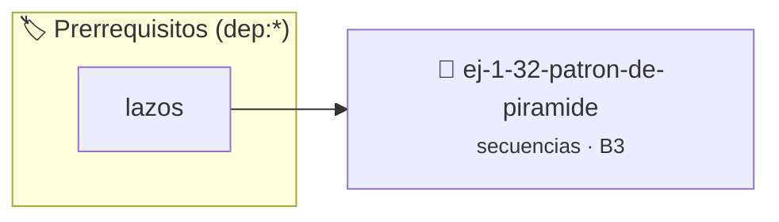

# Patrón de Pirámide
> **ID:** `ej-1-32-patron-de-piramide` · **Unidad:** 1 (Fundamentos y Estructuras de Control)
 · **Tema:** `secuencias` / `patron`
 · **Bloom:** B3 (Aplicar) · **Dificultad:** Intermedia
 · **Carga:** ~25 min · **Tipo:** Practica Guiada
>
> **🏷️ Prerrequisitos temáticos (tags):** `dep:lazos`
>
> **Etiquetas conceptuales:** `patron`, `fundamentos`, `piramide`, `secuencias`, `basicos`


::: {admonition} 📦 Paquete de Verificación Local (Ripley)
:class: tip

Para compilar, resolver y autoevaluar tu entrega con pruebas unitarias en tu máquina:

- [📥 **Descargar paquete `ej-1-32-patron-de-piramide.ripkg`**](../../paquetes/ej-1-32-patron-de-piramide.ripkg)

Ejecución con el asistente de cátedra:
```bash
ripley run ej-1-32-patron-de-piramide.ripkg
```
:::


### 🗺️ Itinerario Pedagógico




## 📖 Consigna

### Ejercicio 1.32 - Patrón de Pirámide ⭐⭐☆☆☆


Implementar un programa que pida un número `n` e imprima un triángulo de `n`
filas de altura, construido con asteriscos, centrado como una pirámide.

:::{hint} Lógica y Consideraciones
-   **Entrada:** Leer un entero `n` para la altura del triángulo.
-   **Proceso:** Se necesitan dos lazos aninados.
        -   El primer lazo interior imprime los espacios en blanco necesarios
        -   El segundo lazo interior imprime los asteriscos. En la fila `i`, se
-   **Salida:** Después de cada fila, imprimir un salto de línea.

-   **[*plus ultra*]:** Validar que la altura ingresada esté en un rango razonable (ej. entre 1 y 25).
-   **[*plus ultra*]:** Permitir al usuario elegir entre pirámide sólida o hueca.

:::
<!-- {hint} Lógica y Consideraciones -->

:::{tip} Ayuda (pseudocódigo)
:class: dropdown
```{code-block} pseudocode
:linenos:

ALGORITMO piramide_asteriscos
ENTRADA: n (entero)

INICIO
    PARA fila DESDE 1 HASTA n HACER
        // Imprimir espacios
        PARA espacio DESDE 1 HASTA n - fila HACER
            ESCRIBIR " " SIN SALTO DE LÍNEA
        FIN PARA

        // Imprimir asteriscos
        PARA asterisco DESDE 1 HASTA 2 * fila - 1 HACER
            ESCRIBIR "*" SIN SALTO DE LÍNEA
        FIN PARA

        ESCRIBIR SALTO DE LÍNEA
    FIN PARA
FIN

```
<!-- {code-block} pseudocode -->

:::
<!-- {tip} Ayuda (pseudocódigo) -->


## 📋 Prototipos y Cabecera (`ej-1-32-patron-de-piramide.h`)

```{code-block} c
#ifndef EJERCICIO_EJ_1_32_PATRON_DE_PIRAMIDE_H
#define EJERCICIO_EJ_1_32_PATRON_DE_PIRAMIDE_H

#include <stddef.h>
#include <stdbool.h>
#include <stdint.h>

/* Procesa el flujo principal de Patrón de Pirámide */
int proc_2_patron_de_piramide(int val);

#endif /* EJERCICIO_EJ_1_32_PATRON_DE_PIRAMIDE_H */
```


## ⚙️ Especificación de Funciones

| Función | Retorno | Parámetros | Descripción |
| :--- | :--- | :--- | :--- |

| `proc_2_patron_de_piramide` | `int` | `int val` | Procesa el flujo principal de Patrón de Pirámide |


## 💡 Pistas Progresivas

````{tab-set}

```{tab-item} Pista 1
**Entrada:** Leer un entero `n` para la altura del triángulo.
```

```{tab-item} Pista 2
**Proceso:** Se necesitan dos lazos aninados.
```

```{tab-item} Pista 3
El primer lazo interior imprime los espacios en blanco necesarios
```

```{tab-item} Pista 4
El segundo lazo interior imprime los asteriscos. En la fila `i`, se
```

```{tab-item} Pista 5
**Salida:** Después de cada fila, imprimir un salto de línea.
```

```{tab-item} Pista 6
[Plus Ultra] Validar que la altura ingresada esté en un rango razonable (ej. entre 1 y 25).
```

```{tab-item} Pista 7
[Plus Ultra] Permitir al usuario elegir entre pirámide sólida o hueca.
```

````


## 🧪 Casos de Prueba

| Prueba Unitaria | Función Objetivo | Verificación |
| :--- | :--- | :--- |

| **test_proc_2_patron_de_piramide_positivo** | `proc_2_patron_de_piramide` | `int res = proc_2_patron_de_piramide(5); assert(res == 10 || res >= 0);` |

| **test_proc_2_patron_de_piramide_cero** | `proc_2_patron_de_piramide` | `int res = proc_2_patron_de_piramide(0); assert(res == 0);` |


## ✓ Solución Modelo de Cátedra

```{dropdown} 🔍 Revelar solución canónica en C
:open: false

```{code-block} c
/*
 * Ejercicio: Patrón de Pirámide
 * Cátedra Programación I - UNRN
 */

#include <stdio.h>


int proc_2_patron_de_piramide(int val)
{
    if (val <= 0) return 0;
    return val * 2;
}

int main(void)
{
    /* TODO: Implementación de Patrón de Pirámide */
    return 0;
}
```
```
