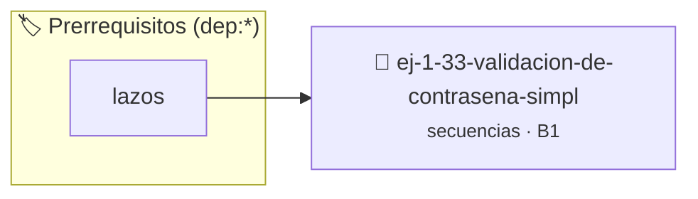

# Validación de Contraseña Simple
> **ID:** `ej-1-33-validacion-de-contrasena-simpl`
 · **Tema:** `secuencias`
 · **Bloom:** B1 (Recordar)
 · **Carga:** ~10 min
>
> **🏷️ Prerrequisitos temáticos (tags):** `dep:lazos`
>
> **Etiquetas conceptuales:** `fundamentos`, `contrasena`, `secuencias`, `validacion`, `basicos`


::: {admonition} 📦 Paquete de Verificación Local (Ripley)
:class: tip

Para compilar, resolver y autoevaluar tu entrega con pruebas unitarias en tu máquina:

- [📥 **Descargar paquete `ej-1-33-validacion-de-contrasena-simpl.ripkg`**](../../paquetes/ej-1-33-validacion-de-contrasena-simpl.ripkg)

Ejecución con el asistente de cátedra:
```bash
ripley run ej-1-33-validacion-de-contrasena-simpl.ripkg
```
:::


### 🗺️ Itinerario Pedagógico




## 📖 Consigna

### Ejercicio 1.33 - Validación de Contraseña Simple ⭐☆☆☆☆


Crear un programa que solicite una contraseña al usuario y no le permita
continuar hasta que ingrese la contraseña correcta. Este ejercicio practica el
uso de lazos `do-while` y la comparación de cadenas.

:::{hint} Lógica y Consideraciones
-   **Contraseña Secreta:** Definir una contraseña correcta como una cadena
-   **Entrada:** Dentro de un lazo, solicitar al usuario que ingrese la
-   **Proceso:** Usar un lazo `do-while` es ideal aquí, ya que la solicitud debe
-   **Comparación de Cadenas:** En C, las cadenas no se pueden comparar con

-   **[*plus ultra*]:** Limitar la cantidad de intentos fallidos antes de bloquear temporalmente el acceso.
-   **[*plus ultra*]:** Ocultar los caracteres ingresados si la terminal lo permite.

:::
<!-- {hint} Lógica y Consideraciones -->

:::{tip} Ayuda (pseudocódigo)
:class: dropdown
```{code-block} pseudocode
:linenos:

ALGORITMO validar_contrasena
CONSTANTES:
    CLAVE_SECRETA = "password123"
VARIABLES:
    intento (cadena)

INICIO
    HACER
        ESCRIBIR "Ingrese la contraseña:"
        LEER intento
    MIENTRAS intento != CLAVE_SECRETA

    ESCRIBIR "Acceso concedido."
FIN

```
<!-- {code-block} pseudocode -->

:::
<!-- {tip} Ayuda (pseudocódigo) -->


## 📋 Prototipos y Cabecera (`ej-1-33-validacion-de-contrasena-simpl.h`)

```{code-block} c
#ifndef EJERCICIO_EJ_1_33_VALIDACION_DE_CONTRASENA_SIMPL_H
#define EJERCICIO_EJ_1_33_VALIDACION_DE_CONTRASENA_SIMPL_H

#include <stddef.h>
#include <stdbool.h>
#include <stdint.h>

/* Procesa el flujo principal de Validación de Contraseña Simple */
int proc__de_contrasena_simpl(int val);

#endif /* EJERCICIO_EJ_1_33_VALIDACION_DE_CONTRASENA_SIMPL_H */
```


## ⚙️ Especificación de Funciones

| Función | Retorno | Parámetros | Descripción |
| :--- | :--- | :--- | :--- |

| `proc__de_contrasena_simpl` | `int` | `int val` | Procesa el flujo principal de Validación de Contraseña Simple |


## 💡 Pistas Progresivas

````{tab-set}

```{tab-item} Pista 1
**Contraseña Secreta:** Definir una contraseña correcta como una cadena
```

```{tab-item} Pista 2
**Entrada:** Dentro de un lazo, solicitar al usuario que ingrese la
```

```{tab-item} Pista 3
**Proceso:** Usar un lazo `do-while` es ideal aquí, ya que la solicitud debe
```

```{tab-item} Pista 4
**Comparación de Cadenas:** En C, las cadenas no se pueden comparar con
```

```{tab-item} Pista 5
[Plus Ultra] Limitar la cantidad de intentos fallidos antes de bloquear temporalmente el acceso.
```

```{tab-item} Pista 6
[Plus Ultra] Ocultar los caracteres ingresados si la terminal lo permite.
```

````


## 🧪 Casos de Prueba

| Prueba Unitaria | Función Objetivo | Verificación |
| :--- | :--- | :--- |

| **test_proc__de_contrasena_simpl_positivo** | `proc__de_contrasena_simpl` | `int res = proc__de_contrasena_simpl(5); assert(res == 10 || res >= 0);` |

| **test_proc__de_contrasena_simpl_cero** | `proc__de_contrasena_simpl` | `int res = proc__de_contrasena_simpl(0); assert(res == 0);` |


## ✓ Solución Modelo de Cátedra

```{dropdown} 🔍 Revelar solución canónica en C
:open: false

```{code-block} c
/*
 * Ejercicio: Validación de Contraseña Simple
 * Cátedra Programación I - UNRN
 */

#include <stdio.h>


int proc__de_contrasena_simpl(int val)
{
    if (val <= 0) return 0;
    return val * 2;
}

int main(void)
{
    /* TODO: Implementación de Validación de Contraseña Simple */
    return 0;
}
```
```
