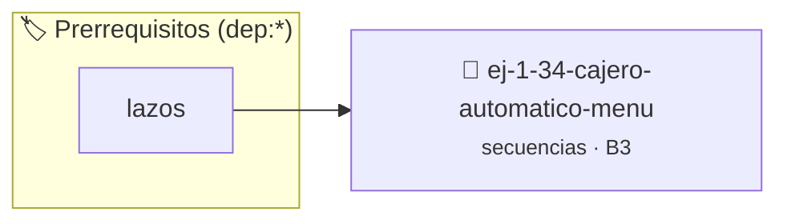

# Cajero Automático (Menú)
> **ID:** `ej-1-34-cajero-automatico-menu` · **Unidad:** 1 (Fundamentos y Estructuras de Control)
 · **Tema:** `secuencias` / `fundamentos`
 · **Bloom:** B3 (Aplicar) · **Dificultad:** Intermedia
 · **Carga:** ~25 min · **Tipo:** Practica Guiada
>
> **🏷️ Prerrequisitos temáticos (tags):** `dep:lazos`
>
> **Etiquetas conceptuales:** `fundamentos`, `secuencias`, `automatico`, `basicos`, `menu`


::: {admonition} 📦 Paquete de Verificación Local (Ripley)
:class: tip

Para compilar, resolver y autoevaluar tu entrega con pruebas unitarias en tu máquina:

- [📥 **Descargar paquete `ej-1-34-cajero-automatico-menu.ripkg`**](../../paquetes/ej-1-34-cajero-automatico-menu.ripkg)

Ejecución con el asistente de cátedra:
```bash
ripley run ej-1-34-cajero-automatico-menu.ripkg
```
:::


### 🗺️ Itinerario Pedagógico




## 📖 Consigna

Simular la interfaz de un menú de cajero automático. El programa debe mostrar
una lista de opciones y ejecutar una acción simple según la elección del
usuario, repitiendo el proceso hasta que el usuario decida salir.


:::{tip} Ayuda (pseudocódigo)
:class: dropdown
```{code-block} pseudocode
:linenos:

ALGORITMO cajero_automatico
VARIABLES:
    saldo (real)
    opcion, monto (entero)

INICIO
    saldo = 1000.0
    HACER
        ESCRIBIR "1. Consultar Saldo"
        ESCRIBIR "2. Depositar"
        ESCRIBIR "3. Retirar"
        ESCRIBIR "4. Salir"
        LEER opcion

        SEGUN opcion HACER
            CASO 1: ESCRIBIR "Su saldo es: ", saldo
            CASO 2: 
                ESCRIBIR "Ingrese monto a depositar:"
                LEER monto
                saldo = saldo + monto
            CASO 3:
                ESCRIBIR "Ingrese monto a retirar:"
                LEER monto
                SI monto <= saldo ENTONCES
                    saldo = saldo - monto
                SINO
                    ESCRIBIR "Saldo insuficiente."
                FIN SI
        FIN SEGUN
    MIENTRAS opcion != 4
FIN

```

:::

### 📋 Contrato de las Funciones

```c
/*
 * Procesa el flujo principal de Cajero Automático (Menú)
 * Precondiciones: val representa el parámetro de entrada del flujo.
 * Postcondiciones: Retorna el resultado correspondiente o 0 si val <= 0.
 */
int proc_jero_automatico_menu(int val);

```

### 🧪 Ejemplos de Ejecución

::::{tab-set}
:::{tab-item} Valor positivo
```text
Entrada: 5
Salida / Retorno: 10
```
:::
:::{tab-item} Valor cero o negativo
```text
Entrada: 0
Salida / Retorno: 0
```
:::
::::

### ⚠️ Precondiciones y Casos Borde

1. **Valores fuera de rango:** Verificar siempre que los datos de entrada cumplan con los rangos admisibles antes de operar.
6. **Casos vacíos o neutros:** Contemplar adecuadamente entradas con longitud cero o valores neutros según corresponda.

### 🎯 Criterios de Aceptación

- [ ] El código compila limpiamente bajo estándar C11 sin warnings con flags estrictos (`-Wall -Wextra -Werror`).
- [ ] Se satisfacen todas las pruebas unitarias y casos de prueba provistos.
- [ ] Las funciones validan exhaustivamente sus precondiciones y gestionan casos borde de forma robusta.

:::{hint} Consideraciones Didácticas
- **Estado:** Mantener una variable para el saldo de la cuenta.
- **Proceso:** Usar un lazo `do-while` que se ejecute mientras la opción
- **Menú:** Dentro del lazo, imprimir las opciones (1. Consultar, 2.
- **Entrada:** Leer la opción del usuario.
- **Selección:** Usar una estructura `switch` para manejar las diferentes
- Mantener el saldo actualizado entre operaciones y validar que no se extraiga más dinero del disponible.
- Implementar la opción de consultar los últimos movimientos o transferencias.
:::


## 📋 Prototipos y Cabecera (`ej-1-34-cajero-automatico-menu.h`)

```{code-block} c
#ifndef EJERCICIO_EJ_1_34_CAJERO_AUTOMATICO_MENU_H
#define EJERCICIO_EJ_1_34_CAJERO_AUTOMATICO_MENU_H

#include <stddef.h>
#include <stdbool.h>
#include <stdint.h>

/* Procesa el flujo principal de Cajero Automático (Menú) */
int proc_jero_automatico_menu(int val);

#endif /* EJERCICIO_EJ_1_34_CAJERO_AUTOMATICO_MENU_H */
```


## ⚙️ Especificación de Funciones

| Función | Retorno | Parámetros | Descripción |
| :--- | :--- | :--- | :--- |

| `proc_jero_automatico_menu` | `int` | `int val` | Procesa el flujo principal de Cajero Automático (Menú) |


## 💡 Pistas Progresivas

````{tab-set}

```{tab-item} Pista 1
**Estado:** Mantener una variable para el saldo de la cuenta.
```

```{tab-item} Pista 2
**Proceso:** Usar un lazo `do-while` que se ejecute mientras la opción
```

```{tab-item} Pista 3
**Menú:** Dentro del lazo, imprimir las opciones (1. Consultar, 2.
```

```{tab-item} Pista 4
**Entrada:** Leer la opción del usuario.
```

```{tab-item} Pista 5
**Selección:** Usar una estructura `switch` para manejar las diferentes
```

```{tab-item} Pista 6
[Plus Ultra] Mantener el saldo actualizado entre operaciones y validar que no se extraiga más dinero del disponible.
```

```{tab-item} Pista 7
[Plus Ultra] Implementar la opción de consultar los últimos movimientos o transferencias.
```

````


## 🧪 Casos de Prueba

| Prueba Unitaria | Función Objetivo | Verificación |
| :--- | :--- | :--- |

| **test_proc_jero_automatico_menu_positivo** | `proc_jero_automatico_menu` | `int res = proc_jero_automatico_menu(5); assert(res == 10 || res >= 0);` |

| **test_proc_jero_automatico_menu_cero** | `proc_jero_automatico_menu` | `int res = proc_jero_automatico_menu(0); assert(res == 0);` |


## ✓ Solución Modelo de Cátedra

```{dropdown} 🔍 Revelar solución canónica en C
:open: false

```{code-block} c
/*
 * Ejercicio: Cajero Automático (Menú)
 * Cátedra Programación I - UNRN
 */

#include <stdio.h>


int proc_jero_automatico_menu(int val)
{
    if (val <= 0) return 0;
    return val * 2;
}

int main(void)
{
    /* TODO: Implementación de Cajero Automático (Menú) */
    return 0;
}
```
```
