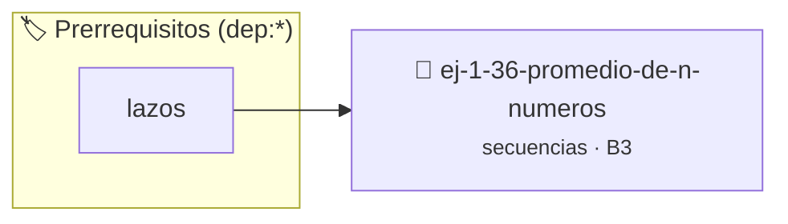

# Promedio de N Números
> **ID:** `ej-1-36-promedio-de-n-numeros`
 · **Tema:** `secuencias`
 · **Bloom:** B3 (Aplicar)
 · **Carga:** ~25 min
>
> **🏷️ Prerrequisitos temáticos (tags):** `dep:lazos`
>
> **Etiquetas conceptuales:** `fundamentos`, `secuencias`, `basicos`, `promedio`, `numeros`


::: {admonition} 📦 Paquete de Verificación Local (Ripley)
:class: tip

Para compilar, resolver y autoevaluar tu entrega con pruebas unitarias en tu máquina:

- [📥 **Descargar paquete `ej-1-36-promedio-de-n-numeros.ripkg`**](../../paquetes/ej-1-36-promedio-de-n-numeros.ripkg)

Ejecución con el asistente de cátedra:
```bash
ripley run ej-1-36-promedio-de-n-numeros.ripkg
```
:::


### 🗺️ Itinerario Pedagógico




## 📖 Consigna

### Ejercicio 1.36 - Promedio de N Números ⭐⭐☆☆☆

**Tema:** secuencias · **Nivel:** aplicar · **Duración estimada:** 25 minutos

#### Consigna

Escribí un programa en C que calcule el **promedio aritmético** de una secuencia de
$N$ números reales ingresados por teclado. Para eso, el programa debe:

1.  Preguntar al usuario cuántos números va a ingresar (cantidad $N$ de la secuencia).
2.  Leer los $N$ números **uno por uno**, recorriendo la secuencia con un ciclo contado.
3.  Acumular la suma de todos los valores leídos.
4.  Calcular y mostrar el promedio:

$$
\bar{x} = \frac{x_1 + x_2 + \cdots + x_N}{N}
$$

> **Nota:** el programa debe ser *flexible*: la longitud de la secuencia no se conoce
> de antemano; la define el usuario en tiempo de ejecución al ingresar $N$.

#### Contrato del programa

| Etapa       | Descripción                                                                                      |
| ----------- | ------------------------------------------------------------------------------------------------ |
| **Entrada** | Un entero $N$ (cantidad de datos) y luego $N$ números reales, uno por vez, en orden de ingreso.  |
| **Proceso** | Recorrido exacto de $N$ iteraciones con un acumulador de suma inicializado en `0`.               |
| **Salida**  | El promedio aritmético con dos decimales, o un mensaje de error si $N \le 0$.                    |

#### Precondiciones y casos borde

-   **Secuencia vacía ($N = 0$):** el promedio **no está definido**. No debes dividir:
    mostrá un mensaje de error claro y terminá sin calcular nada (evitás la división por cero).
-   **Cantidad negativa ($N < 0$):** una cantidad de datos nunca puede ser negativa;
    se trata igual que el caso anterior.
-   **Secuencia unitaria ($N = 1$):** el promedio es igual al único número ingresado.
    Es el recorrido mínimo del ciclo: usalo para verificar tu implementación.
-   **Números negativos o decimales:** la secuencia puede contener valores negativos y/o
    con parte fraccionaria, y el promedio puede resultar negativo o no entero.
    Usá variables `double` para no perder precisión.
-   **Validez del formato:** podés asumir que cada número se ingresa bien formado
    (no se pide validar el formato de cada lectura).

#### Ejemplos de ejecución

**Ejemplo 1 — Secuencia típica:**

```text
¿Cuántos números vas a ingresar? 3
Número 1: 4
Número 2: 8
Número 3: 6
El promedio es: 6.00
```

**Ejemplo 2 — Secuencia con negativos y decimales:**

```text
¿Cuántos números vas a ingresar? 4
Número 1: 10.5
Número 2: 20
Número 3: -5
Número 4: 4.5
El promedio es: 7.50
```

**Ejemplo 3 — Cantidad inválida:**

```text
¿Cuántos números vas a ingresar? 0
Error: la cantidad de números debe ser mayor a cero.
```

#### Criterios de aceptación

-   [ ] El programa lee primero $N$ y luego recorre la secuencia con un **ciclo contado**
        (`for`) de exactamente $N$ iteraciones.
-   [ ] La suma se acumula en una variable `double` inicializada en `0` **antes** del ciclo.
-   [ ] El promedio se calcula **después** del recorrido, dividiendo la suma por $N$.
-   [ ] Si $N \le 0$, no se realiza ninguna división y se muestra un mensaje de error.
-   [ ] La salida coincide con el formato de los ejemplos (dos decimales).

#### Requerimiento de implementación

El flujo principal del programa debe resolverse dentro de la siguiente función,
ya declarada en el encabezado del ejercicio:

```c
/*
 * Procesa el flujo principal del promedio de N números.
 *
 * Pre:  `val` recibe la cantidad N de datos a promediar.
 * Post: si `val > 0`, lee la secuencia de `val` números, calcula el promedio,
 *       lo muestra por pantalla y devuelve un valor >= 0.
 *       Si `val <= 0`, no realiza ninguna división y devuelve 0.
 */
int proc_romedio_de_n_numeros(int val);
```

:::{hint} Lógica y Consideraciones
-   **Entrada inicial:** leer la cantidad de números a promediar ($N$).
-   **Variables:** necesitás un `acumulador` para la suma (inicializado en `0`) y el índice del ciclo como contador.
-   **Proceso:** recorré la secuencia con un ciclo contado de $N$ iteraciones; en cada vuelta leé un número y sumalo al acumulador.
-   **Salida:** al terminar el recorrido, calculá `suma / N` y mostrá el resultado con dos decimales.
-   **Caso borde:** si $N \le 0$, no dividas: mostrá un mensaje de error.

-   **[*plus ultra*]:** validar que la cantidad $N$ de datos sea mayor a cero, volviendo a preguntar hasta obtener un valor válido, para evitar la división por cero.
-   **[*plus ultra*]:** calcular, en el mismo recorrido, el valor máximo y el mínimo del conjunto.

:::
<!-- {hint} Lógica y Consideraciones -->

:::{tip} Ayuda (pseudocódigo)
:class: dropdown
```{code-block} pseudocode
:linenos:

ALGORITMO promedio_n_numeros
VARIABLES:
    cantidad, i (enteros)
    numero, suma, promedio (reales)

INICIO
    ESCRIBIR "¿Cuántos números vas a ingresar?"
    LEER cantidad

    SI cantidad <= 0 ENTONCES
        ESCRIBIR "Error: la cantidad debe ser mayor a cero."
    SINO
        suma = 0
        PARA i DESDE 1 HASTA cantidad HACER
            ESCRIBIR "Número ", i, ":"
            LEER numero
            suma = suma + numero
        FIN PARA
        promedio = suma / cantidad
        ESCRIBIR "El promedio es: ", promedio
    FIN SI
FIN

```
<!-- {code-block} pseudocode -->

:::
<!-- {tip} Ayuda (pseudocódigo) -->


## 📋 Prototipos y Cabecera (`ej-1-36-promedio-de-n-numeros.h`)

```{code-block} c
#ifndef EJERCICIO_EJ_1_36_PROMEDIO_DE_N_NUMEROS_H
#define EJERCICIO_EJ_1_36_PROMEDIO_DE_N_NUMEROS_H

#include <stddef.h>
#include <stdbool.h>
#include <stdint.h>

/* Procesa el flujo principal de Promedio de N Números */
int proc_romedio_de_n_numeros(int val);

#endif /* EJERCICIO_EJ_1_36_PROMEDIO_DE_N_NUMEROS_H */
```


## ⚙️ Especificación de Funciones

| Función | Retorno | Parámetros | Descripción |
| :--- | :--- | :--- | :--- |

| `proc_romedio_de_n_numeros` | `int` | `int val` | Procesa el flujo principal de Promedio de N Números |


## 💡 Pistas Progresivas

````{tab-set}

```{tab-item} Pista 1
**Entrada Inicial:** Leer la cantidad de números a promediar ($N$).
```

```{tab-item} Pista 2
**Variables:** Se necesita un `acumulador` para la suma y un contador.
```

```{tab-item} Pista 3
**Proceso:**
```

```{tab-item} Pista 4
**Salida:** Mostrar el promedio calculado.
```

```{tab-item} Pista 5
[Plus Ultra] Validar que la cantidad N de datos sea mayor a cero para evitar división por cero.
```

```{tab-item} Pista 6
[Plus Ultra] Calcular en el mismo recorrido el valor máximo y mínimo del conjunto.
```

````


## 🧪 Casos de Prueba

| Prueba Unitaria | Función Objetivo | Verificación |
| :--- | :--- | :--- |

| **test_proc_romedio_de_n_numeros_positivo** | `proc_romedio_de_n_numeros` | `int res = proc_romedio_de_n_numeros(5); assert(res == 10 || res >= 0);` |

| **test_proc_romedio_de_n_numeros_cero** | `proc_romedio_de_n_numeros` | `int res = proc_romedio_de_n_numeros(0); assert(res == 0);` |


## ✓ Solución Modelo de Cátedra

```{dropdown} 🔍 Revelar solución canónica en C
:open: false

```{code-block} c
/*
 * Ejercicio: Promedio de N Números
 * Cátedra Programación I - UNRN
 */

#include <stdio.h>


int proc_romedio_de_n_numeros(int val)
{
    if (val <= 0) return 0;
    return val * 2;
}

int main(void)
{
    /* TODO: Implementación de Promedio de N Números */
    return 0;
}
```
```
