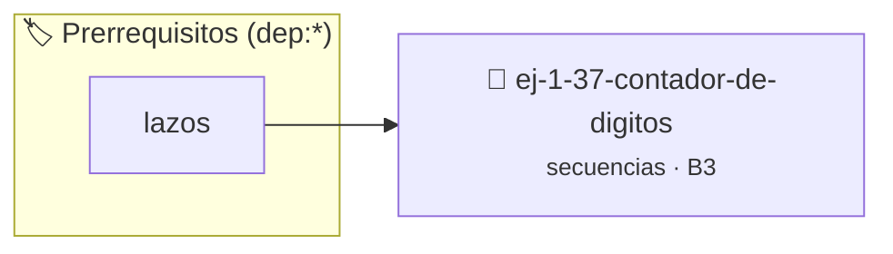

# Contador de Dígitos
> **ID:** `ej-1-37-contador-de-digitos` · **Unidad:** 1 (Fundamentos y Estructuras de Control)
 · **Tema:** `secuencias` / `fundamentos`
 · **Bloom:** B3 (Aplicar) · **Dificultad:** Intermedia
 · **Carga:** ~25 min · **Tipo:** Practica Guiada
>
> **🏷️ Prerrequisitos temáticos (tags):** `dep:lazos`
>
> **Etiquetas conceptuales:** `fundamentos`, `secuencias`, `digitos`, `basicos`, `contador`


::: {admonition} 📦 Paquete de Verificación Local (Ripley)
:class: tip

Para compilar, resolver y autoevaluar tu entrega con pruebas unitarias en tu máquina:

- [📥 **Descargar paquete `ej-1-37-contador-de-digitos.ripkg`**](../../paquetes/ej-1-37-contador-de-digitos.ripkg)

Ejecución con el asistente de cátedra:
```bash
ripley run ej-1-37-contador-de-digitos.ripkg
```
:::


### 🗺️ Itinerario Pedagógico




## 📖 Consigna

Crear una función que reciba un número entero y devuelva la cantidad de dígitos
que lo componen.


:::{tip} Ayuda (pseudocódigo)
:class: dropdown
```{code-block} pseudocode
:linenos:

ALGORITMO contar_digitos
ENTRADA: numero (entero)
VARIABLES:
    contador (entero)

INICIO
    SI numero == 0 ENTONCES
        RETORNAR 1
    FIN SI

    contador = 0
    // Manejar números negativos
    numero_abs = VALOR_ABSOLUTO(numero)

    MIENTRAS numero_abs > 0 HACER
        numero_abs = numero_abs / 10
        contador = contador + 1
    FIN MIENTRAS

    RETORNAR contador
FIN

```

:::

### 📋 Contrato de las Funciones

```c
/*
 * Procesa el flujo principal de Contador de Dígitos
 * Precondiciones: val representa el parámetro de entrada del flujo.
 * Postcondiciones: Retorna el resultado correspondiente o 0 si val <= 0.
 */
int proc__contador_de_digitos(int val);

```

### 🧪 Ejemplos de Ejecución

::::{tab-set}
:::{tab-item} Valor positivo
```text
Entrada: 5
Salida / Retorno: 10
```
:::
:::{tab-item} Valor cero o negativo
```text
Entrada: 0
Salida / Retorno: 0
```
:::
::::

### ⚠️ Precondiciones y Casos Borde

1. **Valores fuera de rango:** Verificar siempre que los datos de entrada cumplan con los rangos admisibles antes de operar.
6. **Casos vacíos o neutros:** Contemplar adecuadamente entradas con longitud cero o valores neutros según corresponda.

### 🎯 Criterios de Aceptación

- [ ] El código compila limpiamente bajo estándar C11 sin warnings con flags estrictos (`-Wall -Wextra -Werror`).
- [ ] Se satisfacen todas las pruebas unitarias y casos de prueba provistos.
- [ ] Las funciones validan exhaustivamente sus precondiciones y gestionan casos borde de forma robusta.

:::{hint} Consideraciones Didácticas
- **Entrada:** Un número entero.
- **Proceso:** La forma más simple es usar la división entera por 10
- **Caso Especial:** Si el número de entrada es 0, tiene 1 dígito. El lazo
- Manejar correctamente números negativos y el caso especial del número 0.
- Modularizar el conteo en una función recursiva o iterativa pura.
:::


## 📋 Prototipos y Cabecera (`ej-1-37-contador-de-digitos.h`)

```{code-block} c
#ifndef EJERCICIO_EJ_1_37_CONTADOR_DE_DIGITOS_H
#define EJERCICIO_EJ_1_37_CONTADOR_DE_DIGITOS_H

#include <stddef.h>
#include <stdbool.h>
#include <stdint.h>

/* Procesa el flujo principal de Contador de Dígitos */
int proc__contador_de_digitos(int val);

#endif /* EJERCICIO_EJ_1_37_CONTADOR_DE_DIGITOS_H */
```


## ⚙️ Especificación de Funciones

| Función | Retorno | Parámetros | Descripción |
| :--- | :--- | :--- | :--- |

| `proc__contador_de_digitos` | `int` | `int val` | Procesa el flujo principal de Contador de Dígitos |


## 💡 Pistas Progresivas

````{tab-set}

```{tab-item} Pista 1
**Entrada:** Un número entero.
```

```{tab-item} Pista 2
**Proceso:** La forma más simple es usar la división entera por 10
```

```{tab-item} Pista 3
**Caso Especial:** Si el número de entrada es 0, tiene 1 dígito. El lazo
```

```{tab-item} Pista 4
[Plus Ultra] Manejar correctamente números negativos y el caso especial del número 0.
```

```{tab-item} Pista 5
[Plus Ultra] Modularizar el conteo en una función recursiva o iterativa pura.
```

````


## 🧪 Casos de Prueba

| Prueba Unitaria | Función Objetivo | Verificación |
| :--- | :--- | :--- |

| **test_proc__contador_de_digitos_positivo** | `proc__contador_de_digitos` | `int res = proc__contador_de_digitos(5); assert(res == 10 || res >= 0);` |

| **test_proc__contador_de_digitos_cero** | `proc__contador_de_digitos` | `int res = proc__contador_de_digitos(0); assert(res == 0);` |


## ✓ Solución Modelo de Cátedra

```{dropdown} 🔍 Revelar solución canónica en C
:open: false

```{code-block} c
/*
 * Ejercicio: Contador de Dígitos
 * Cátedra Programación I - UNRN
 */

#include <stdio.h>


int proc__contador_de_digitos(int val)
{
    if (val <= 0) return 0;
    return val * 2;
}

int main(void)
{
    /* TODO: Implementación de Contador de Dígitos */
    return 0;
}
```
```
