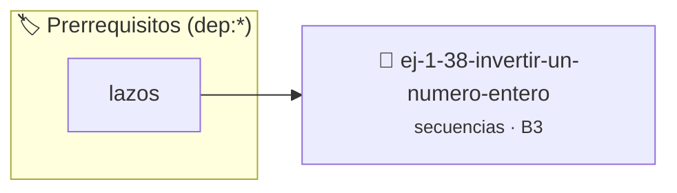

# Invertir un Número Entero
> **ID:** `ej-1-38-invertir-un-numero-entero`
 · **Tema:** `secuencias`
 · **Bloom:** B3 (Aplicar)
 · **Carga:** ~25 min
>
> **🏷️ Prerrequisitos temáticos (tags):** `dep:lazos`
>
> **Etiquetas conceptuales:** `invertir`, `fundamentos`, `secuencias`, `numero`, `basicos`


::: {admonition} 📦 Paquete de Verificación Local (Ripley)
:class: tip

Para compilar, resolver y autoevaluar tu entrega con pruebas unitarias en tu máquina:

- [📥 **Descargar paquete `ej-1-38-invertir-un-numero-entero.ripkg`**](../../paquetes/ej-1-38-invertir-un-numero-entero.ripkg)

Ejecución con el asistente de cátedra:
```bash
ripley run ej-1-38-invertir-un-numero-entero.ripkg
```
:::


### 🗺️ Itinerario Pedagógico




## 📖 Consigna

### Ejercicio 1.38 - Invertir un Número Entero ⭐⭐☆☆☆


Implementar una función que tome un número entero y devuelva otro número con los
dígitos en orden inverso.

:::{hint} Lógica y Consideraciones
-   **Entrada:** Un número entero.
-   **Proceso:** Se puede construir el número invertido dígito por dígito.
-   **Salida:** Devolver el número `invertido`.

-   **[*plus ultra*]:** Manejar correctamente números que terminan en cero y valores negativos.
-   **[*plus ultra*]:** Detectar si el número original es capicúa (palíndromo numérico).

:::
<!-- {hint} Lógica y Consideraciones -->

:::{tip} Ayuda (pseudocódigo)
:class: dropdown
```{code-block} pseudocode
:linenos:

ALGORITMO invertir_numero
ENTRADA: numero (entero)
VARIABLES:
    invertido, digito (enteros)

INICIO
    invertido = 0
    MIENTRAS numero != 0 HACER
        digito = numero MOD 10
        invertido = (invertido * 10) + digito
        numero = numero / 10
    FIN MIENTRAS
    RETORNAR invertido
FIN

```
<!-- {code-block} pseudocode -->

:::
<!-- {tip} Ayuda (pseudocódigo) -->


## 📋 Prototipos y Cabecera (`ej-1-38-invertir-un-numero-entero.h`)

```{code-block} c
#ifndef EJERCICIO_EJ_1_38_INVERTIR_UN_NUMERO_ENTERO_H
#define EJERCICIO_EJ_1_38_INVERTIR_UN_NUMERO_ENTERO_H

#include <stddef.h>
#include <stdbool.h>
#include <stdint.h>

/* Procesa el flujo principal de Invertir un Número Entero */
int proc_tir_un_numero_entero(int val);

#endif /* EJERCICIO_EJ_1_38_INVERTIR_UN_NUMERO_ENTERO_H */
```


## ⚙️ Especificación de Funciones

| Función | Retorno | Parámetros | Descripción |
| :--- | :--- | :--- | :--- |

| `proc_tir_un_numero_entero` | `int` | `int val` | Procesa el flujo principal de Invertir un Número Entero |


## 💡 Pistas Progresivas

````{tab-set}

```{tab-item} Pista 1
**Entrada:** Un número entero.
```

```{tab-item} Pista 2
**Proceso:** Se puede construir el número invertido dígito por dígito.
```

```{tab-item} Pista 3
**Salida:** Devolver el número `invertido`.
```

```{tab-item} Pista 4
[Plus Ultra] Manejar correctamente números que terminan en cero y valores negativos.
```

```{tab-item} Pista 5
[Plus Ultra] Detectar si el número original es capicúa (palíndromo numérico).
```

````


## 🧪 Casos de Prueba

| Prueba Unitaria | Función Objetivo | Verificación |
| :--- | :--- | :--- |

| **test_proc_tir_un_numero_entero_positivo** | `proc_tir_un_numero_entero` | `int res = proc_tir_un_numero_entero(5); assert(res == 10 || res >= 0);` |

| **test_proc_tir_un_numero_entero_cero** | `proc_tir_un_numero_entero` | `int res = proc_tir_un_numero_entero(0); assert(res == 0);` |


## ✓ Solución Modelo de Cátedra

```{dropdown} 🔍 Revelar solución canónica en C
:open: false

```{code-block} c
/*
 * Ejercicio: Invertir un Número Entero
 * Cátedra Programación I - UNRN
 */

#include <stdio.h>


int proc_tir_un_numero_entero(int val)
{
    if (val <= 0) return 0;
    return val * 2;
}

int main(void)
{
    /* TODO: Implementación de Invertir un Número Entero */
    return 0;
}
```
```
