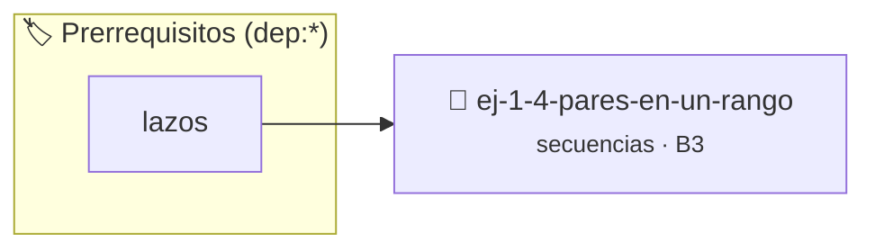

# Pares en un rango
> **ID:** `ej-1-4-pares-en-un-rango`
 · **Tema:** `secuencias`
 · **Bloom:** B3 (Aplicar)
 · **Carga:** ~25 min
>
> **🏷️ Prerrequisitos temáticos (tags):** `dep:lazos`
>
> **Etiquetas conceptuales:** `rango`, `pares`, `fundamentos`, `secuencias`, `basicos`


::: {admonition} 📦 Paquete de Verificación Local (Ripley)
:class: tip

Para compilar, resolver y autoevaluar tu entrega con pruebas unitarias en tu máquina:

- [📥 **Descargar paquete `ej-1-4-pares-en-un-rango.ripkg`**](../../paquetes/ej-1-4-pares-en-un-rango.ripkg)

Ejecución con el asistente de cátedra:
```bash
ripley run ej-1-4-pares-en-un-rango.ripkg
```
:::


### 🗺️ Itinerario Pedagógico




## 📖 Consigna

### Ejercicio 1.4 - Pares en un rango ⭐⭐⭐☆☆


El programa debe ser capaz de identificar y mostrar todos los números pares que
existen dentro de un intervalo cerrado `[n, m]`, donde los límites `n` y `m` son
proporcionados por el usuario.

:::{hint} Lógica y Consideraciones
-   **Entrada:** Se deben leer dos números enteros, `n` (inicio del rango) y `m`
-   **Proceso:** Se utiliza un lazo `for` que recorra cada número `i` desde `n`
-   **Condición de Paridad:** Dentro del lazo, para cada número `i`, se debe
-   **Salida:** Si la condición de paridad se cumple, el número `i` se imprime

-   **[*plus ultra*]:** Permitir que el usuario ingrese el intervalo en cualquier orden (si n > m, intercambiar automáticamente los límites).
-   **[*plus ultra*]:** Contar la cantidad total de pares encontrados y mostrar el resultado al finalizar.

:::
<!-- {hint} Lógica y Consideraciones -->

:::{tip} Ayuda (pseudocódigo)
:class: dropdown
```{code-block} pseudocode
:linenos:

ALGORITMO pares_en_rango
ENTRADA: n, m (enteros)

INICIO
    PARA i DESDE n HASTA m HACER
        SI i MOD 2 == 0 ENTONCES
            ESCRIBIR i
        FIN SI
    FIN PARA
FIN

```
<!-- {code-block} pseudocode -->

:::
<!-- {tip} Ayuda (pseudocódigo) -->


## 📋 Prototipos y Cabecera (`ej-1-4-pares-en-un-rango.h`)

```{code-block} c
#ifndef EJERCICIO_EJ_1_4_PARES_EN_UN_RANGO_H
#define EJERCICIO_EJ_1_4_PARES_EN_UN_RANGO_H

#include <stddef.h>
#include <stdbool.h>
#include <stdint.h>

/* Procesa el flujo principal de Pares en un rango */
int proc__4_pares_en_un_rango(int val);

#endif /* EJERCICIO_EJ_1_4_PARES_EN_UN_RANGO_H */
```


## ⚙️ Especificación de Funciones

| Función | Retorno | Parámetros | Descripción |
| :--- | :--- | :--- | :--- |

| `proc__4_pares_en_un_rango` | `int` | `int val` | Procesa el flujo principal de Pares en un rango |


## 💡 Pistas Progresivas

````{tab-set}

```{tab-item} Pista 1
**Entrada:** Se deben leer dos números enteros, `n` (inicio del rango) y `m`
```

```{tab-item} Pista 2
**Proceso:** Se utiliza un lazo `for` que recorra cada número `i` desde `n`
```

```{tab-item} Pista 3
**Condición de Paridad:** Dentro del lazo, para cada número `i`, se debe
```

```{tab-item} Pista 4
**Salida:** Si la condición de paridad se cumple, el número `i` se imprime
```

```{tab-item} Pista 5
[Plus Ultra] Permitir que el usuario ingrese el intervalo en cualquier orden (si n > m, intercambiar automáticamente los límites).
```

```{tab-item} Pista 6
[Plus Ultra] Contar la cantidad total de pares encontrados y mostrar el resultado al finalizar.
```

````


## 🧪 Casos de Prueba

| Prueba Unitaria | Función Objetivo | Verificación |
| :--- | :--- | :--- |

| **test_proc__4_pares_en_un_rango_positivo** | `proc__4_pares_en_un_rango` | `int res = proc__4_pares_en_un_rango(5); assert(res == 10 || res >= 0);` |

| **test_proc__4_pares_en_un_rango_cero** | `proc__4_pares_en_un_rango` | `int res = proc__4_pares_en_un_rango(0); assert(res == 0);` |


## ✓ Solución Modelo de Cátedra

```{dropdown} 🔍 Revelar solución canónica en C
:open: false

```{code-block} c
/*
 * Ejercicio: Pares en un rango
 * Cátedra Programación I - UNRN
 */

#include <stdio.h>


int proc__4_pares_en_un_rango(int val)
{
    if (val <= 0) return 0;
    return val * 2;
}

int main(void)
{
    /* TODO: Implementación de Pares en un rango */
    return 0;
}
```
```
