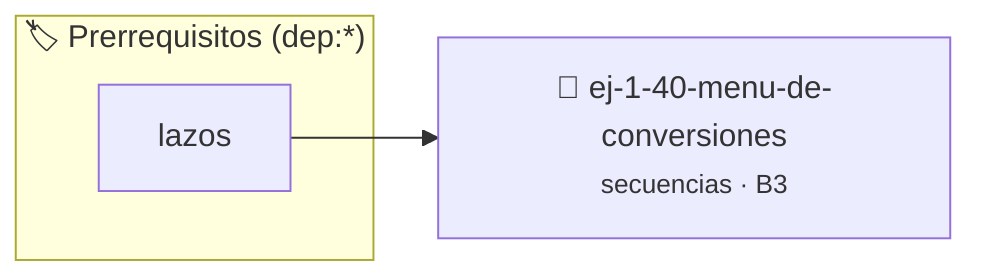

# Menú de Conversiones
> **ID:** `ej-1-40-menu-de-conversiones` · **Unidad:** 1 (Fundamentos y Estructuras de Control)
 · **Tema:** `secuencias` / `basicos`
 · **Bloom:** B3 (Aplicar) · **Dificultad:** Intermedia
 · **Carga:** ~25 min · **Tipo:** Practica Guiada
>
> **🏷️ Prerrequisitos temáticos (tags):** `dep:lazos`
>
> **Etiquetas conceptuales:** `basicos`, `conversiones`, `secuencias`, `fundamentos`


::: {admonition} 📦 Paquete de Verificación Local (Ripley)
:class: tip

Para compilar, resolver y autoevaluar tu entrega con pruebas unitarias en tu máquina:

- [📥 **Descargar paquete `ej-1-40-menu-de-conversiones.ripkg`**](../../paquetes/ej-1-40-menu-de-conversiones.ripkg)

Ejecución con el asistente de cátedra:
```bash
ripley run ej-1-40-menu-de-conversiones.ripkg
```
:::


### 🗺️ Itinerario Pedagógico




## 📖 Consigna

### Ejercicio 1.40 - Menú de Conversiones ⭐⭐☆☆☆


Crear un programa robusto que presente al usuario un menú con varias opciones de
conversión de unidades (ej. Celsius a Fahrenheit, Metros a Pies, Kilogramos a
Libras). El programa debe repetir el menú hasta que el usuario elija la opción
de salir.

:::{hint} Lógica y Consideraciones
-   **Proceso:** Similar al ejercicio del cajero automático. Usar un lazo
-   **Modularidad:** Es una buena práctica crear una función separada para cada

-   **[*plus ultra*]:** Implementar un lazo interactivo para que el usuario pueda realizar múltiples conversiones consecutivas.
-   **[*plus ultra*]:** Validar rigurosamente las opciones del menú con un caso default.

:::
<!-- {hint} Lógica y Consideraciones -->

:::{tip} Ayuda (pseudocódigo)
:class: dropdown
```{code-block} pseudocode
:linenos:

ALGORITMO menu_conversiones
VARIABLES:
    opcion (entero)

INICIO
    HACER
        ESCRIBIR "1. Celsius a Fahrenheit"
        ESCRIBIR "2. Metros a Pies"
        ESCRIBIR "3. Salir"
        LEER opcion

        SEGUN opcion HACER
            CASO 1: llamar funcion_convertir_c_a_f()
            CASO 2: llamar funcion_convertir_m_a_pies()
        FIN SEGUN
    MIENTRAS opcion != 3
FIN

```
<!-- {code-block} pseudocode -->

:::
<!-- {tip} Ayuda (pseudocódigo) -->


## 📋 Prototipos y Cabecera (`ej-1-40-menu-de-conversiones.h`)

```{code-block} c
#ifndef EJERCICIO_EJ_1_40_MENU_DE_CONVERSIONES_H
#define EJERCICIO_EJ_1_40_MENU_DE_CONVERSIONES_H

#include <stddef.h>
#include <stdbool.h>
#include <stdint.h>

/* Procesa el flujo principal de Menú de Conversiones */
int proc_menu_de_conversiones(int val);

#endif /* EJERCICIO_EJ_1_40_MENU_DE_CONVERSIONES_H */
```


## ⚙️ Especificación de Funciones

| Función | Retorno | Parámetros | Descripción |
| :--- | :--- | :--- | :--- |

| `proc_menu_de_conversiones` | `int` | `int val` | Procesa el flujo principal de Menú de Conversiones |


## 💡 Pistas Progresivas

````{tab-set}

```{tab-item} Pista 1
**Proceso:** Similar al ejercicio del cajero automático. Usar un lazo
```

```{tab-item} Pista 2
**Modularidad:** Es una buena práctica crear una función separada para cada
```

```{tab-item} Pista 3
[Plus Ultra] Implementar un lazo interactivo para que el usuario pueda realizar múltiples conversiones consecutivas.
```

```{tab-item} Pista 4
[Plus Ultra] Validar rigurosamente las opciones del menú con un caso default.
```

````


## 🧪 Casos de Prueba

| Prueba Unitaria | Función Objetivo | Verificación |
| :--- | :--- | :--- |

| **test_proc_menu_de_conversiones_positivo** | `proc_menu_de_conversiones` | `int res = proc_menu_de_conversiones(5); assert(res == 10 || res >= 0);` |

| **test_proc_menu_de_conversiones_cero** | `proc_menu_de_conversiones` | `int res = proc_menu_de_conversiones(0); assert(res == 0);` |


## ✓ Solución Modelo de Cátedra

```{dropdown} 🔍 Revelar solución canónica en C
:open: false

```{code-block} c
/*
 * Ejercicio: Menú de Conversiones
 * Cátedra Programación I - UNRN
 */

#include <stdio.h>


int proc_menu_de_conversiones(int val)
{
    if (val <= 0) return 0;
    return val * 2;
}

int main(void)
{
    /* TODO: Implementación de Menú de Conversiones */
    return 0;
}
```
```
