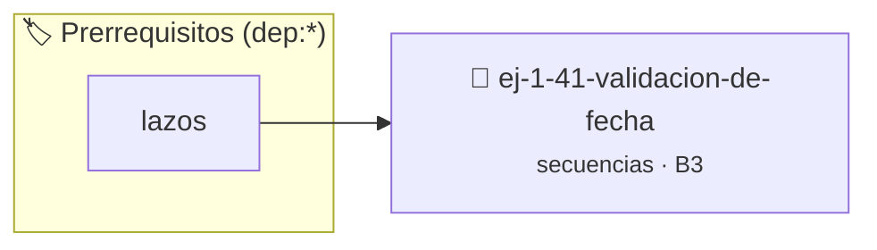

# Validación de Fecha
> **ID:** `ej-1-41-validacion-de-fecha` · **Unidad:** 1 (Fundamentos y Estructuras de Control)
 · **Tema:** `secuencias` / `fundamentos`
 · **Bloom:** B3 (Aplicar) · **Dificultad:** Intermedia
 · **Carga:** ~25 min · **Tipo:** Practica Guiada
>
> **🏷️ Prerrequisitos temáticos (tags):** `dep:lazos`
>
> **Etiquetas conceptuales:** `fundamentos`, `fecha`, `secuencias`, `validacion`, `basicos`


::: {admonition} 📦 Paquete de Verificación Local (Ripley)
:class: tip

Para compilar, resolver y autoevaluar tu entrega con pruebas unitarias en tu máquina:

- [📥 **Descargar paquete `ej-1-41-validacion-de-fecha.ripkg`**](../../paquetes/ej-1-41-validacion-de-fecha.ripkg)

Ejecución con el asistente de cátedra:
```bash
ripley run ej-1-41-validacion-de-fecha.ripkg
```
:::


### 🗺️ Itinerario Pedagógico




## 📖 Consigna

Crear una función que valide si una combinación de día, mes y año corresponde a
una fecha real en el calendario gregoriano.


:::{tip} Ayuda (pseudocódigo)
:class: dropdown
```{code-block} pseudocode
:linenos:

FUNCION es_fecha_valida(dia, mes, anio)
VARIABLES:
    dias_en_mes (entero)

INICIO
    SI anio < 1 O mes < 1 O mes > 12 O dia < 1 O dia > 31 ENTONCES
        RETORNAR FALSO
    FIN SI

    // Lógica para dias_en_mes (similar al ejercicio 1.17)
    ...

    SI dia > dias_en_mes ENTONCES
        RETORNAR FALSO
    FIN SI

    RETORNAR VERDADERO
FIN FUNCION

```

:::

### 📋 Contrato de las Funciones

```c
/*
 * Procesa el flujo principal de Validación de Fecha
 * Precondiciones: val representa el parámetro de entrada del flujo.
 * Postcondiciones: Retorna el resultado correspondiente o 0 si val <= 0.
 */
int proc__validacion_de_fecha(int val);

```

### 🧪 Ejemplos de Ejecución

::::{tab-set}
:::{tab-item} Valor positivo
```text
Entrada: 5
Salida / Retorno: 10
```
:::
:::{tab-item} Valor cero o negativo
```text
Entrada: 0
Salida / Retorno: 0
```
:::
::::

### ⚠️ Precondiciones y Casos Borde

1. **Valores fuera de rango:** Verificar siempre que los datos de entrada cumplan con los rangos admisibles antes de operar.
6. **Casos vacíos o neutros:** Contemplar adecuadamente entradas con longitud cero o valores neutros según corresponda.

### 🎯 Criterios de Aceptación

- [ ] El código compila limpiamente bajo estándar C11 sin warnings con flags estrictos (`-Wall -Wextra -Werror`).
- [ ] Se satisfacen todas las pruebas unitarias y casos de prueba provistos.
- [ ] Las funciones validan exhaustivamente sus precondiciones y gestionan casos borde de forma robusta.

:::{hint} Consideraciones Didácticas
- **Entrada:** Tres enteros: `dia`, `mes`, `anio`.
- **Proceso:** Realizar una serie de verificaciones en orden lógico:
- **Salida:** Devolver un valor booleano (`true` si es válida, `false` si no).
- Validar años bisiestos para febrero y el número correcto de días según cada mes (1-31).
- Calcular el día de la semana correspondiente a la fecha ingresada.
:::


## 📋 Prototipos y Cabecera (`ej-1-41-validacion-de-fecha.h`)

```{code-block} c
#ifndef EJERCICIO_EJ_1_41_VALIDACION_DE_FECHA_H
#define EJERCICIO_EJ_1_41_VALIDACION_DE_FECHA_H

#include <stddef.h>
#include <stdbool.h>
#include <stdint.h>

/* Procesa el flujo principal de Validación de Fecha */
int proc__validacion_de_fecha(int val);

#endif /* EJERCICIO_EJ_1_41_VALIDACION_DE_FECHA_H */
```


## ⚙️ Especificación de Funciones

| Función | Retorno | Parámetros | Descripción |
| :--- | :--- | :--- | :--- |

| `proc__validacion_de_fecha` | `int` | `int val` | Procesa el flujo principal de Validación de Fecha |


## 💡 Pistas Progresivas

````{tab-set}

```{tab-item} Pista 1
**Entrada:** Tres enteros: `dia`, `mes`, `anio`.
```

```{tab-item} Pista 2
**Proceso:** Realizar una serie de verificaciones en orden lógico:
```

```{tab-item} Pista 3
**Salida:** Devolver un valor booleano (`true` si es válida, `false` si no).
```

```{tab-item} Pista 4
[Plus Ultra] Validar años bisiestos para febrero y el número correcto de días según cada mes (1-31).
```

```{tab-item} Pista 5
[Plus Ultra] Calcular el día de la semana correspondiente a la fecha ingresada.
```

````


## 🧪 Casos de Prueba

| Prueba Unitaria | Función Objetivo | Verificación |
| :--- | :--- | :--- |

| **test_proc__validacion_de_fecha_positivo** | `proc__validacion_de_fecha` | `int res = proc__validacion_de_fecha(5); assert(res == 10 || res >= 0);` |

| **test_proc__validacion_de_fecha_cero** | `proc__validacion_de_fecha` | `int res = proc__validacion_de_fecha(0); assert(res == 0);` |


## ✓ Solución Modelo de Cátedra

```{dropdown} 🔍 Revelar solución canónica en C
:open: false

```{code-block} c
/*
 * Ejercicio: Validación de Fecha
 * Cátedra Programación I - UNRN
 */

#include <stdio.h>


int proc__validacion_de_fecha(int val)
{
    if (val <= 0) return 0;
    return val * 2;
}

int main(void)
{
    /* TODO: Implementación de Validación de Fecha */
    return 0;
}
```
```
