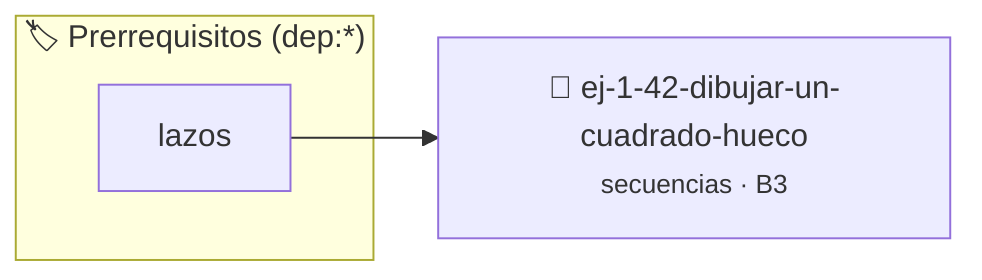

# Dibujar un Cuadrado Hueco
> **ID:** `ej-1-42-dibujar-un-cuadrado-hueco` · **Unidad:** 1 (Fundamentos y Estructuras de Control)
 · **Tema:** `secuencias` / `fundamentos`
 · **Bloom:** B3 (Aplicar) · **Dificultad:** Intermedia
 · **Carga:** ~25 min · **Tipo:** Practica Guiada
>
> **🏷️ Prerrequisitos temáticos (tags):** `dep:lazos`
>
> **Etiquetas conceptuales:** `fundamentos`, `hueco`, `dibujar`, `secuencias`, `cuadrado`


::: {admonition} 📦 Paquete de Verificación Local (Ripley)
:class: tip

Para compilar, resolver y autoevaluar tu entrega con pruebas unitarias en tu máquina:

- [📥 **Descargar paquete `ej-1-42-dibujar-un-cuadrado-hueco.ripkg`**](../../paquetes/ej-1-42-dibujar-un-cuadrado-hueco.ripkg)

Ejecución con el asistente de cátedra:
```bash
ripley run ej-1-42-dibujar-un-cuadrado-hueco.ripkg
```
:::


### 🗺️ Itinerario Pedagógico




## 📖 Consigna

### Ejercicio 1.42 - Dibujar un Cuadrado Hueco ⭐⭐☆☆☆


Pedir al usuario un número `n` y dibujar el contorno de un cuadrado de `n x n`
utilizando asteriscos. El interior del cuadrado debe estar vacío.

:::{hint} Lógica y Consideraciones
-   **Entrada:** Leer un entero `n`.
-   **Proceso:** Usar lazos aninados. El lazo exterior para las filas y el
-   **Condición:** Dentro del lazo interior, se debe decidir si imprimir un
    -   Es la primera o la última fila (`fila == 1` o `fila == n`).
    -   Es la primera o la última columna (`columna == 1` o `columna == n`).
-   En cualquier otro caso, se imprime un espacio.

-   **[*plus ultra*]:** Validar que el lado del cuadrado sea mayor o igual a 2.
-   **[*plus ultra*]:** Permitir elegir un carácter diferente para el borde y para el relleno.

:::
<!-- {hint} Lógica y Consideraciones -->

:::{tip} Ayuda (pseudocódigo)
:class: dropdown
```{code-block} pseudocode
:linenos:

ALGORITMO cuadrado_hueco
ENTRADA: n (entero)

INICIO
    PARA fila DESDE 1 HASTA n HACER
        PARA columna DESDE 1 HASTA n HACER
            SI fila == 1 O fila == n O columna == 1 O columna == n ENTONCES
                ESCRIBIR "*" SIN SALTO DE LÍNEA
            SINO
                ESCRIBIR " " SIN SALTO DE LÍNEA
            FIN SI
        FIN PARA
        ESCRIBIR SALTO DE LÍNEA
    FIN PARA
FIN

```
<!-- {code-block} pseudocode -->

:::
<!-- {tip} Ayuda (pseudocódigo) -->


## 📋 Prototipos y Cabecera (`ej-1-42-dibujar-un-cuadrado-hueco.h`)

```{code-block} c
#ifndef EJERCICIO_EJ_1_42_DIBUJAR_UN_CUADRADO_HUECO_H
#define EJERCICIO_EJ_1_42_DIBUJAR_UN_CUADRADO_HUECO_H

#include <stddef.h>
#include <stdbool.h>
#include <stdint.h>

/* Procesa el flujo principal de Dibujar un Cuadrado Hueco */
int proc_ar_un_cuadrado_hueco(int val);

#endif /* EJERCICIO_EJ_1_42_DIBUJAR_UN_CUADRADO_HUECO_H */
```


## ⚙️ Especificación de Funciones

| Función | Retorno | Parámetros | Descripción |
| :--- | :--- | :--- | :--- |

| `proc_ar_un_cuadrado_hueco` | `int` | `int val` | Procesa el flujo principal de Dibujar un Cuadrado Hueco |


## 💡 Pistas Progresivas

````{tab-set}

```{tab-item} Pista 1
**Entrada:** Leer un entero `n`.
```

```{tab-item} Pista 2
**Proceso:** Usar lazos aninados. El lazo exterior para las filas y el
```

```{tab-item} Pista 3
**Condición:** Dentro del lazo interior, se debe decidir si imprimir un
```

```{tab-item} Pista 4
Es la primera o la última fila (`fila == 1` o `fila == n`).
```

```{tab-item} Pista 5
Es la primera o la última columna (`columna == 1` o `columna == n`).
```

```{tab-item} Pista 6
En cualquier otro caso, se imprime un espacio.
```

```{tab-item} Pista 7
[Plus Ultra] Validar que el lado del cuadrado sea mayor o igual a 2.
```

```{tab-item} Pista 8
[Plus Ultra] Permitir elegir un carácter diferente para el borde y para el relleno.
```

````


## 🧪 Casos de Prueba

| Prueba Unitaria | Función Objetivo | Verificación |
| :--- | :--- | :--- |

| **test_proc_ar_un_cuadrado_hueco_positivo** | `proc_ar_un_cuadrado_hueco` | `int res = proc_ar_un_cuadrado_hueco(5); assert(res == 10 || res >= 0);` |

| **test_proc_ar_un_cuadrado_hueco_cero** | `proc_ar_un_cuadrado_hueco` | `int res = proc_ar_un_cuadrado_hueco(0); assert(res == 0);` |


## ✓ Solución Modelo de Cátedra

```{dropdown} 🔍 Revelar solución canónica en C
:open: false

```{code-block} c
/*
 * Ejercicio: Dibujar un Cuadrado Hueco
 * Cátedra Programación I - UNRN
 */

#include <stdio.h>


int proc_ar_un_cuadrado_hueco(int val)
{
    if (val <= 0) return 0;
    return val * 2;
}

int main(void)
{
    /* TODO: Implementación de Dibujar un Cuadrado Hueco */
    return 0;
}
```
```
