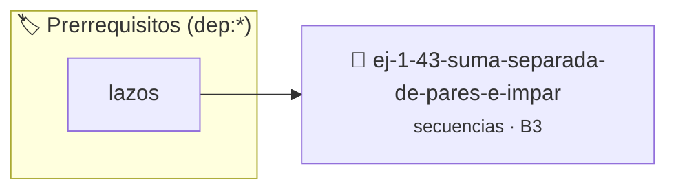

# Suma Separada de Pares e Impares
> **ID:** `ej-1-43-suma-separada-de-pares-e-impar` · **Unidad:** 1 (Fundamentos y Estructuras de Control)
 · **Tema:** `secuencias` / `pares`
 · **Bloom:** B3 (Aplicar) · **Dificultad:** Intermedia
 · **Carga:** ~25 min · **Tipo:** Practica Guiada
>
> **🏷️ Prerrequisitos temáticos (tags):** `dep:lazos`
>
> **Etiquetas conceptuales:** `pares`, `fundamentos`, `secuencias`, `separada`, `basicos`


::: {admonition} 📦 Paquete de Verificación Local (Ripley)
:class: tip

Para compilar, resolver y autoevaluar tu entrega con pruebas unitarias en tu máquina:

- [📥 **Descargar paquete `ej-1-43-suma-separada-de-pares-e-impar.ripkg`**](../../paquetes/ej-1-43-suma-separada-de-pares-e-impar.ripkg)

Ejecución con el asistente de cátedra:
```bash
ripley run ej-1-43-suma-separada-de-pares-e-impar.ripkg
```
:::


### 🗺️ Itinerario Pedagógico




## 📖 Consigna

Dado un rango de números `[n, m]`, el programa debe calcular la suma de todos
los números pares y la suma de todos los números impares de forma independiente
y mostrar ambos resultados.


:::{tip} Ayuda (pseudocódigo)
:class: dropdown
```{code-block} pseudocode
:linenos:

ALGORITMO suma_pares_impares_rango
ENTRADA: n, m (enteros)
VARIABLES:
    suma_pares, suma_impares (enteros)

INICIO
    suma_pares = 0
    suma_impares = 0
    PARA i DESDE n HASTA m HACER
        SI i MOD 2 == 0 ENTONCES
            suma_pares = suma_pares + i
        SINO
            suma_impares = suma_impares + i
        FIN SI
    FIN PARA
    ESCRIBIR "Suma de pares: ", suma_pares
    ESCRIBIR "Suma de impares: ", suma_impares
FIN

```

:::

### 📋 Contrato de las Funciones

```c
/*
 * Procesa el flujo principal de Suma Separada de Pares e Impares
 * Precondiciones: val representa el parámetro de entrada del flujo.
 * Postcondiciones: Retorna el resultado correspondiente o 0 si val <= 0.
 */
int proc_ada_de_pares_e_impar(int val);

```

### 🧪 Ejemplos de Ejecución

::::{tab-set}
:::{tab-item} Valor positivo
```text
Entrada: 5
Salida / Retorno: 10
```
:::
:::{tab-item} Valor cero o negativo
```text
Entrada: 0
Salida / Retorno: 0
```
:::
::::

### ⚠️ Precondiciones y Casos Borde

1. **Valores fuera de rango:** Verificar siempre que los datos de entrada cumplan con los rangos admisibles antes de operar.
6. **Casos vacíos o neutros:** Contemplar adecuadamente entradas con longitud cero o valores neutros según corresponda.

### 🎯 Criterios de Aceptación

- [ ] El código compila limpiamente bajo estándar C11 sin warnings con flags estrictos (`-Wall -Wextra -Werror`).
- [ ] Se satisfacen todas las pruebas unitarias y casos de prueba provistos.
- [ ] Las funciones validan exhaustivamente sus precondiciones y gestionan casos borde de forma robusta.

:::{hint} Consideraciones Didácticas
- **Variables:** Se necesitan dos acumuladores: `suma_pares` y `suma_impares`,
- **Entrada:** Leer los enteros `n` y `m`.
- **Proceso:**
- **Salida:** Mostrar los valores finales de ambas sumas.
- Permitir definir los límites del rango de manera dinámica mediante entrada por consola.
- Calcular también la cantidad de pares e impares encontrados en el intervalo.
:::


## 📋 Prototipos y Cabecera (`ej-1-43-suma-separada-de-pares-e-impar.h`)

```{code-block} c
#ifndef EJERCICIO_EJ_1_43_SUMA_SEPARADA_DE_PARES_E_IMPAR_H
#define EJERCICIO_EJ_1_43_SUMA_SEPARADA_DE_PARES_E_IMPAR_H

#include <stddef.h>
#include <stdbool.h>
#include <stdint.h>

/* Procesa el flujo principal de Suma Separada de Pares e Impares */
int proc_ada_de_pares_e_impar(int val);

#endif /* EJERCICIO_EJ_1_43_SUMA_SEPARADA_DE_PARES_E_IMPAR_H */
```


## ⚙️ Especificación de Funciones

| Función | Retorno | Parámetros | Descripción |
| :--- | :--- | :--- | :--- |

| `proc_ada_de_pares_e_impar` | `int` | `int val` | Procesa el flujo principal de Suma Separada de Pares e Impares |


## 💡 Pistas Progresivas

````{tab-set}

```{tab-item} Pista 1
**Variables:** Se necesitan dos acumuladores: `suma_pares` y `suma_impares`,
```

```{tab-item} Pista 2
**Entrada:** Leer los enteros `n` y `m`.
```

```{tab-item} Pista 3
**Proceso:**
```

```{tab-item} Pista 4
**Salida:** Mostrar los valores finales de ambas sumas.
```

```{tab-item} Pista 5
[Plus Ultra] Permitir definir los límites del rango de manera dinámica mediante entrada por consola.
```

```{tab-item} Pista 6
[Plus Ultra] Calcular también la cantidad de pares e impares encontrados en el intervalo.
```

````


## 🧪 Casos de Prueba

| Prueba Unitaria | Función Objetivo | Verificación |
| :--- | :--- | :--- |

| **test_proc_ada_de_pares_e_impar_positivo** | `proc_ada_de_pares_e_impar` | `int res = proc_ada_de_pares_e_impar(5); assert(res == 10 || res >= 0);` |

| **test_proc_ada_de_pares_e_impar_cero** | `proc_ada_de_pares_e_impar` | `int res = proc_ada_de_pares_e_impar(0); assert(res == 0);` |


## ✓ Solución Modelo de Cátedra

```{dropdown} 🔍 Revelar solución canónica en C
:open: false

```{code-block} c
/*
 * Ejercicio: Suma Separada de Pares e Impares
 * Cátedra Programación I - UNRN
 */

#include <stdio.h>


int proc_ada_de_pares_e_impar(int val)
{
    if (val <= 0) return 0;
    return val * 2;
}

int main(void)
{
    /* TODO: Implementación de Suma Separada de Pares e Impares */
    return 0;
}
```
```
