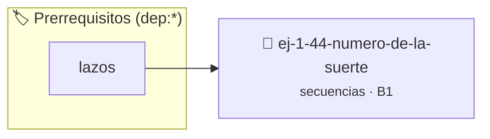

# Número de la Suerte
> **ID:** `ej-1-44-numero-de-la-suerte`
 · **Tema:** `secuencias`
 · **Bloom:** B1 (Recordar)
 · **Carga:** ~10 min
>
> **🏷️ Prerrequisitos temáticos (tags):** `dep:lazos`
>
> **Etiquetas conceptuales:** `fundamentos`, `secuencias`, `numero`, `basicos`, `suerte`


::: {admonition} 📦 Paquete de Verificación Local (Ripley)
:class: tip

Para compilar, resolver y autoevaluar tu entrega con pruebas unitarias en tu máquina:

- [📥 **Descargar paquete `ej-1-44-numero-de-la-suerte.ripkg`**](../../paquetes/ej-1-44-numero-de-la-suerte.ripkg)

Ejecución con el asistente de cátedra:
```bash
ripley run ej-1-44-numero-de-la-suerte.ripkg
```
:::


### 🗺️ Itinerario Pedagógico




## 📖 Consigna

### Ejercicio 1.44 - Número de la Suerte ⭐⭐☆☆☆


Un número de la suerte es un entero con una cantidad par de dígitos, donde la
suma de los dígitos de la primera mitad es igual a la suma de los dígitos de la
segunda mitad. El programa debe verificar si un número dado es de la suerte.

:::{hint} Lógica y Consideraciones
-   **Entrada:** Leer un número entero.
-   **Proceso:**

-   **[*plus ultra*]:** Validar que la fecha contenga valores válidos de día, mes y año.
-   **[*plus ultra*]:** Modularizar la suma sucesiva de dígitos en una función auxiliar pura.

:::
<!-- {hint} Lógica y Consideraciones -->

:::{tip} Ayuda (pseudocódigo)
:class: dropdown
```{code-block} pseudocode
:linenos:

ALGORITMO numero_de_la_suerte
ENTRADA: numero (entero)
VARIABLES:
    total_digitos, mitad_digitos, i (enteros)
    primera_mitad, segunda_mitad (enteros)
    suma1, suma2 (enteros)

INICIO
    LEER numero
    total_digitos = contar_digitos(numero)

    SI total_digitos MOD 2 != 0 ENTONCES
        ESCRIBIR "No es un número de la suerte (dígitos impares)."
        TERMINAR
    FIN SI

    mitad_digitos = total_digitos / 2
    divisor = potencia(10, mitad_digitos)

    primera_mitad = numero / divisor
    segunda_mitad = numero MOD divisor

    suma1 = sumar_digitos(primera_mitad)
    suma2 = sumar_digitos(segunda_mitad)

    SI suma1 == suma2 ENTONCES
        ESCRIBIR "Es un número de la suerte."
    SINO
        ESCRIBIR "No es un número de la suerte."
    FIN SI
FIN

```
<!-- {code-block} pseudocode -->

:::
<!-- {tip} Ayuda (pseudocódigo) -->
## Ejercicio 1.45 - Hola Mundo Personalizado ⭐☆☆☆☆

Escribí un programa que solicite tu nombre y te salude personalmente.

**Ejemplo de ejecución:**

:::{hint} Lógica y Consideraciones

-   **[*plus ultra*]:** Validar que el nombre ingresado contenga caracteres legibles y no esté vacío.
-   **[*plus ultra*]:** Dar formato especial a la salida con marcos en la terminal.

:::
<!-- {hint} Lógica y Consideraciones -->

```
Ingresá tu nombre: Juan
¡Hola, Juan! Bienvenido a la programación en C.
```

**Orientación:**
- Usá `printf()` para mostrar mensajes
- Usá `scanf()` para leer el nombre (máximo 50 caracteres)
- Recordá incluir `<stdio.h>`

---
## Ejercicio 1.46 - Calculadora Simple ⭐⭐☆☆☆

Escribí un programa que lea dos números enteros y muestre su suma, resta,
producto y división.

**Ejemplo de ejecución:**

:::{hint} Lógica y Consideraciones

-   **[*plus ultra*]:** Validar que el segundo número no sea cero antes de calcular el cociente.
-   **[*plus ultra*]:** Modularizar cada operación aritmética en su propia función.

:::
<!-- {hint} Lógica y Consideraciones -->

```
Primer número: 10
Segundo número: 3
Suma: 13
Resta: 7
Producto: 30
División: 3.33
```

**Orientación:**
- Declará variables para los dos números
- Para la división con decimales, convertí al menos uno de los operandos a
  `double`
- Usá `%.2f` para mostrar dos decimales

---
## Ejercicio 1.47 - Conversor de Temperatura ⭐⭐☆☆☆

Creá un programa que convierta temperatura de Celsius a Fahrenheit y Kelvin.

**Fórmulas:**
- Fahrenheit = Celsius × 9/5 + 32
- Kelvin = Celsius + 273.15

**Orientación:**
- Usá `double` para almacenar temperaturas
- Aplicá las fórmulas de conversión
- Mostrá resultados con dos decimales


:::{hint} Lógica y Consideraciones

-   **[*plus ultra*]:** Validar que las temperaturas no estén por debajo del cero absoluto.
-   **[*plus ultra*]:** Modularizar las fórmulas en funciones con contratos y pruebas unitarias.

:::
<!-- {hint} Lógica y Consideraciones -->

---
## Ejercicio 1.48 - Área y Perímetro ⭐⭐☆☆☆

Escribí un programa que calcule el área y perímetro de un rectángulo dados su
ancho y alto.

**Orientación:**
- Área = ancho × alto
- Perímetro = 2 × (ancho + alto)
- Usá `double` para las medidas
- Verificá que ancho y alto sean positivos


:::{hint} Lógica y Consideraciones

-   **[*plus ultra*]:** Validar que ancho y alto sean positivos antes de calcular.
-   **[*plus ultra*]:** Modularizar el cálculo en funciones independientes para área y perímetro.

:::
<!-- {hint} Lógica y Consideraciones -->

---
## Ejercicio 1.49 - Promedio de Tres Números ⭐⭐☆☆☆

Calculá el promedio de tres números decimales ingresados por el usuario.

**Orientación:**
- Leé tres números con `scanf("%lf", ...)`
- Promedio = (a + b + c) / 3.0
- Mostrá el resultado con dos decimales


:::{hint} Lógica y Consideraciones

-   **[*plus ultra*]:** Validar los datos ingresados verificando el retorno de scanf.
-   **[*plus ultra*]:** Modularizar el promedio en una función double calcular_promedio(double a, double b, double c).

:::
<!-- {hint} Lógica y Consideraciones -->

---
## Ejercicio 1.50 - Intercambio de Variables ⭐⭐☆☆☆

Leé dos números enteros y mostralos intercambiados (sin usar una tercera
variable).

**Ejemplo:**

:::{hint} Lógica y Consideraciones

-   **[*plus ultra*]:** Implementar una función que reciba dos variables y muestre sus valores antes y después de operar.
-   **[*plus ultra*]:** Verificar que el intercambio funcione correctamente para números negativos y cero.

:::
<!-- {hint} Lógica y Consideraciones -->

```
Ingresá a: 5
Ingresá b: 10
Después del intercambio:
a = 10
b = 5
```

**Orientación:**
- Usá operaciones aritméticas para intercambiar:
  - `a = a + b;`
  - `b = a - b;`
  - `a = a - b;`
- Verificá el resultado imprimiendo antes y después del intercambio

---
## Ejercicio 1.51 - Conversión de Unidades ⭐⭐☆☆☆

Convertí una distancia en metros a kilómetros, centímetros y milímetros.

**Orientación:**
- 1 metro = 0.001 km = 100 cm = 1000 mm
- Usá constantes para los factores de conversión
- Mostrá todas las conversiones


:::{hint} Lógica y Consideraciones

-   **[*plus ultra*]:** Modularizar cada conversión en funciones puras independientes.
-   **[*plus ultra*]:** Formatear las unidades en una tabla comparativa alineada.

:::
<!-- {hint} Lógica y Consideraciones -->

---
## Ejercicio 1.52 - Cálculo de IMC ⭐⭐⭐☆☆

Calculá el Índice de Masa Corporal (IMC) dados peso (kg) y altura (m).

**Fórmula:** IMC = peso / (altura × altura)

**Orientación:**
- Verificá que altura sea mayor que 0
- Mostrá el IMC con dos decimales
- Opcionalmente, mostrá la categoría (bajo peso, normal, sobrepeso)


:::{hint} Lógica y Consideraciones

-   **[*plus ultra*]:** Validar que peso y altura sean mayores a cero y clasificar según la tabla oficial de la OMS.
-   **[*plus ultra*]:** Modularizar el cálculo en una función libre de operaciones de E/S.

:::
<!-- {hint} Lógica y Consideraciones -->

---
## Ejercicio 1.53 - Cantidad de Billetes ⭐⭐⭐☆☆

Dado un monto en pesos, calculá cuántos billetes de cada denominación (1000,
500, 200, 100, 50, 20, 10) se necesitan.

**Ejemplo:**

:::{hint} Lógica y Consideraciones

-   **[*plus ultra*]:** Validar que el monto sea un número entero no negativo.
-   **[*plus ultra*]:** Permitir configurar las denominaciones de billetes en orden decreciente.

:::
<!-- {hint} Lógica y Consideraciones -->

```
Monto: 1780
1 billete(s) de 1000
1 billete(s) de 500
1 billete(s) de 200
0 billete(s) de 100
1 billete(s) de 50
1 billete(s) de 20
1 billete(s) de 10
```

**Orientación:**
- Usá división entera y módulo
- Empezá por el billete más grande
- Restá el valor usado del monto

---
## Ejercicio 1.54 - Segundos a Horas, Minutos y Segundos ⭐⭐⭐☆☆

Convertí una cantidad de segundos a formato HH:MM:SS.

**Ejemplo:**

:::{hint} Lógica y Consideraciones

-   **[*plus ultra*]:** Validar que la cantidad de segundos no sea negativa.
-   **[*plus ultra*]:** Permitir incluir días si los segundos superan las 24 horas.

:::
<!-- {hint} Lógica y Consideraciones -->

```
Segundos: 3665
Resultado: 1:01:05
```

**Orientación:**
- Horas = segundos / 3600
- Minutos = (segundos % 3600) / 60
- Segundos restantes = segundos % 60
- Mostrá con formato `printf("%d:%02d:%02d", h, m, s)`

---
## Ejercicio 1.55 - Dígitos de un Número ⭐⭐⭐☆☆

Leé un número de tres dígitos y mostrá cada dígito por separado.

**Ejemplo:**

:::{hint} Lógica y Consideraciones

-   **[*plus ultra*]:** Validar que el número ingresado esté exactamente en el rango [100, 999].
-   **[*plus ultra*]:** Extender el algoritmo para números de cantidad variable de dígitos usando un lazo.

:::
<!-- {hint} Lógica y Consideraciones -->

```
Número: 457
Centenas: 4
Decenas: 5
Unidades: 7
```

**Orientación:**
- Centenas = numero / 100
- Decenas = (numero / 10) % 10
- Unidades = numero % 10

---
## Ejercicio 1.56 - Precio con Descuento ⭐⭐⭐☆☆

Calculá el precio final de un producto aplicando un descuento porcentual.

**Ejemplo:**

:::{hint} Lógica y Consideraciones

-   **[*plus ultra*]:** Validar que el porcentaje de descuento esté en el rango [0, 100].
-   **[*plus ultra*]:** Mostrar el desglose del ahorro total obtenido junto con el precio final.

:::
<!-- {hint} Lógica y Consideraciones -->

```
Precio original: 1000
Descuento (%): 15
Precio final: 850.00
```

**Orientación:**
- Descuento = precio × (porcentaje / 100.0)
- Precio final = precio - descuento
- Mostrá ambos valores

---
## Ejercicio 1.57 - División Entera y Resto ⭐⭐☆☆☆

Leé dos números enteros `dividendo` y `divisor`. Mostrá el cociente entero, el
resto de la división (módulo) y el resultado de la división real (con decimales).

**Orientación:**
- Verificá que el divisor sea distinto de cero antes de realizar la operación
- Usá `/` para la división entera y `%` para el resto
- Convertí uno de los operandos a `double` mediante `(double)` para obtener el cociente con decimales

:::{hint} Lógica y Consideraciones

-   **[*plus ultra*]:** Validar que el divisor sea distinto de cero informando un mensaje de error descriptivo por consola.
-   **[*plus ultra*]:** Modularizar el cálculo en una función pura que retorne el cociente y verifique la validez matemática.

:::
<!-- {hint} Lógica y Consideraciones -->

---
## Ejercicio 1.58 - Conversión de Base ⭐⭐⭐⭐☆

Convertí un número decimal a binario, octal y hexadecimal.

**Orientación:**
- Usá especificadores de formato: `%d`, `%o`, `%x`
- Mostrá el número en las cuatro bases
- Opcionalmente, implementá conversión manual con divisiones sucesivas


:::{hint} Lógica y Consideraciones

-   **[*plus ultra*]:** Validar que el número decimal ingresado sea no negativo.
-   **[*plus ultra*]:** Modularizar la conversión a binario mediante divisiones sucesivas por 2 en un lazo.

:::
<!-- {hint} Lógica y Consideraciones -->

---
## Ejercicio 1.59 - Área de Triángulo (Herón) ⭐⭐⭐⭐☆

Calculá el área de un triángulo usando la fórmula de Herón dados los tres lados.

**Fórmula:** 
- s = (a + b + c) / 2
- área = √(s × (s-a) × (s-b) × (s-c))

**Orientación:**
- Verificá que los lados formen un triángulo válido (a + b > c, etc.)
- Usá `sqrt()` de `<math.h>`
- Compilá con `-lm` para enlazar la biblioteca matemática


:::{hint} Lógica y Consideraciones

-   **[*plus ultra*]:** Validar la desigualdad triangular antes de aplicar la raíz cuadrada.
-   **[*plus ultra*]:** Modularizar el cálculo del semiperímetro y del área en funciones separadas.

:::
<!-- {hint} Lógica y Consideraciones -->

---
## Ejercicio 1.60 - Ecuación Cuadrática ⭐⭐⭐⭐☆

Resolvé una ecuación cuadrática ax² + bx + c = 0, mostrando las raíces reales si
existen.

**Orientación:**
- Calculá el discriminante: Δ = b² - 4ac
- Si Δ < 0: no hay raíces reales
- Si Δ = 0: una raíz: x = -b / (2a)
- Si Δ > 0: dos raíces: x = (-b ± √Δ) / (2a)
- Usá `sqrt()` de `<math.h>`


:::{hint} Lógica y Consideraciones

-   **[*plus ultra*]:** Manejar los tres casos del discriminante (dos raíces reales, una raíz doble, raíces complejas).
-   **[*plus ultra*]:** Validar que el coeficiente principal a no sea cero (en cuyo caso es una ecuación lineal).

:::
<!-- {hint} Lógica y Consideraciones -->

---
## Ejercicio 1.61 - Interés Compuesto ⭐⭐⭐⭐☆

Calculá el monto final de una inversión con interés compuesto.

**Fórmula:** A = P × (1 + r/n)^(n×t)

Donde:
- P = capital inicial
- r = tasa de interés anual (decimal)
- n = veces que se capitaliza por año
- t = tiempo en años

**Orientación:**
- Usá `pow()` de `<math.h>`
- Mostrá el monto inicial, final y la ganancia
- Compilá con `-lm`


:::{hint} Lógica y Consideraciones

-   **[*plus ultra*]:** Validar que el capital, tasa de interés, frecuencia y tiempo sean positivos.
-   **[*plus ultra*]:** Mostrar una tabla período por período con la evolución del capital acumulado.

:::
<!-- {hint} Lógica y Consideraciones -->

---
## Ejercicio 1.62 - Conversión RGB a Hexadecimal ⭐⭐⭐⭐☆

Convertí un color RGB (rojo, verde, azul) a su representación hexadecimal.

**Ejemplo:**

:::{hint} Lógica y Consideraciones

-   **[*plus ultra*]:** Validar que cada componente RGB esté en el rango [0, 255].
-   **[*plus ultra*]:** Formatear la salida con ceros a la izquierda para asegurar siempre 6 dígitos hexadecimales (#RRGGBB).

:::
<!-- {hint} Lógica y Consideraciones -->

```
Rojo (0-255): 255
Verde (0-255): 127
Azul (0-255): 80
Hexadecimal: #FF7F50
```

**Orientación:**
- Verificá que cada valor esté en rango 0-255
- Usá `printf("%02X", valor)` para formato hexadecimal
- Combiná los tres valores en formato #RRGGBB

---
## Ejercicio 1.63 - Cálculo de Potencia (sin pow) ⭐⭐⭐⭐⭐

Calculá base^exponente usando solo multiplicaciones (exponente entero positivo).

**Orientación:**
- Leé base (double) y exponente (int positivo)
- Usá un lazo para multiplicar base por sí misma exponente veces
- Considerá el caso especial cuando exponente = 0 (resultado = 1)
- **Spoiler:** Este ejercicio requiere lazos, pero podés usar multiplicaciones
  repetidas en línea


:::{hint} Lógica y Consideraciones

-   **[*plus ultra*]:** Manejar el caso especial de exponente 0 (resultado 1) y base 0 con exponente positivo.
-   **[*plus ultra*]:** Extender la función para aceptar exponentes negativos retornando un double.

:::
<!-- {hint} Lógica y Consideraciones -->

---
## Ejercicio 1.64 - Calculadora Científica Básica ⭐⭐⭐⭐⭐

Creá una calculadora que realice operaciones avanzadas: potencia, raíz cuadrada,
seno, coseno, tangente, logaritmo.

**Orientación:**
- Mostrá un menú de opciones
- Leé la operación deseada y los operandos necesarios
- Usá funciones de `<math.h>`: `pow()`, `sqrt()`, `sin()`, `cos()`, `tan()`,
  `log()`
- Recordá que funciones trigonométricas usan radianes
- Verificá casos especiales (raíz de negativo, log de 0 o negativo, etc.)
- Compilá con `-lm`


:::{hint} Lógica y Consideraciones

-   **[*plus ultra*]:** Validar operaciones inválidas como división por cero, logaritmo de no positivos o raíz de negativos.
-   **[*plus ultra*]:** Implementar un menú con lazo que permita realizar cálculos consecutivos hasta salir.

:::
<!-- {hint} Lógica y Consideraciones -->

---

## Notas Finales

:::{tip} Consejos Generales

- **Validación:** Siempre verificá entradas inválidas (divisiones por cero,
  valores fuera de rango)
- **Formato:** Usá `printf()` con especificadores apropiados (`%d`, `%f`, `%c`,
  etc.)
- **Constantes:** Definí valores fijos con `#define` o `const`
- **Comentarios:** Documentá qué hace cada sección del código
- **Testing:** Probá con diferentes entradas, incluyendo casos extremos

:::
<!-- {tip} Consejos Generales -->

:::{note} Compilación con Matemáticas

Para ejercicios que usan `<math.h>`, compilá con:
``` bash
gcc -Wall -Wextra -std=c99 programa.c -o programa -lm
```
<!-- bash -->
El flag `-lm` enlaza la biblioteca matemática.

:::
<!-- {note} Compilación con Matemáticas -->

Estas consignas cubren los conceptos fundamentales del Apunte 1: variables,
tipos de datos, operadores aritméticos, relacionales, lógicos, entrada/salida, y uso básico de
bibliotecas estándar.


## 📋 Prototipos y Cabecera (`ej-1-44-numero-de-la-suerte.h`)

```{code-block} c
#ifndef EJERCICIO_EJ_1_44_NUMERO_DE_LA_SUERTE_H
#define EJERCICIO_EJ_1_44_NUMERO_DE_LA_SUERTE_H

#include <stddef.h>
#include <stdbool.h>
#include <stdint.h>

/* Procesa el flujo principal de Número de la Suerte */
int proc__numero_de_la_suerte(int val);

#endif /* EJERCICIO_EJ_1_44_NUMERO_DE_LA_SUERTE_H */
```


## ⚙️ Especificación de Funciones

| Función | Retorno | Parámetros | Descripción |
| :--- | :--- | :--- | :--- |

| `proc__numero_de_la_suerte` | `int` | `int val` | Procesa el flujo principal de Número de la Suerte |


## 💡 Pistas Progresivas

````{tab-set}

```{tab-item} Pista 1
**Entrada:** Leer un número entero.
```

```{tab-item} Pista 2
**Proceso:**
```

```{tab-item} Pista 3
[Plus Ultra] Validar que la fecha contenga valores válidos de día, mes y año.
```

```{tab-item} Pista 4
[Plus Ultra] Modularizar la suma sucesiva de dígitos en una función auxiliar pura.
```

```{tab-item} Pista 5
[Plus Ultra] Validar que el nombre ingresado contenga caracteres legibles y no esté vacío.
```

```{tab-item} Pista 6
[Plus Ultra] Dar formato especial a la salida con marcos en la terminal.
```

```{tab-item} Pista 7
[Plus Ultra] Validar que el segundo número no sea cero antes de calcular el cociente.
```

```{tab-item} Pista 8
[Plus Ultra] Modularizar cada operación aritmética en su propia función.
```

```{tab-item} Pista 9
[Plus Ultra] Validar que las temperaturas no estén por debajo del cero absoluto.
```

```{tab-item} Pista 10
[Plus Ultra] Modularizar las fórmulas en funciones con contratos y pruebas unitarias.
```

```{tab-item} Pista 11
[Plus Ultra] Validar que ancho y alto sean positivos antes de calcular.
```

```{tab-item} Pista 12
[Plus Ultra] Modularizar el cálculo en funciones independientes para área y perímetro.
```

```{tab-item} Pista 13
[Plus Ultra] Validar los datos ingresados verificando el retorno de scanf.
```

```{tab-item} Pista 14
[Plus Ultra] Modularizar el promedio en una función double calcular_promedio(double a, double b, double c).
```

```{tab-item} Pista 15
[Plus Ultra] Implementar una función que reciba dos variables y muestre sus valores antes y después de operar.
```

```{tab-item} Pista 16
[Plus Ultra] Verificar que el intercambio funcione correctamente para números negativos y cero.
```

```{tab-item} Pista 17
[Plus Ultra] Modularizar cada conversión en funciones puras independientes.
```

```{tab-item} Pista 18
[Plus Ultra] Formatear las unidades en una tabla comparativa alineada.
```

```{tab-item} Pista 19
[Plus Ultra] Validar que peso y altura sean mayores a cero y clasificar según la tabla oficial de la OMS.
```

```{tab-item} Pista 20
[Plus Ultra] Modularizar el cálculo en una función libre de operaciones de E/S.
```

```{tab-item} Pista 21
[Plus Ultra] Validar que el monto sea un número entero no negativo.
```

```{tab-item} Pista 22
[Plus Ultra] Permitir configurar las denominaciones de billetes en orden decreciente.
```

```{tab-item} Pista 23
[Plus Ultra] Validar que la cantidad de segundos no sea negativa.
```

```{tab-item} Pista 24
[Plus Ultra] Permitir incluir días si los segundos superan las 24 horas.
```

```{tab-item} Pista 25
[Plus Ultra] Validar que el número ingresado esté exactamente en el rango [100, 999].
```

```{tab-item} Pista 26
[Plus Ultra] Extender el algoritmo para números de cantidad variable de dígitos usando un lazo.
```

```{tab-item} Pista 27
[Plus Ultra] Validar que el porcentaje de descuento esté en el rango [0, 100].
```

```{tab-item} Pista 28
[Plus Ultra] Mostrar el desglose del ahorro total obtenido junto con el precio final.
```

```{tab-item} Pista 29
[Plus Ultra] Validar que el divisor sea distinto de cero informando un mensaje de error descriptivo por consola.
```

```{tab-item} Pista 30
[Plus Ultra] Modularizar el cálculo en una función pura que retorne el cociente y verifique la validez matemática.
```

```{tab-item} Pista 31
[Plus Ultra] Validar que el número decimal ingresado sea no negativo.
```

```{tab-item} Pista 32
[Plus Ultra] Modularizar la conversión a binario mediante divisiones sucesivas por 2 en un lazo.
```

```{tab-item} Pista 33
[Plus Ultra] Validar la desigualdad triangular antes de aplicar la raíz cuadrada.
```

```{tab-item} Pista 34
[Plus Ultra] Modularizar el cálculo del semiperímetro y del área en funciones separadas.
```

```{tab-item} Pista 35
[Plus Ultra] Manejar los tres casos del discriminante (dos raíces reales, una raíz doble, raíces complejas).
```

```{tab-item} Pista 36
[Plus Ultra] Validar que el coeficiente principal a no sea cero (en cuyo caso es una ecuación lineal).
```

```{tab-item} Pista 37
[Plus Ultra] Validar que el capital, tasa de interés, frecuencia y tiempo sean positivos.
```

```{tab-item} Pista 38
[Plus Ultra] Mostrar una tabla período por período con la evolución del capital acumulado.
```

```{tab-item} Pista 39
[Plus Ultra] Validar que cada componente RGB esté en el rango [0, 255].
```

```{tab-item} Pista 40
[Plus Ultra] Formatear la salida con ceros a la izquierda para asegurar siempre 6 dígitos hexadecimales (#RRGGBB).
```

```{tab-item} Pista 41
[Plus Ultra] Manejar el caso especial de exponente 0 (resultado 1) y base 0 con exponente positivo.
```

```{tab-item} Pista 42
[Plus Ultra] Extender la función para aceptar exponentes negativos retornando un double.
```

```{tab-item} Pista 43
[Plus Ultra] Validar operaciones inválidas como división por cero, logaritmo de no positivos o raíz de negativos.
```

```{tab-item} Pista 44
[Plus Ultra] Implementar un menú con lazo que permita realizar cálculos consecutivos hasta salir.
```

```{tab-item} Pista 45
**Validación:** Siempre verificá entradas inválidas (divisiones por cero, valores fuera de rango)
```

```{tab-item} Pista 46
**Formato:** Usá `printf()` con especificadores apropiados (`%d`, `%f`, `%c`, etc.)
```

```{tab-item} Pista 47
**Constantes:** Definí valores fijos con `#define` o `const`
```

```{tab-item} Pista 48
**Comentarios:** Documentá qué hace cada sección del código
```

```{tab-item} Pista 49
**Testing:** Probá con diferentes entradas, incluyendo casos extremos
```

````


## 🧪 Casos de Prueba

| Prueba Unitaria | Función Objetivo | Verificación |
| :--- | :--- | :--- |

| **test_proc__numero_de_la_suerte_positivo** | `proc__numero_de_la_suerte` | `int res = proc__numero_de_la_suerte(5); assert(res == 10 || res >= 0);` |

| **test_proc__numero_de_la_suerte_cero** | `proc__numero_de_la_suerte` | `int res = proc__numero_de_la_suerte(0); assert(res == 0);` |


## ✓ Solución Modelo de Cátedra

```{dropdown} 🔍 Revelar solución canónica en C
:open: false

```{code-block} c
/*
 * Ejercicio: Número de la Suerte
 * Cátedra Programación I - UNRN
 */

#include <stdio.h>


int proc__numero_de_la_suerte(int val)
{
    if (val <= 0) return 0;
    return val * 2;
}

int main(void)
{
    /* TODO: Implementación de Número de la Suerte */
    return 0;
}
```
```
