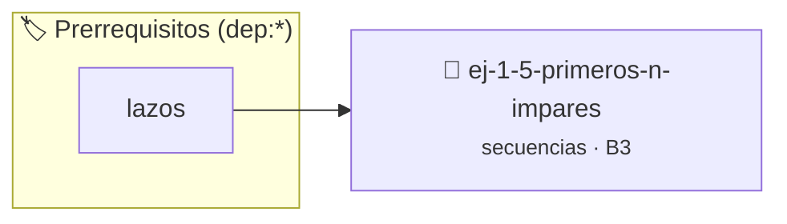

# Primeros N Impares
> **ID:** `ej-1-5-primeros-n-impares` · **Unidad:** 1 (Fundamentos y Estructuras de Control)
 · **Tema:** `secuencias` / `fundamentos`
 · **Bloom:** B3 (Aplicar) · **Dificultad:** Intermedia
 · **Carga:** ~25 min · **Tipo:** Practica Guiada
>
> **🏷️ Prerrequisitos temáticos (tags):** `dep:lazos`
>
> **Etiquetas conceptuales:** `fundamentos`, `secuencias`, `basicos`, `impares`, `primeros`


::: {admonition} 📦 Paquete de Verificación Local (Ripley)
:class: tip

Para compilar, resolver y autoevaluar tu entrega con pruebas unitarias en tu máquina:

- [📥 **Descargar paquete `ej-1-5-primeros-n-impares.ripkg`**](../../paquetes/ej-1-5-primeros-n-impares.ripkg)

Ejecución con el asistente de cátedra:
```bash
ripley run ej-1-5-primeros-n-impares.ripkg
```
:::


### 🗺️ Itinerario Pedagógico




## 📖 Consigna

Este ejercicio consiste en generar una secuencia de números impares, comenzando
desde 1, hasta alcanzar un total de $N$ términos, donde $N$ es un número
proporcionado por el usuario.


:::{tip} Ayuda (pseudocódigo)
:class: dropdown
```{code-block} pseudocode
:linenos:

ALGORITMO primeros_n_impares
ENTRADA: n_terminos (entero)

INICIO
    PARA k DESDE 1 HASTA n_terminos HACER
        impar = 2 * k - 1
        ESCRIBIR impar
    FIN PARA
FIN

```

:::

---

## Operaciones con Rangos Numéricos

### 📋 Contrato de las Funciones

```c
/*
 * Procesa el flujo principal de Primeros N Impares
 * Precondiciones: val representa el parámetro de entrada del flujo.
 * Postcondiciones: Retorna el resultado correspondiente o 0 si val <= 0.
 */
int proc_5_primeros_n_impares(int val);

```

### 🧪 Ejemplos de Ejecución

::::{tab-set}
:::{tab-item} Valor positivo
```text
Entrada: 5
Salida / Retorno: 10
```
:::
:::{tab-item} Valor cero o negativo
```text
Entrada: 0
Salida / Retorno: 0
```
:::
::::

### ⚠️ Precondiciones y Casos Borde

1. **Valores fuera de rango:** Verificar siempre que los datos de entrada cumplan con los rangos admisibles antes de operar.
6. **Casos vacíos o neutros:** Contemplar adecuadamente entradas con longitud cero o valores neutros según corresponda.

### 🎯 Criterios de Aceptación

- [ ] El código compila limpiamente bajo estándar C11 sin warnings con flags estrictos (`-Wall -Wextra -Werror`).
- [ ] Se satisfacen todas las pruebas unitarias y casos de prueba provistos.
- [ ] Las funciones validan exhaustivamente sus precondiciones y gestionan casos borde de forma robusta.

:::{hint} Consideraciones Didácticas
- **Entrada:** Se debe leer un número entero $N$ que representa la cantidad de
- **Proceso:** Se puede abordar de dos maneras:
- **Salida:** Se imprime la secuencia de los primeros $N$ números impares.
- Validar que N sea un entero mayor a cero; de lo contrario, volver a solicitarlo.
- Mostrar la suma acumulada de los primeros N impares y verificar que sea igual a N².
:::


## 📋 Prototipos y Cabecera (`ej-1-5-primeros-n-impares.h`)

```{code-block} c
#ifndef EJERCICIO_EJ_1_5_PRIMEROS_N_IMPARES_H
#define EJERCICIO_EJ_1_5_PRIMEROS_N_IMPARES_H

#include <stddef.h>
#include <stdbool.h>
#include <stdint.h>

/* Procesa el flujo principal de Primeros N Impares */
int proc_5_primeros_n_impares(int val);

#endif /* EJERCICIO_EJ_1_5_PRIMEROS_N_IMPARES_H */
```


## ⚙️ Especificación de Funciones

| Función | Retorno | Parámetros | Descripción |
| :--- | :--- | :--- | :--- |

| `proc_5_primeros_n_impares` | `int` | `int val` | Procesa el flujo principal de Primeros N Impares |


## 💡 Pistas Progresivas

````{tab-set}

```{tab-item} Pista 1
**Entrada:** Se debe leer un número entero $N$ que representa la cantidad de
```

```{tab-item} Pista 2
**Proceso:** Se puede abordar de dos maneras:
```

```{tab-item} Pista 3
**Salida:** Se imprime la secuencia de los primeros $N$ números impares.
```

```{tab-item} Pista 4
[Plus Ultra] Validar que N sea un entero mayor a cero; de lo contrario, volver a solicitarlo.
```

```{tab-item} Pista 5
[Plus Ultra] Mostrar la suma acumulada de los primeros N impares y verificar que sea igual a N².
```

````


## 🧪 Casos de Prueba

| Prueba Unitaria | Función Objetivo | Verificación |
| :--- | :--- | :--- |

| **test_proc_5_primeros_n_impares_positivo** | `proc_5_primeros_n_impares` | `int res = proc_5_primeros_n_impares(5); assert(res == 10 || res >= 0);` |

| **test_proc_5_primeros_n_impares_cero** | `proc_5_primeros_n_impares` | `int res = proc_5_primeros_n_impares(0); assert(res == 0);` |


## ✓ Solución Modelo de Cátedra

```{dropdown} 🔍 Revelar solución canónica en C
:open: false

```{code-block} c
/*
 * Ejercicio: Primeros N Impares
 * Cátedra Programación I - UNRN
 */

#include <stdio.h>


int proc_5_primeros_n_impares(int val)
{
    if (val <= 0) return 0;
    return val * 2;
}

int main(void)
{
    /* TODO: Implementación de Primeros N Impares */
    return 0;
}
```
```
