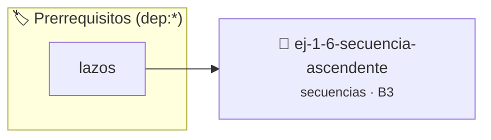

# Secuencia Ascendente
> **ID:** `ej-1-6-secuencia-ascendente` · **Unidad:** 1 (Fundamentos y Estructuras de Control)
 · **Tema:** `secuencias` / `fundamentos`
 · **Bloom:** B3 (Aplicar) · **Dificultad:** Intermedia
 · **Carga:** ~25 min · **Tipo:** Practica Guiada
>
> **🏷️ Prerrequisitos temáticos (tags):** `dep:lazos`
>
> **Etiquetas conceptuales:** `fundamentos`, `secuencia`, `secuencias`, `basicos`, `ascendente`


::: {admonition} 📦 Paquete de Verificación Local (Ripley)
:class: tip

Para compilar, resolver y autoevaluar tu entrega con pruebas unitarias en tu máquina:

- [📥 **Descargar paquete `ej-1-6-secuencia-ascendente.ripkg`**](../../paquetes/ej-1-6-secuencia-ascendente.ripkg)

Ejecución con el asistente de cátedra:
```bash
ripley run ej-1-6-secuencia-ascendente.ripkg
```
:::


### 🗺️ Itinerario Pedagógico




## 📖 Consigna

### Ejercicio 1.6 - Secuencia Ascendente ⭐⭐☆☆☆


El objetivo es mostrar una secuencia de números enteros que comienza en un
número `n` y termina justo antes de un número `m`. Esto corresponde al intervalo
matemático `[n, m)`.

:::{hint} Lógica y Consideraciones
-   **Entrada:** Leer los enteros `n` (inclusive) y `m` (exclusive).
-   **Proceso:** Utilizar un lazo `for` que se inicialice en `n` y continúe
-   **Salida:** En cada iteración del lazo, imprimir el valor actual del

-   **[*plus ultra*]:** Manejar el caso donde n >= m informando al usuario que el rango es vacío.
-   **[*plus ultra*]:** Permitir al usuario ingresar un paso de incremento distinto de 1.

:::
<!-- {hint} Lógica y Consideraciones -->

:::{tip} Ayuda (pseudocódigo)
:class: dropdown
```{code-block} pseudocode
:linenos:

ALGORITMO secuencia_ascendente
ENTRADA: n, m (enteros)

INICIO
    PARA i DESDE n HASTA m-1 HACER
        ESCRIBIR i
    FIN PARA
FIN

```
<!-- {code-block} pseudocode -->

:::
<!-- {tip} Ayuda (pseudocódigo) -->


## 📋 Prototipos y Cabecera (`ej-1-6-secuencia-ascendente.h`)

```{code-block} c
#ifndef EJERCICIO_EJ_1_6_SECUENCIA_ASCENDENTE_H
#define EJERCICIO_EJ_1_6_SECUENCIA_ASCENDENTE_H

#include <stddef.h>
#include <stdbool.h>
#include <stdint.h>

/* Procesa el flujo principal de Secuencia Ascendente */
int proc_secuencia_ascendente(int val);

#endif /* EJERCICIO_EJ_1_6_SECUENCIA_ASCENDENTE_H */
```


## ⚙️ Especificación de Funciones

| Función | Retorno | Parámetros | Descripción |
| :--- | :--- | :--- | :--- |

| `proc_secuencia_ascendente` | `int` | `int val` | Procesa el flujo principal de Secuencia Ascendente |


## 💡 Pistas Progresivas

````{tab-set}

```{tab-item} Pista 1
**Entrada:** Leer los enteros `n` (inclusive) y `m` (exclusive).
```

```{tab-item} Pista 2
**Proceso:** Utilizar un lazo `for` que se inicialice en `n` y continúe
```

```{tab-item} Pista 3
**Salida:** En cada iteración del lazo, imprimir el valor actual del
```

```{tab-item} Pista 4
[Plus Ultra] Manejar el caso donde n >= m informando al usuario que el rango es vacío.
```

```{tab-item} Pista 5
[Plus Ultra] Permitir al usuario ingresar un paso de incremento distinto de 1.
```

````


## 🧪 Casos de Prueba

| Prueba Unitaria | Función Objetivo | Verificación |
| :--- | :--- | :--- |

| **test_proc_secuencia_ascendente_positivo** | `proc_secuencia_ascendente` | `int res = proc_secuencia_ascendente(5); assert(res == 10 || res >= 0);` |

| **test_proc_secuencia_ascendente_cero** | `proc_secuencia_ascendente` | `int res = proc_secuencia_ascendente(0); assert(res == 0);` |


## ✓ Solución Modelo de Cátedra

```{dropdown} 🔍 Revelar solución canónica en C
:open: false

```{code-block} c
/*
 * Ejercicio: Secuencia Ascendente
 * Cátedra Programación I - UNRN
 */

#include <stdio.h>


int proc_secuencia_ascendente(int val)
{
    if (val <= 0) return 0;
    return val * 2;
}

int main(void)
{
    /* TODO: Implementación de Secuencia Ascendente */
    return 0;
}
```
```
