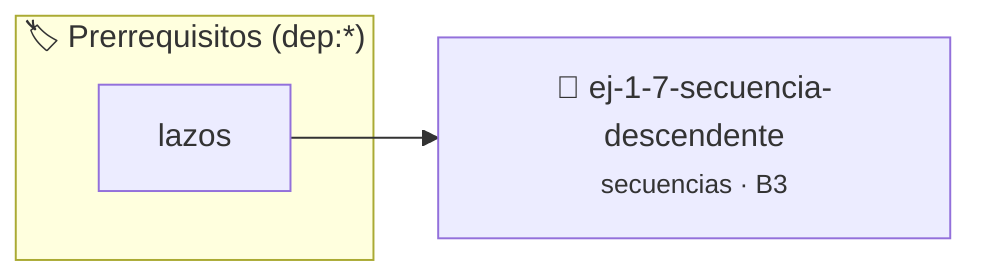

# Secuencia Descendente
> **ID:** `ej-1-7-secuencia-descendente` · **Unidad:** 1 (Fundamentos y Estructuras de Control)
 · **Tema:** `secuencias` / `descendente`
 · **Bloom:** B3 (Aplicar) · **Dificultad:** Intermedia
 · **Carga:** ~25 min · **Tipo:** Practica Guiada
>
> **🏷️ Prerrequisitos temáticos (tags):** `dep:lazos`
>
> **Etiquetas conceptuales:** `descendente`, `fundamentos`, `secuencia`, `secuencias`, `basicos`


::: {admonition} 📦 Paquete de Verificación Local (Ripley)
:class: tip

Para compilar, resolver y autoevaluar tu entrega con pruebas unitarias en tu máquina:

- [📥 **Descargar paquete `ej-1-7-secuencia-descendente.ripkg`**](../../paquetes/ej-1-7-secuencia-descendente.ripkg)

Ejecución con el asistente de cátedra:
```bash
ripley run ej-1-7-secuencia-descendente.ripkg
```
:::


### 🗺️ Itinerario Pedagógico




## 📖 Consigna

Similar al anterior, pero esta vez la secuencia debe ir en orden descendente. Se
parte de un número `n` y se retrocede hasta un número `m`, sin incluirlo. Esto
corresponde al intervalo `(m, n]`.


:::{tip} Ayuda (pseudocódigo)
:class: dropdown
```{code-block} pseudocode
:linenos:

ALGORITMO secuencia_descendente
ENTRADA: n, m (enteros)

INICIO
    PARA i DESDE n HASTA m+1 CON PASO -1 HACER
        ESCRIBIR i
    FIN PARA
FIN

```

:::

### 📋 Contrato de las Funciones

```c
/*
 * Procesa el flujo principal de Secuencia Descendente
 * Precondiciones: val representa el parámetro de entrada del flujo.
 * Postcondiciones: Retorna el resultado correspondiente o 0 si val <= 0.
 */
int proc_ecuencia_descendente(int val);

```

### 🧪 Ejemplos de Ejecución

::::{tab-set}
:::{tab-item} Valor positivo
```text
Entrada: 5
Salida / Retorno: 10
```
:::
:::{tab-item} Valor cero o negativo
```text
Entrada: 0
Salida / Retorno: 0
```
:::
::::

### ⚠️ Precondiciones y Casos Borde

1. **Valores fuera de rango:** Verificar siempre que los datos de entrada cumplan con los rangos admisibles antes de operar.
6. **Casos vacíos o neutros:** Contemplar adecuadamente entradas con longitud cero o valores neutros según corresponda.

### 🎯 Criterios de Aceptación

- [ ] El código compila limpiamente bajo estándar C11 sin warnings con flags estrictos (`-Wall -Wextra -Werror`).
- [ ] Se satisfacen todas las pruebas unitarias y casos de prueba provistos.
- [ ] Las funciones validan exhaustivamente sus precondiciones y gestionan casos borde de forma robusta.

:::{hint} Consideraciones Didácticas
- **Entrada:** Leer los enteros `n` (inclusive) y `m` (exclusive).
- **Proceso:** Utilizar un lazo `for` que se inicialice en `n` y continúe
- **Salida:** Imprimir el valor del contador en cada iteración.
- Validar que n > m para que la secuencia descendente tenga al menos un elemento.
- Permitir al usuario ingresar un paso de decremento personalizado.
:::


## 📋 Prototipos y Cabecera (`ej-1-7-secuencia-descendente.h`)

```{code-block} c
#ifndef EJERCICIO_EJ_1_7_SECUENCIA_DESCENDENTE_H
#define EJERCICIO_EJ_1_7_SECUENCIA_DESCENDENTE_H

#include <stddef.h>
#include <stdbool.h>
#include <stdint.h>

/* Procesa el flujo principal de Secuencia Descendente */
int proc_ecuencia_descendente(int val);

#endif /* EJERCICIO_EJ_1_7_SECUENCIA_DESCENDENTE_H */
```


## ⚙️ Especificación de Funciones

| Función | Retorno | Parámetros | Descripción |
| :--- | :--- | :--- | :--- |

| `proc_ecuencia_descendente` | `int` | `int val` | Procesa el flujo principal de Secuencia Descendente |


## 💡 Pistas Progresivas

````{tab-set}

```{tab-item} Pista 1
**Entrada:** Leer los enteros `n` (inclusive) y `m` (exclusive).
```

```{tab-item} Pista 2
**Proceso:** Utilizar un lazo `for` que se inicialice en `n` y continúe
```

```{tab-item} Pista 3
**Salida:** Imprimir el valor del contador en cada iteración.
```

```{tab-item} Pista 4
[Plus Ultra] Validar que n > m para que la secuencia descendente tenga al menos un elemento.
```

```{tab-item} Pista 5
[Plus Ultra] Permitir al usuario ingresar un paso de decremento personalizado.
```

````


## 🧪 Casos de Prueba

| Prueba Unitaria | Función Objetivo | Verificación |
| :--- | :--- | :--- |

| **test_proc_ecuencia_descendente_positivo** | `proc_ecuencia_descendente` | `int res = proc_ecuencia_descendente(5); assert(res == 10 || res >= 0);` |

| **test_proc_ecuencia_descendente_cero** | `proc_ecuencia_descendente` | `int res = proc_ecuencia_descendente(0); assert(res == 0);` |


## ✓ Solución Modelo de Cátedra

```{dropdown} 🔍 Revelar solución canónica en C
:open: false

```{code-block} c
/*
 * Ejercicio: Secuencia Descendente
 * Cátedra Programación I - UNRN
 */

#include <stdio.h>


int proc_ecuencia_descendente(int val)
{
    if (val <= 0) return 0;
    return val * 2;
}

int main(void)
{
    /* TODO: Implementación de Secuencia Descendente */
    return 0;
}
```
```
