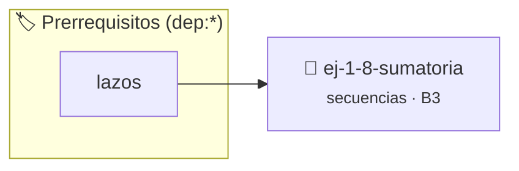

# Sumatoria
> **ID:** `ej-1-8-sumatoria`
 · **Tema:** `secuencias`
 · **Bloom:** B3 (Aplicar)
 · **Carga:** ~25 min
>
> **🏷️ Prerrequisitos temáticos (tags):** `dep:lazos`
>
> **Etiquetas conceptuales:** `sumatoria`, `basicos`, `secuencias`, `fundamentos`


::: {admonition} 📦 Paquete de Verificación Local (Ripley)
:class: tip

Para compilar, resolver y autoevaluar tu entrega con pruebas unitarias en tu máquina:

- [📥 **Descargar paquete `ej-1-8-sumatoria.ripkg`**](../../paquetes/ej-1-8-sumatoria.ripkg)

Ejecución con el asistente de cátedra:
```bash
ripley run ej-1-8-sumatoria.ripkg
```
:::


### 🗺️ Itinerario Pedagógico




## 📖 Consigna

### Ejercicio 1.8 - Sumatoria ⭐⭐☆☆☆


Calcular la suma de todos los números enteros en un rango cerrado `[n, m]`. Esto
es equivalente a la operación matemática $\sum_{i=n}^{m} i$.

:::{hint} Lógica y Consideraciones
-   **Variables:** Se necesita una variable `acumulador` (o `suma`),
-   **Entrada:** Leer los enteros `n` y `m`.
-   **Proceso:** Usar un lazo `for` que itere desde `n` hasta `m`. En cada
-   **Salida:** Después de que el lazo termine, imprimir el valor final del

-   **[*plus ultra*]:** Validar que n <= m y calcular la sumatoria tanto mediante un lazo como con la fórmula de Gauss para comparar resultados.
-   **[*plus ultra*]:** Usar el tipo long long para prevenir desbordamientos en rangos grandes.

:::
<!-- {hint} Lógica y Consideraciones -->

:::{tip} Ayuda (pseudocódigo)
:class: dropdown
```{code-block} pseudocode
:linenos:

ALGORITMO sumatoria_rango
ENTRADA: n, m (enteros)
VARIABLES:
    suma (entero)

INICIO
    suma = 0
    PARA i DESDE n HASTA m HACER
        suma = suma + i
    FIN PARA
    ESCRIBIR "La suma es: ", suma
FIN

```
<!-- {code-block} pseudocode -->

:::
<!-- {tip} Ayuda (pseudocódigo) -->


## 📋 Prototipos y Cabecera (`ej-1-8-sumatoria.h`)

```{code-block} c
#ifndef EJERCICIO_EJ_1_8_SUMATORIA_H
#define EJERCICIO_EJ_1_8_SUMATORIA_H

#include <stddef.h>
#include <stdbool.h>
#include <stdint.h>

/* Procesa el flujo principal de Sumatoria */
int ejecutar_ej_1_8_sumatoria(int val);

#endif /* EJERCICIO_EJ_1_8_SUMATORIA_H */
```


## ⚙️ Especificación de Funciones

| Función | Retorno | Parámetros | Descripción |
| :--- | :--- | :--- | :--- |

| `ejecutar_ej_1_8_sumatoria` | `int` | `int val` | Procesa el flujo principal de Sumatoria |


## 💡 Pistas Progresivas

````{tab-set}

```{tab-item} Pista 1
**Variables:** Se necesita una variable `acumulador` (o `suma`),
```

```{tab-item} Pista 2
**Entrada:** Leer los enteros `n` y `m`.
```

```{tab-item} Pista 3
**Proceso:** Usar un lazo `for` que itere desde `n` hasta `m`. En cada
```

```{tab-item} Pista 4
**Salida:** Después de que el lazo termine, imprimir el valor final del
```

```{tab-item} Pista 5
[Plus Ultra] Validar que n <= m y calcular la sumatoria tanto mediante un lazo como con la fórmula de Gauss para comparar resultados.
```

```{tab-item} Pista 6
[Plus Ultra] Usar el tipo long long para prevenir desbordamientos en rangos grandes.
```

````


## 🧪 Casos de Prueba

| Prueba Unitaria | Función Objetivo | Verificación |
| :--- | :--- | :--- |

| **test_ejecutar_ej_1_8_sumatoria_positivo** | `ejecutar_ej_1_8_sumatoria` | `int res = ejecutar_ej_1_8_sumatoria(5); assert(res == 10 || res >= 0);` |

| **test_ejecutar_ej_1_8_sumatoria_cero** | `ejecutar_ej_1_8_sumatoria` | `int res = ejecutar_ej_1_8_sumatoria(0); assert(res == 0);` |


## ✓ Solución Modelo de Cátedra

```{dropdown} 🔍 Revelar solución canónica en C
:open: false

```{code-block} c
/*
 * Ejercicio: Sumatoria
 * Cátedra Programación I - UNRN
 */

#include <stdio.h>


int ejecutar_ej_1_8_sumatoria(int val)
{
    if (val <= 0) return 0;
    return val * 2;
}

int main(void)
{
    /* TODO: Implementación de Sumatoria */
    return 0;
}
```
```
