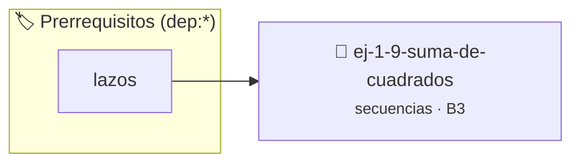

# Suma de Cuadrados
> **ID:** `ej-1-9-suma-de-cuadrados` · **Unidad:** 1 (Fundamentos y Estructuras de Control)
 · **Tema:** `secuencias` / `cuadrados`
 · **Bloom:** B3 (Aplicar) · **Dificultad:** Intermedia
 · **Carga:** ~25 min · **Tipo:** Practica Guiada
>
> **🏷️ Prerrequisitos temáticos (tags):** `dep:lazos`
>
> **Etiquetas conceptuales:** `cuadrados`, `basicos`, `secuencias`, `fundamentos`


::: {admonition} 📦 Paquete de Verificación Local (Ripley)
:class: tip

Para compilar, resolver y autoevaluar tu entrega con pruebas unitarias en tu máquina:

- [📥 **Descargar paquete `ej-1-9-suma-de-cuadrados.ripkg`**](../../paquetes/ej-1-9-suma-de-cuadrados.ripkg)

Ejecución con el asistente de cátedra:
```bash
ripley run ej-1-9-suma-de-cuadrados.ripkg
```
:::


### 🗺️ Itinerario Pedagógico




## 📖 Consigna

### Ejercicio 1.9 - Suma de Cuadrados ⭐⭐☆☆☆


Calcular la suma de los cuadrados de todos los números enteros en un rango
cerrado `[n, m]`. La operación es $\sum_{i=n}^{m} i^2$.

:::{hint} Lógica y Consideraciones
-   **Variables:** Se necesita un `acumulador` inicializado en 0.
-   **Entrada:** Leer los enteros `n` y `m`.
-   **Proceso:** Usar un lazo `for` que itere de `n` a `m`. En cada iteración,
-   **Salida:** Al final, imprimir el valor del `acumulador`.

-   **[*plus ultra*]:** Usar tipos enteros amplios como long long para soportar sumas de cuadrados elevadas.
-   **[*plus ultra*]:** Comparar el resultado del lazo con la fórmula matemática n*(n+1)*(2n+1)/6.

:::
<!-- {hint} Lógica y Consideraciones -->

:::{tip} Ayuda (pseudocódigo)
:class: dropdown
```{code-block} pseudocode
:linenos:

ALGORITMO suma_cuadrados_rango
ENTRADA: n, m (enteros)
VARIABLES:
    suma_cuadrados (entero)

INICIO
    suma_cuadrados = 0
    PARA i DESDE n HASTA m HACER
        suma_cuadrados = suma_cuadrados + (i * i)
    FIN PARA
    ESCRIBIR "La suma de cuadrados es: ", suma_cuadrados
FIN

```
<!-- {code-block} pseudocode -->

:::
<!-- {tip} Ayuda (pseudocódigo) -->

---

## Estructuras Condicionales


## 📋 Prototipos y Cabecera (`ej-1-9-suma-de-cuadrados.h`)

```{code-block} c
#ifndef EJERCICIO_EJ_1_9_SUMA_DE_CUADRADOS_H
#define EJERCICIO_EJ_1_9_SUMA_DE_CUADRADOS_H

#include <stddef.h>
#include <stdbool.h>
#include <stdint.h>

/* Procesa el flujo principal de Suma de Cuadrados */
int proc__9_suma_de_cuadrados(int val);

#endif /* EJERCICIO_EJ_1_9_SUMA_DE_CUADRADOS_H */
```


## ⚙️ Especificación de Funciones

| Función | Retorno | Parámetros | Descripción |
| :--- | :--- | :--- | :--- |

| `proc__9_suma_de_cuadrados` | `int` | `int val` | Procesa el flujo principal de Suma de Cuadrados |


## 💡 Pistas Progresivas

````{tab-set}

```{tab-item} Pista 1
**Variables:** Se necesita un `acumulador` inicializado en 0.
```

```{tab-item} Pista 2
**Entrada:** Leer los enteros `n` y `m`.
```

```{tab-item} Pista 3
**Proceso:** Usar un lazo `for` que itere de `n` a `m`. En cada iteración,
```

```{tab-item} Pista 4
**Salida:** Al final, imprimir el valor del `acumulador`.
```

```{tab-item} Pista 5
[Plus Ultra] Usar tipos enteros amplios como long long para soportar sumas de cuadrados elevadas.
```

```{tab-item} Pista 6
[Plus Ultra] Comparar el resultado del lazo con la fórmula matemática n*(n+1)*(2n+1)/6.
```

````


## 🧪 Casos de Prueba

| Prueba Unitaria | Función Objetivo | Verificación |
| :--- | :--- | :--- |

| **test_proc__9_suma_de_cuadrados_positivo** | `proc__9_suma_de_cuadrados` | `int res = proc__9_suma_de_cuadrados(5); assert(res == 10 || res >= 0);` |

| **test_proc__9_suma_de_cuadrados_cero** | `proc__9_suma_de_cuadrados` | `int res = proc__9_suma_de_cuadrados(0); assert(res == 0);` |


## ✓ Solución Modelo de Cátedra

```{dropdown} 🔍 Revelar solución canónica en C
:open: false

```{code-block} c
/*
 * Ejercicio: Suma de Cuadrados
 * Cátedra Programación I - UNRN
 */

#include <stdio.h>


int proc__9_suma_de_cuadrados(int val)
{
    if (val <= 0) return 0;
    return val * 2;
}

int main(void)
{
    /* TODO: Implementación de Suma de Cuadrados */
    return 0;
}
```
```
