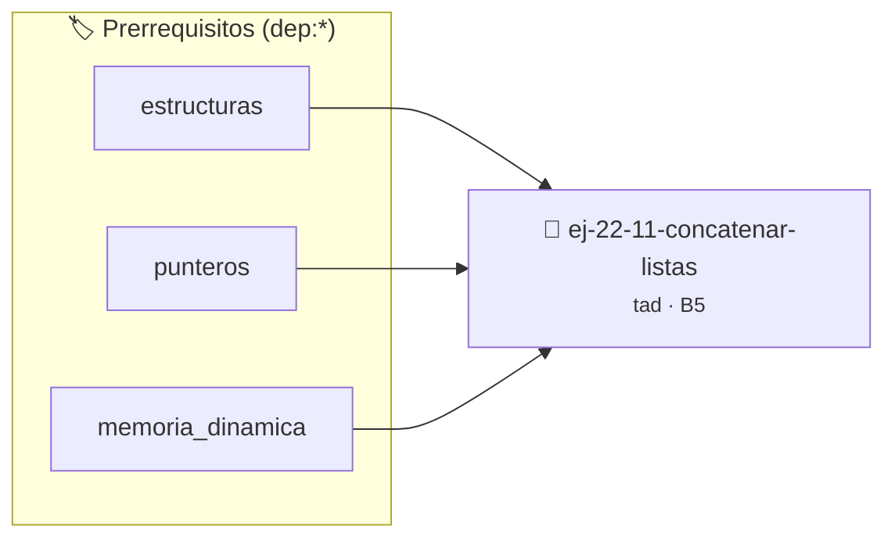

# Concatenar Listas
> **ID:** `ej-22-11-concatenar-listas` · **Unidad:** 4 (Tipos Abstractos y Algorítmica)
 · **Tema:** `tad` / `arboles_binarios`
 · **Bloom:** B5 (Evaluar / Crear) · **Dificultad:** Desafio
 · **Carga:** ~45 min · **Tipo:** Desafio
>
> **🏷️ Prerrequisitos temáticos (tags):** `dep:estructuras`, `dep:punteros`, `dep:memoria_dinamica`
>
> **Etiquetas conceptuales:** `listas`, `concatenar`, `tad`, `abstraccion`, `algoritmos`


::: {admonition} 📦 Paquete de Verificación Local (Ripley)
:class: tip

Para compilar, resolver y autoevaluar tu entrega con pruebas unitarias en tu máquina:

- [📥 **Descargar paquete `ej-22-11-concatenar-listas.ripkg`**](../../paquetes/ej-22-11-concatenar-listas.ripkg)

Ejecución con el asistente de cátedra:
```bash
ripley run ej-22-11-concatenar-listas.ripkg
```
:::


### 🗺️ Itinerario Pedagógico




## 📖 Consigna

### Ejercicio 22.11 - Concatenar Listas ⭐⭐☆☆☆

Desarrollar una función que anexe de forma destructiva todos los elementos de la
segunda lista al final de la primera.


:::{hint} Lógica y Consideraciones

-   **[*plus ultra*]:** Garantizar la terminación con `\0` y prevenir
    desbordamientos de búfer validando la capacidad máxima.
-   **[*plus ultra*]:** Soportar la lectura de cadenas con espacios y múltiples
    líneas de manera robusta.

:::
<!-- {hint} Lógica y Consideraciones -->

``` c
void lista_concatenar(lista_t *destino, lista_t *origen);
```
<!-- c -->
## Ejercicio 22.12 - TAD Contador ⭐☆☆☆☆

Implementá un contador simple con:
- `contador_t *crear_contador()`
- `void incrementar(contador_t *c)`
- `void decrementar(contador_t *c)`
- `int obtener_valor(const contador_t *c)`
- `void destruir_contador(contador_t *c)`

**Orientación:**
- `contador.h`: declaración opaca `typedef struct contador contador_t;`
- `contador.c`: definición completa `struct contador { int valor; };`
- Mantené valor privado, solo accesible por funciones


:::{hint} Lógica y Consideraciones

-   **[*plus ultra*]:** Garantizar la terminación con `\0` y prevenir
    desbordamientos de búfer validando la capacidad máxima.
-   **[*plus ultra*]:** Soportar la lectura de cadenas con espacios y múltiples
    líneas de manera robusta.

:::
<!-- {hint} Lógica y Consideraciones -->

---
## Ejercicio 22.13 - TAD Pila (Stack) ⭐⭐☆☆☆

Implementá pila con array estático de tamaño fijo:
- `pila_t *crear_pila(int capacidad)`
- `bool apilar(pila_t *p, int dato)`
- `bool desapilar(pila_t *p, int *dato)`
- `bool ver_tope(const pila_t *p, int *dato)`
- `bool esta_vacia(const pila_t *p)`
- `void destruir_pila(pila_t *p)`

**Orientación:**
- Estructura interna: `int *datos; int tope; int capacidad;`
- `apilar` verifica que no esté llena
- `desapilar` y `ver_tope` retornan `false` si está vacía


:::{hint} Lógica y Consideraciones

-   **[*plus ultra*]:** Garantizar la terminación con `\0` y prevenir
    desbordamientos de búfer validando la capacidad máxima.
-   **[*plus ultra*]:** Soportar la lectura de cadenas con espacios y múltiples
    líneas de manera robusta.

:::
<!-- {hint} Lógica y Consideraciones -->

---
## Ejercicio 22.14 - TAD Cola (Queue) ⭐⭐⭐☆☆

Implementá cola FIFO con lista enlazada:
- `cola_t *crear_cola()`
- `bool encolar(cola_t *c, int dato)`
- `bool desencolar(cola_t *c, int *dato)`
- `bool ver_frente(const cola_t *c, int *dato)`
- `bool esta_vacia(const cola_t *c)`
- `size_t obtener_tamanio(const cola_t *c)`
- `void destruir_cola(cola_t *c)`

**Orientación:**
- Estructura interna: `nodo_t *primero; nodo_t *ultimo; size_t tamanio;`
- `encolar` agrega al final
- `desencolar` quita del frente


:::{hint} Lógica y Consideraciones

-   **[*plus ultra*]:** Garantizar la terminación con `\0` y prevenir
    desbordamientos de búfer validando la capacidad máxima.
-   **[*plus ultra*]:** Soportar la lectura de cadenas con espacios y múltiples
    líneas de manera robusta.

:::
<!-- {hint} Lógica y Consideraciones -->

---
## Ejercicio 22.15 - TAD Lista Enlazada ⭐⭐⭐☆☆

Implementá lista enlazada simple:
- `lista_t *crear_lista()`
- `bool insertar_inicio(lista_t *l, int dato)`
- `bool insertar_final(lista_t *l, int dato)`
- `bool eliminar_primero(lista_t *l, int *dato)`
- `bool buscar(const lista_t *l, int dato)`
- `size_t obtener_largo(const lista_t *l)`
- `void destruir_lista(lista_t *l)`

**Orientación:**
- Mantené puntero a primero y último para inserción eficiente
- Mantené contador de tamaño


:::{hint} Lógica y Consideraciones

-   **[*plus ultra*]:** Validar punteros `NULL` recibidos como parámetro para
    evitar fallos de segmentación.
-   **[*plus ultra*]:** Implementar una versión utilizando aritmética de
    punteros en lugar de indexación directa.

:::
<!-- {hint} Lógica y Consideraciones -->

---
## Ejercicio 22.16 - TAD Conjunto (Set) ⭐⭐⭐⭐☆

Implementá conjunto sin elementos repetidos:
- `conjunto_t *crear_conjunto()`
- `bool agregar(conjunto_t *c, int elem)`
- `bool contiene(const conjunto_t *c, int elem)`
- `bool eliminar(conjunto_t *c, int elem)`
- `size_t obtener_cardinalidad(const conjunto_t *c)`
- `conjunto_t *union_conjuntos(const conjunto_t *a, const conjunto_t *b)`
- `conjunto_t *interseccion(const conjunto_t *a, const conjunto_t *b)`
- `void destruir_conjunto(conjunto_t *c)`

**Orientación:**
- Usá array dinámico o lista
- `agregar` solo inserta si no existe
- Operaciones de conjuntos crean nuevos conjuntos


:::{hint} Lógica y Consideraciones

-   **[*plus ultra*]:** Garantizar la terminación con `\0` y prevenir
    desbordamientos de búfer validando la capacidad máxima.
-   **[*plus ultra*]:** Soportar la lectura de cadenas con espacios y múltiples
    líneas de manera robusta.

:::
<!-- {hint} Lógica y Consideraciones -->

---
## Ejercicio 22.17 - TAD Diccionario (Map) ⭐⭐⭐⭐☆

Implementá diccionario clave-valor (strings a enteros):
- `diccionario_t *crear_diccionario()`
- `bool insertar(diccionario_t *d, const char *clave, int valor)`
- `bool obtener(const diccionario_t *d, const char *clave, int *valor)`
- `bool actualizar(diccionario_t *d, const char *clave, int valor)`
- `bool eliminar(diccionario_t *d, const char *clave)`
- `bool contiene_clave(const diccionario_t *d, const char *clave)`
- `void destruir_diccionario(diccionario_t *d)`

**Orientación:**
- Array de pares `{char *clave; int valor}`
- Duplicá claves con `strdup` (o `malloc + strcpy`)
- Liberá claves al eliminar/destruir


:::{hint} Lógica y Consideraciones

-   **[*plus ultra*]:** Verificar el retorno de asignación de memoria y
    garantizar la liberación total de recursos en caso de error.
-   **[*plus ultra*]:** Verificar la ausencia de fugas de memoria (*memory
    leaks*) mediante Valgrind o AddressSanitizer.

:::
<!-- {hint} Lógica y Consideraciones -->

---
## Ejercicio 22.18 - TAD Pila Genérica ⭐⭐⭐⭐☆

Pila que almacena `void *` (cualquier tipo):
- `pila_t *crear_pila()`
- `bool apilar(pila_t *p, void *dato)`
- `bool desapilar(pila_t *p, void **dato)`
- `void destruir_pila(pila_t *p, void (*destruir_dato)(void *))`

**Orientación:**
- Almacená `void *` en lugar de `int`
- Usuario pasa callback para destruir datos si son dinámicos
- Usuario responsable de castear datos al tipo correcto


:::{hint} Lógica y Consideraciones

-   **[*plus ultra*]:** Garantizar la terminación con `\0` y prevenir
    desbordamientos de búfer validando la capacidad máxima.
-   **[*plus ultra*]:** Soportar la lectura de cadenas con espacios y múltiples
    líneas de manera robusta.

:::
<!-- {hint} Lógica y Consideraciones -->

---
## Ejercicio 22.19 - TAD Cola de Prioridad ⭐⭐⭐⭐⭐

Cola donde elementos con mayor prioridad salen primero:
- `cola_prioridad_t *crear_cola_prioridad()`
- `bool encolar(cola_prioridad_t *c, int dato, int prioridad)`
- `bool desencolar(cola_prioridad_t *c, int *dato)`
- `void destruir_cola_prioridad(cola_prioridad_t *c)`

**Orientación:**
- Implementá con heap binario (array)
- Mantené invariante de heap al insertar/extraer
- Prioridad mayor = sube en el heap


:::{hint} Lógica y Consideraciones

-   **[*plus ultra*]:** Garantizar la terminación con `\0` y prevenir
    desbordamientos de búfer validando la capacidad máxima.
-   **[*plus ultra*]:** Soportar la lectura de cadenas con espacios y múltiples
    líneas de manera robusta.

:::
<!-- {hint} Lógica y Consideraciones -->

---
## Ejercicio 22.20 - TAD Árbol Binario de Búsqueda ⭐⭐⭐⭐⭐

ABB con operaciones estándar:
- `abb_t *crear_abb()`
- `bool insertar(abb_t *arbol, int dato)`
- `bool buscar(const abb_t *arbol, int dato)`
- `bool eliminar(abb_t *arbol, int dato)`
- `void recorrer_inorden(const abb_t *arbol, void (*visitar)(int))`
- `int altura(const abb_t *arbol)`
- `void destruir_abb(abb_t *arbol)`

**Orientación:**
- Estructura opaca oculta raíz
- Eliminación: 3 casos (sin hijos, 1 hijo, 2 hijos)
- Recorrido inorden: izquierdo, raíz, derecho


:::{hint} Lógica y Consideraciones

-   **[*plus ultra*]:** Garantizar la terminación con `\0` y prevenir
    desbordamientos de búfer validando la capacidad máxima.
-   **[*plus ultra*]:** Soportar la lectura de cadenas con espacios y múltiples
    líneas de manera robusta.

:::
<!-- {hint} Lógica y Consideraciones -->

---
## Ejercicio 22.21 - TAD Grafo ⭐⭐⭐⭐⭐

Grafo dirigido con listas de adyacencia:
- `grafo_t *crear_grafo(int vertices)`
- `bool agregar_arista(grafo_t *g, int origen, int destino)`
- `bool existe_arista(const grafo_t *g, int origen, int destino)`
- `int *obtener_vecinos(const grafo_t *g, int vertice, int *cantidad)`
- `void destruir_grafo(grafo_t *g)`

**Orientación:**
- Array de listas de adyacencia
- Validá índices de vértices
- `obtener_vecinos` retorna array dinámico (caller libera)


:::{hint} Lógica y Consideraciones

-   **[*plus ultra*]:** Garantizar la terminación con `\0` y prevenir
    desbordamientos de búfer validando la capacidad máxima.
-   **[*plus ultra*]:** Soportar la lectura de cadenas con espacios y múltiples
    líneas de manera robusta.

:::
<!-- {hint} Lógica y Consideraciones -->

---
## Ejercicio 22.22 - TAD Matriz Dispersa ⭐⭐⭐⭐⭐

Matriz que solo almacena elementos no cero:
- `matriz_t *crear_matriz(int filas, int cols)`
- `bool asignar(matriz_t *m, int fila, int col, double valor)`
- `double obtener(const matriz_t *m, int fila, int col)`
- `void destruir_matriz(matriz_t *m)`

**Orientación:**
- Usá hash o lista de triplas `(fila, col, valor)`
- Solo almacená valores != 0
- `obtener` retorna 0 si no está almacenado


:::{hint} Lógica y Consideraciones

-   **[*plus ultra*]:** Garantizar la terminación con `\0` y prevenir
    desbordamientos de búfer validando la capacidad máxima.
-   **[*plus ultra*]:** Soportar la lectura de cadenas con espacios y múltiples
    líneas de manera robusta.

:::
<!-- {hint} Lógica y Consideraciones -->

---
## Ejercicio 22.23 - TAD Cadena Dinámica ⭐⭐⭐⭐☆

String que crece automáticamente:
- `cadena_t *crear_cadena(const char *inicial)`
- `void concatenar(cadena_t *c, const char *str)`
- `void insertar(cadena_t *c, size_t pos, const char *str)`
- `void eliminar(cadena_t *c, size_t inicio, size_t fin)`
- `const char *obtener_cstr(const cadena_t *c)`
- `size_t longitud(const cadena_t *c)`
- `void destruir_cadena(cadena_t *c)`

**Orientación:**
- Internamente: `char *datos; size_t longitud; size_t capacidad;`
- Redimensioná automáticamente con `realloc`


:::{hint} Lógica y Consideraciones

-   **[*plus ultra*]:** Verificar el retorno de asignación de memoria y
    garantizar la liberación total de recursos en caso de error.
-   **[*plus ultra*]:** Verificar la ausencia de fugas de memoria (*memory
    leaks*) mediante Valgrind o AddressSanitizer.

:::
<!-- {hint} Lógica y Consideraciones -->

---
## Ejercicio 22.24 - TAD Tabla Hash ⭐⭐⭐⭐⭐

Hash table con manejo de colisiones:
- `hash_t *crear_hash(size_t tamanio_inicial)`
- `bool insertar(hash_t *h, const char *clave, void *valor)`
- `void *obtener(const hash_t *h, const char *clave)`
- `bool eliminar(hash_t *h, const char *clave)`
- `void destruir_hash(hash_t *h, void (*destruir_dato)(void *))`

**Orientación:**
- Encadenamiento para colisiones
- Redimensioná cuando factor de carga > 0.75
- Función hash: suma de caracteres módulo tamaño


:::{hint} Lógica y Consideraciones

-   **[*plus ultra*]:** Garantizar la terminación con `\0` y prevenir
    desbordamientos de búfer validando la capacidad máxima.
-   **[*plus ultra*]:** Soportar la lectura de cadenas con espacios y múltiples
    líneas de manera robusta.

:::
<!-- {hint} Lógica y Consideraciones -->

---
## Ejercicio 22.25 - TAD Buffer Circular ⭐⭐⭐⭐☆

Buffer circular para comunicación productor-consumidor:
- `buffer_t *crear_buffer(size_t capacidad)`
- `bool escribir(buffer_t *b, int dato)`
- `bool leer(buffer_t *b, int *dato)`
- `bool esta_lleno(const buffer_t *b)`
- `size_t espacios_libres(const buffer_t *b)`
- `void destruir_buffer(buffer_t *b)`

**Orientación:**
- Array circular con índices `inicio` y `fin`
- Cuando `fin` alcanza `capacidad`, vuelve a 0
- Lleno cuando `(fin + 1) % capacidad == inicio`


:::{hint} Lógica y Consideraciones

-   **[*plus ultra*]:** Garantizar la terminación con `\0` y prevenir
    desbordamientos de búfer validando la capacidad máxima.
-   **[*plus ultra*]:** Soportar la lectura de cadenas con espacios y múltiples
    líneas de manera robusta.

:::
<!-- {hint} Lógica y Consideraciones -->

---
## Ejercicio 22.26 - TAD Iterador ⭐⭐⭐⭐⭐

Iterador externo para lista:
- `iterador_t *crear_iterador(const lista_t *lista)`
- `bool tiene_siguiente(const iterador_t *it)`
- `int siguiente(iterador_t *it)`
- `void reiniciar(iterador_t *it)`
- `void destruir_iterador(iterador_t *it)`

**Orientación:**
- Mantené puntero al nodo actual
- `siguiente` avanza y retorna valor
- Permite recorrer sin exponer estructura interna


:::{hint} Lógica y Consideraciones

-   **[*plus ultra*]:** Validar punteros `NULL` recibidos como parámetro para
    evitar fallos de segmentación.
-   **[*plus ultra*]:** Implementar una versión utilizando aritmética de
    punteros en lugar de indexación directa.

:::
<!-- {hint} Lógica y Consideraciones -->

---
## Ejercicio 22.27 - TAD Árbol AVL ⭐⭐⭐⭐⭐

Árbol auto-balanceado:
- Misma interfaz que ABB
- Mantené balance en cada nodo
- Rotaciones para rebalancear después de insertar/eliminar

**Orientación:**
- Factor de balance = altura(izq) - altura(der)
- Balance en rango [-1, 1]
- 4 tipos de rotación: LL, RR, LR, RL


:::{hint} Lógica y Consideraciones

-   **[*plus ultra*]:** Implementar encapsulamiento completo manteniendo la
    definición interna oculta en el archivo `.c`.
-   **[*plus ultra*]:** Añadir una función de duplicación profunda (*deep copy*)
    para copiar la estructura de forma segura.

:::
<!-- {hint} Lógica y Consideraciones -->

---
## Ejercicio 22.28 - TAD Heap (Min/Max) ⭐⭐⭐⭐⭐

Heap binario genérico:
- `heap_t *crear_heap(bool es_max, int (*comparar)(int, int))`
- `bool insertar(heap_t *h, int dato)`
- `bool extraer_raiz(heap_t *h, int *dato)`
- `int ver_raiz(const heap_t *h)`
- `void destruir_heap(heap_t *h)`

**Orientación:**
- Array dinámico como estructura subyacente
- `insertar`: añadir al final, subir (heapify-up)
- `extraer`: quitar raíz, poner último, bajar (heapify-down)


:::{hint} Lógica y Consideraciones

-   **[*plus ultra*]:** Garantizar la terminación con `\0` y prevenir
    desbordamientos de búfer validando la capacidad máxima.
-   **[*plus ultra*]:** Soportar la lectura de cadenas con espacios y múltiples
    líneas de manera robusta.

:::
<!-- {hint} Lógica y Consideraciones -->

---
## Ejercicio 22.29 - TAD Cache LRU ⭐⭐⭐⭐⭐

Cache con política Least Recently Used:
- `cache_t *crear_cache(size_t capacidad)`
- `bool insertar(cache_t *c, const char *clave, void *valor)`
- `void *obtener(cache_t *c, const char *clave)`
- `void destruir_cache(cache_t *c, void (*destruir_dato)(void *))`

**Orientación:**
- Combina hash + lista doblemente enlazada
- `obtener` mueve elemento al frente (más reciente)
- Al insertar con capacidad llena, elimina último (menos reciente)


:::{hint} Lógica y Consideraciones

-   **[*plus ultra*]:** Garantizar la terminación con `\0` y prevenir
    desbordamientos de búfer validando la capacidad máxima.
-   **[*plus ultra*]:** Soportar la lectura de cadenas con espacios y múltiples
    líneas de manera robusta.

:::
<!-- {hint} Lógica y Consideraciones -->

---
## Ejercicio 22.30 - TAD Multi-Conjunto (Bag) ⭐⭐⭐⭐⭐

Permite elementos repetidos con conteo:
- `bag_t *crear_bag()`
- `void agregar(bag_t *b, int elem, int cantidad)`
- `int obtener_cantidad(const bag_t *b, int elem)`
- `void eliminar(bag_t *b, int elem, int cantidad)`
- `void destruir_bag(bag_t *b)`

**Orientación:**
- Hash de elemento a contador
- Permite múltiples copias del mismo elemento


:::{hint} Lógica y Consideraciones

-   **[*plus ultra*]:** Garantizar la terminación con `\0` y prevenir
    desbordamientos de búfer validando la capacidad máxima.
-   **[*plus ultra*]:** Soportar la lectura de cadenas con espacios y múltiples
    líneas de manera robusta.

:::
<!-- {hint} Lógica y Consideraciones -->

---
## Ejercicio 22.31 - Sistema de TADs Interconectados ⭐⭐⭐⭐⭐

Sistema completo: Biblioteca de libros usando múltiples TADs:
- `libro_t` (TAD básico)
- `biblioteca_t` (contiene conjunto de libros)
- `usuario_t` (con lista de préstamos)
- `sistema_t` (gestiona biblioteca y usuarios)

Operaciones:
- Agregar/eliminar libros
- Registrar/eliminar usuarios
- Prestar/devolver libros
- Buscar libros por título/autor
- Historial de préstamos

**Orientación:**
- Cada TAD en archivos separados
- TADs se componen entre sí
- `sistema_t` orquesta todas las operaciones
- Manejo robusto de errores


:::{hint} Lógica y Consideraciones

-   **[*plus ultra*]:** Garantizar la terminación con `\0` y prevenir
    desbordamientos de búfer validando la capacidad máxima.
-   **[*plus ultra*]:** Soportar la lectura de cadenas con espacios y múltiples
    líneas de manera robusta.

:::
<!-- {hint} Lógica y Consideraciones -->

---

## Notas Finales

:::{tip} Principios de Diseño de TADs

1. **Encapsulamiento:** Ocultar detalles de implementación
2. **Interfaz mínima:** Solo exponer lo necesario
3. **Invariantes:** Mantener estructura consistente siempre
4. **Error handling:** Retornar códigos de error o usar convenciones (NULL,
   false)
5. **Documentación:** Especificar precondiciones, postcondiciones y complejidad

:::
<!-- {tip} Principios de Diseño de TADs -->

:::{note} Estructura de Archivos

```
tad/
├── pila.h          # Interfaz pública
├── pila.c          # Implementación privada
├── test_pila.c     # Pruebas unitarias
└── Makefile        # Compilación
```

Compilar:
``` bash
gcc -c pila.c -o pila.o
gcc -c test_pila.c -o test_pila.o
gcc pila.o test_pila.o -o test_pila
```
<!-- bash -->

:::
<!-- {note} Estructura de Archivos -->

Estas consignas cubren el diseño e implementación de TADs desde básicos hasta
complejos, enfatizando encapsulamiento, modularidad y reutilización.


## 📋 Prototipos y Cabecera (`ej-22-11-concatenar-listas.h`)

```{code-block} c
#ifndef EJERCICIO_EJ_22_11_CONCATENAR_LISTAS_H
#define EJERCICIO_EJ_22_11_CONCATENAR_LISTAS_H

#include <stddef.h>
#include <stdbool.h>
#include <stdint.h>

/* Procesa el flujo principal de Concatenar Listas */
int proc_11_concatenar_listas(int val);

#endif /* EJERCICIO_EJ_22_11_CONCATENAR_LISTAS_H */
```


## ⚙️ Especificación de Funciones

| Función | Retorno | Parámetros | Descripción |
| :--- | :--- | :--- | :--- |

| `proc_11_concatenar_listas` | `int` | `int val` | Procesa el flujo principal de Concatenar Listas |


## 💡 Pistas Progresivas

````{tab-set}

```{tab-item} Pista 1
[Plus Ultra] Garantizar la terminación con `\0` y prevenir desbordamientos de búfer validando la capacidad máxima.
```

```{tab-item} Pista 2
[Plus Ultra] Soportar la lectura de cadenas con espacios y múltiples líneas de manera robusta.
```

```{tab-item} Pista 3
[Plus Ultra] Garantizar la terminación con `\0` y prevenir desbordamientos de búfer validando la capacidad máxima.
```

```{tab-item} Pista 4
[Plus Ultra] Soportar la lectura de cadenas con espacios y múltiples líneas de manera robusta.
```

```{tab-item} Pista 5
[Plus Ultra] Garantizar la terminación con `\0` y prevenir desbordamientos de búfer validando la capacidad máxima.
```

```{tab-item} Pista 6
[Plus Ultra] Soportar la lectura de cadenas con espacios y múltiples líneas de manera robusta.
```

```{tab-item} Pista 7
[Plus Ultra] Garantizar la terminación con `\0` y prevenir desbordamientos de búfer validando la capacidad máxima.
```

```{tab-item} Pista 8
[Plus Ultra] Soportar la lectura de cadenas con espacios y múltiples líneas de manera robusta.
```

```{tab-item} Pista 9
[Plus Ultra] Validar punteros `NULL` recibidos como parámetro para evitar fallos de segmentación.
```

```{tab-item} Pista 10
[Plus Ultra] Implementar una versión utilizando aritmética de punteros en lugar de indexación directa.
```

```{tab-item} Pista 11
[Plus Ultra] Garantizar la terminación con `\0` y prevenir desbordamientos de búfer validando la capacidad máxima.
```

```{tab-item} Pista 12
[Plus Ultra] Soportar la lectura de cadenas con espacios y múltiples líneas de manera robusta.
```

```{tab-item} Pista 13
[Plus Ultra] Verificar el retorno de asignación de memoria y garantizar la liberación total de recursos en caso de error.
```

```{tab-item} Pista 14
[Plus Ultra] Verificar la ausencia de fugas de memoria (*memory leaks*) mediante Valgrind o AddressSanitizer.
```

```{tab-item} Pista 15
[Plus Ultra] Garantizar la terminación con `\0` y prevenir desbordamientos de búfer validando la capacidad máxima.
```

```{tab-item} Pista 16
[Plus Ultra] Soportar la lectura de cadenas con espacios y múltiples líneas de manera robusta.
```

```{tab-item} Pista 17
[Plus Ultra] Garantizar la terminación con `\0` y prevenir desbordamientos de búfer validando la capacidad máxima.
```

```{tab-item} Pista 18
[Plus Ultra] Soportar la lectura de cadenas con espacios y múltiples líneas de manera robusta.
```

```{tab-item} Pista 19
[Plus Ultra] Garantizar la terminación con `\0` y prevenir desbordamientos de búfer validando la capacidad máxima.
```

```{tab-item} Pista 20
[Plus Ultra] Soportar la lectura de cadenas con espacios y múltiples líneas de manera robusta.
```

```{tab-item} Pista 21
[Plus Ultra] Garantizar la terminación con `\0` y prevenir desbordamientos de búfer validando la capacidad máxima.
```

```{tab-item} Pista 22
[Plus Ultra] Soportar la lectura de cadenas con espacios y múltiples líneas de manera robusta.
```

```{tab-item} Pista 23
[Plus Ultra] Garantizar la terminación con `\0` y prevenir desbordamientos de búfer validando la capacidad máxima.
```

```{tab-item} Pista 24
[Plus Ultra] Soportar la lectura de cadenas con espacios y múltiples líneas de manera robusta.
```

```{tab-item} Pista 25
[Plus Ultra] Verificar el retorno de asignación de memoria y garantizar la liberación total de recursos en caso de error.
```

```{tab-item} Pista 26
[Plus Ultra] Verificar la ausencia de fugas de memoria (*memory leaks*) mediante Valgrind o AddressSanitizer.
```

```{tab-item} Pista 27
[Plus Ultra] Garantizar la terminación con `\0` y prevenir desbordamientos de búfer validando la capacidad máxima.
```

```{tab-item} Pista 28
[Plus Ultra] Soportar la lectura de cadenas con espacios y múltiples líneas de manera robusta.
```

```{tab-item} Pista 29
[Plus Ultra] Garantizar la terminación con `\0` y prevenir desbordamientos de búfer validando la capacidad máxima.
```

```{tab-item} Pista 30
[Plus Ultra] Soportar la lectura de cadenas con espacios y múltiples líneas de manera robusta.
```

```{tab-item} Pista 31
[Plus Ultra] Validar punteros `NULL` recibidos como parámetro para evitar fallos de segmentación.
```

```{tab-item} Pista 32
[Plus Ultra] Implementar una versión utilizando aritmética de punteros en lugar de indexación directa.
```

```{tab-item} Pista 33
[Plus Ultra] Implementar encapsulamiento completo manteniendo la definición interna oculta en el archivo `.c`.
```

```{tab-item} Pista 34
[Plus Ultra] Añadir una función de duplicación profunda (*deep copy*) para copiar la estructura de forma segura.
```

```{tab-item} Pista 35
[Plus Ultra] Garantizar la terminación con `\0` y prevenir desbordamientos de búfer validando la capacidad máxima.
```

```{tab-item} Pista 36
[Plus Ultra] Soportar la lectura de cadenas con espacios y múltiples líneas de manera robusta.
```

```{tab-item} Pista 37
[Plus Ultra] Garantizar la terminación con `\0` y prevenir desbordamientos de búfer validando la capacidad máxima.
```

```{tab-item} Pista 38
[Plus Ultra] Soportar la lectura de cadenas con espacios y múltiples líneas de manera robusta.
```

```{tab-item} Pista 39
[Plus Ultra] Garantizar la terminación con `\0` y prevenir desbordamientos de búfer validando la capacidad máxima.
```

```{tab-item} Pista 40
[Plus Ultra] Soportar la lectura de cadenas con espacios y múltiples líneas de manera robusta.
```

```{tab-item} Pista 41
[Plus Ultra] Garantizar la terminación con `\0` y prevenir desbordamientos de búfer validando la capacidad máxima.
```

```{tab-item} Pista 42
[Plus Ultra] Soportar la lectura de cadenas con espacios y múltiples líneas de manera robusta.
```

```{tab-item} Pista 43
**Encapsulamiento:** Ocultar detalles de implementación
```

```{tab-item} Pista 44
**Interfaz mínima:** Solo exponer lo necesario
```

```{tab-item} Pista 45
**Invariantes:** Mantener estructura consistente siempre
```

```{tab-item} Pista 46
**Error handling:** Retornar códigos de error o usar convenciones (NULL, false)
```

```{tab-item} Pista 47
**Documentación:** Especificar precondiciones, postcondiciones y complejidad
```

````


## 🧪 Casos de Prueba

| Prueba Unitaria | Función Objetivo | Verificación |
| :--- | :--- | :--- |

| **test_proc_11_concatenar_listas_positivo** | `proc_11_concatenar_listas` | `int res = proc_11_concatenar_listas(5); assert(res == 10 || res >= 0);` |

| **test_proc_11_concatenar_listas_cero** | `proc_11_concatenar_listas` | `int res = proc_11_concatenar_listas(0); assert(res == 0);` |


## ✓ Solución Modelo de Cátedra

```{dropdown} 🔍 Revelar solución canónica en C
:open: false

```{code-block} c
/*
 * Ejercicio: Concatenar Listas
 * Cátedra Programación I - UNRN
 */

#include <stdio.h>


int proc_11_concatenar_listas(int val)
{
    if (val <= 0) return 0;
    return val * 2;
}

int main(void)
{
    /* TODO: Implementación de Concatenar Listas */
    return 0;
}
```
```
