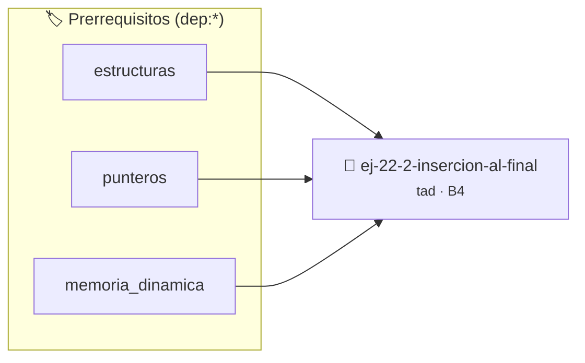

# Inserción al Final
> **ID:** `ej-22-2-insercion-al-final` · **Unidad:** 4 (Tipos Abstractos y Algorítmica)
 · **Tema:** `tad` / `arboles_binarios`
 · **Bloom:** B4 (Analizar) · **Dificultad:** Avanzada
 · **Carga:** ~35 min · **Tipo:** Practica Guiada
>
> **🏷️ Prerrequisitos temáticos (tags):** `dep:estructuras`, `dep:punteros`, `dep:memoria_dinamica`
>
> **Etiquetas conceptuales:** `tad`, `insercion`, `abstraccion`, `final`, `algoritmos`


::: {admonition} 📦 Paquete de Verificación Local (Ripley)
:class: tip

Para compilar, resolver y autoevaluar tu entrega con pruebas unitarias en tu máquina:

- [📥 **Descargar paquete `ej-22-2-insercion-al-final.ripkg`**](../../paquetes/ej-22-2-insercion-al-final.ripkg)

Ejecución con el asistente de cátedra:
```bash
ripley run ej-22-2-insercion-al-final.ripkg
```
:::


### 🗺️ Itinerario Pedagógico




## 📖 Consigna

### Ejercicio 22.2 - Inserción al Final ⭐⭐☆☆☆

Implementar la operación de insertar un elemento al final de la lista. Analizar
la complejidad: $O(n)$ sin puntero al último, $O(1)$ con puntero al último.


:::{hint} Lógica y Consideraciones

-   **[*plus ultra*]:** Validar punteros `NULL` recibidos como parámetro para
    evitar fallos de segmentación.
-   **[*plus ultra*]:** Implementar una versión utilizando aritmética de
    punteros en lugar de indexación directa.

:::
<!-- {hint} Lógica y Consideraciones -->

``` c
bool insertar_al_final(lista_t *lista, int dato);
```
<!-- c -->


## 📋 Prototipos y Cabecera (`ej-22-2-insercion-al-final.h`)

```{code-block} c
#ifndef EJERCICIO_EJ_22_2_INSERCION_AL_FINAL_H
#define EJERCICIO_EJ_22_2_INSERCION_AL_FINAL_H

#include <stddef.h>
#include <stdbool.h>
#include <stdint.h>

/* Procesa el flujo principal de Inserción al Final */
int proc_2_insercion_al_final(int val);

#endif /* EJERCICIO_EJ_22_2_INSERCION_AL_FINAL_H */
```


## ⚙️ Especificación de Funciones

| Función | Retorno | Parámetros | Descripción |
| :--- | :--- | :--- | :--- |

| `proc_2_insercion_al_final` | `int` | `int val` | Procesa el flujo principal de Inserción al Final |


## 💡 Pistas Progresivas

````{tab-set}

```{tab-item} Pista 1
[Plus Ultra] Validar punteros `NULL` recibidos como parámetro para evitar fallos de segmentación.
```

```{tab-item} Pista 2
[Plus Ultra] Implementar una versión utilizando aritmética de punteros en lugar de indexación directa.
```

````


## 🧪 Casos de Prueba

| Prueba Unitaria | Función Objetivo | Verificación |
| :--- | :--- | :--- |

| **test_proc_2_insercion_al_final_positivo** | `proc_2_insercion_al_final` | `int res = proc_2_insercion_al_final(5); assert(res == 10 || res >= 0);` |

| **test_proc_2_insercion_al_final_cero** | `proc_2_insercion_al_final` | `int res = proc_2_insercion_al_final(0); assert(res == 0);` |


## ✓ Solución Modelo de Cátedra

```{dropdown} 🔍 Revelar solución canónica en C
:open: false

```{code-block} c
/*
 * Ejercicio: Inserción al Final
 * Cátedra Programación I - UNRN
 */

#include <stdio.h>


int proc_2_insercion_al_final(int val)
{
    if (val <= 0) return 0;
    return val * 2;
}

int main(void)
{
    /* TODO: Implementación de Inserción al Final */
    return 0;
}
```
```
