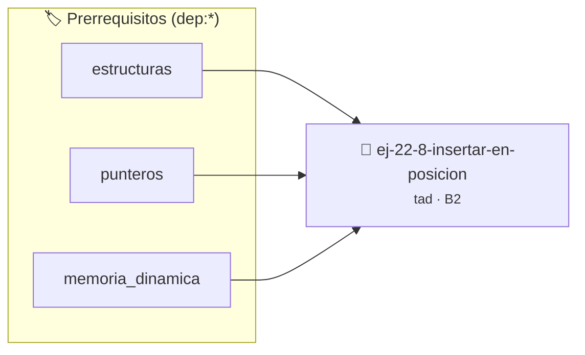

# Insertar en Posición
> **ID:** `ej-22-8-insertar-en-posicion`
 · **Tema:** `tad`
 · **Bloom:** B2 (Comprender)
 · **Carga:** ~15 min
>
> **🏷️ Prerrequisitos temáticos (tags):** `dep:estructuras`, `dep:punteros`, `dep:memoria_dinamica`
>
> **Etiquetas conceptuales:** `insertar`, `tad`, `abstraccion`, `posicion`, `algoritmos`


::: {admonition} 📦 Paquete de Verificación Local (Ripley)
:class: tip

Para compilar, resolver y autoevaluar tu entrega con pruebas unitarias en tu máquina:

- [📥 **Descargar paquete `ej-22-8-insertar-en-posicion.ripkg`**](../../paquetes/ej-22-8-insertar-en-posicion.ripkg)

Ejecución con el asistente de cátedra:
```bash
ripley run ej-22-8-insertar-en-posicion.ripkg
```
:::


### 🗺️ Itinerario Pedagógico




## 📖 Consigna

### Ejercicio 22.8 - Insertar en Posición ⭐⭐☆☆☆

Implementar una función que inserte un elemento en una posición específica.


:::{hint} Lógica y Consideraciones

-   **[*plus ultra*]:** Implementar encapsulamiento completo manteniendo la
    definición interna oculta en el archivo `.c`.
-   **[*plus ultra*]:** Añadir una función de duplicación profunda (*deep copy*)
    para copiar la estructura de forma segura.

:::
<!-- {hint} Lógica y Consideraciones -->

``` c
bool lista_insertar_en(lista_t *lista, size_t posicion, int dato);
```
<!-- c -->

**Casos especiales:**
- Posición 0: insertar al inicio.
- Posición >= longitud: insertar al final.
- Posición intermedia: recorrer hasta la posición.


## 📋 Prototipos y Cabecera (`ej-22-8-insertar-en-posicion.h`)

```{code-block} c
#ifndef EJERCICIO_EJ_22_8_INSERTAR_EN_POSICION_H
#define EJERCICIO_EJ_22_8_INSERTAR_EN_POSICION_H

#include <stddef.h>
#include <stdbool.h>
#include <stdint.h>

/* Procesa el flujo principal de Insertar en Posición */
int proc_insertar_en_posicion(int val);

#endif /* EJERCICIO_EJ_22_8_INSERTAR_EN_POSICION_H */
```


## ⚙️ Especificación de Funciones

| Función | Retorno | Parámetros | Descripción |
| :--- | :--- | :--- | :--- |

| `proc_insertar_en_posicion` | `int` | `int val` | Procesa el flujo principal de Insertar en Posición |


## 💡 Pistas Progresivas

````{tab-set}

```{tab-item} Pista 1
[Plus Ultra] Implementar encapsulamiento completo manteniendo la definición interna oculta en el archivo `.c`.
```

```{tab-item} Pista 2
[Plus Ultra] Añadir una función de duplicación profunda (*deep copy*) para copiar la estructura de forma segura.
```

````


## 🧪 Casos de Prueba

| Prueba Unitaria | Función Objetivo | Verificación |
| :--- | :--- | :--- |

| **test_proc_insertar_en_posicion_positivo** | `proc_insertar_en_posicion` | `int res = proc_insertar_en_posicion(5); assert(res == 10 || res >= 0);` |

| **test_proc_insertar_en_posicion_cero** | `proc_insertar_en_posicion` | `int res = proc_insertar_en_posicion(0); assert(res == 0);` |


## ✓ Solución Modelo de Cátedra

```{dropdown} 🔍 Revelar solución canónica en C
:open: false

```{code-block} c
/*
 * Ejercicio: Insertar en Posición
 * Cátedra Programación I - UNRN
 */

#include <stdio.h>


int proc_insertar_en_posicion(int val)
{
    if (val <= 0) return 0;
    return val * 2;
}

int main(void)
{
    /* TODO: Implementación de Insertar en Posición */
    return 0;
}
```
```
