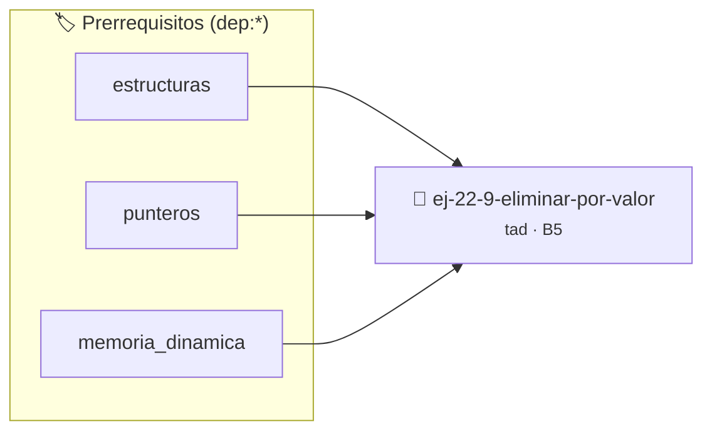

# Eliminar por Valor
> **ID:** `ej-22-9-eliminar-por-valor`
 · **Tema:** `tad`
 · **Bloom:** B5 (Evaluar / Crear)
 · **Carga:** ~45 min
>
> **🏷️ Prerrequisitos temáticos (tags):** `dep:estructuras`, `dep:punteros`, `dep:memoria_dinamica`
>
> **Etiquetas conceptuales:** `tad`, `valor`, `eliminar`, `abstraccion`, `algoritmos`


::: {admonition} 📦 Paquete de Verificación Local (Ripley)
:class: tip

Para compilar, resolver y autoevaluar tu entrega con pruebas unitarias en tu máquina:

- [📥 **Descargar paquete `ej-22-9-eliminar-por-valor.ripkg`**](../../paquetes/ej-22-9-eliminar-por-valor.ripkg)

Ejecución con el asistente de cátedra:
```bash
ripley run ej-22-9-eliminar-por-valor.ripkg
```
:::


### 🗺️ Itinerario Pedagógico




## 📖 Consigna

### Ejercicio 22.9 - Eliminar por Valor ⭐⭐☆☆☆

Implementar la operación de eliminar todas las ocurrencias de un elemento y
liberar sus nodos correspondientes en memoria.


:::{hint} Lógica y Consideraciones

-   **[*plus ultra*]:** Verificar el retorno de asignación de memoria y
    garantizar la liberación total de recursos en caso de error.
-   **[*plus ultra*]:** Verificar la ausencia de fugas de memoria (*memory
    leaks*) mediante Valgrind o AddressSanitizer.

:::
<!-- {hint} Lógica y Consideraciones -->

``` c
bool lista_eliminar(lista_t *lista, int dato);
```
<!-- c -->


## 📋 Prototipos y Cabecera (`ej-22-9-eliminar-por-valor.h`)

```{code-block} c
#ifndef EJERCICIO_EJ_22_9_ELIMINAR_POR_VALOR_H
#define EJERCICIO_EJ_22_9_ELIMINAR_POR_VALOR_H

#include <stddef.h>
#include <stdbool.h>
#include <stdint.h>

/* Procesa el flujo principal de Eliminar por Valor */
int proc_9_eliminar_por_valor(int val);

#endif /* EJERCICIO_EJ_22_9_ELIMINAR_POR_VALOR_H */
```


## ⚙️ Especificación de Funciones

| Función | Retorno | Parámetros | Descripción |
| :--- | :--- | :--- | :--- |

| `proc_9_eliminar_por_valor` | `int` | `int val` | Procesa el flujo principal de Eliminar por Valor |


## 💡 Pistas Progresivas

````{tab-set}

```{tab-item} Pista 1
[Plus Ultra] Verificar el retorno de asignación de memoria y garantizar la liberación total de recursos en caso de error.
```

```{tab-item} Pista 2
[Plus Ultra] Verificar la ausencia de fugas de memoria (*memory leaks*) mediante Valgrind o AddressSanitizer.
```

````


## 🧪 Casos de Prueba

| Prueba Unitaria | Función Objetivo | Verificación |
| :--- | :--- | :--- |

| **test_proc_9_eliminar_por_valor_positivo** | `proc_9_eliminar_por_valor` | `int res = proc_9_eliminar_por_valor(5); assert(res == 10 || res >= 0);` |

| **test_proc_9_eliminar_por_valor_cero** | `proc_9_eliminar_por_valor` | `int res = proc_9_eliminar_por_valor(0); assert(res == 0);` |


## ✓ Solución Modelo de Cátedra

```{dropdown} 🔍 Revelar solución canónica en C
:open: false

```{code-block} c
/*
 * Ejercicio: Eliminar por Valor
 * Cátedra Programación I - UNRN
 */

#include <stdio.h>


int proc_9_eliminar_por_valor(int val)
{
    if (val <= 0) return 0;
    return val * 2;
}

int main(void)
{
    /* TODO: Implementación de Eliminar por Valor */
    return 0;
}
```
```
