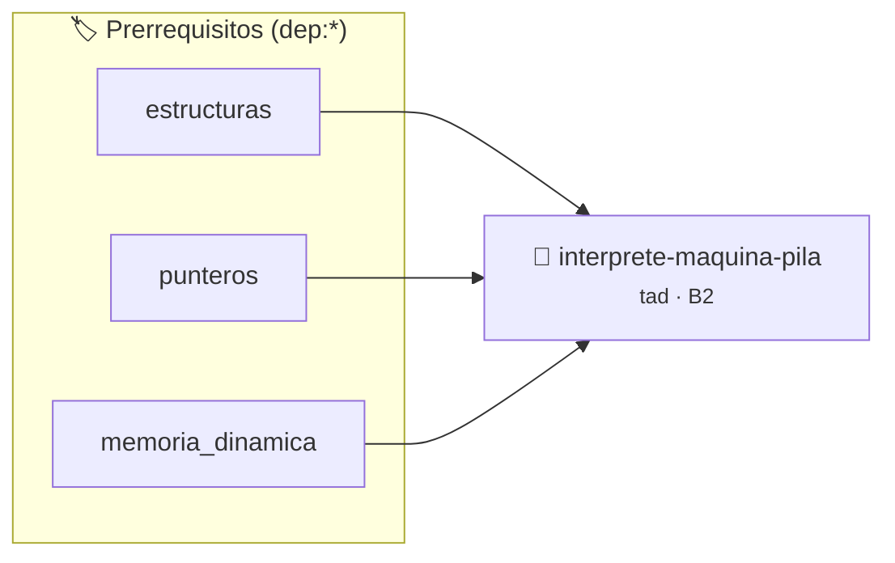

# Intérprete de Bytecode y Máquina Virtual de Pila
> **ID:** `interprete-maquina-pila` · **Unidad:** 4 (Tipos Abstractos y Algorítmica)
 · **Tema:** `tad` / `pilas_y_colas`
 · **Bloom:** B2 (Comprender) · **Dificultad:** Inicial
 · **Carga:** ~15 min · **Tipo:** Practica Guiada
>
> **🏷️ Prerrequisitos temáticos (tags):** `dep:estructuras`, `dep:punteros`, `dep:memoria_dinamica`
>
> **Etiquetas conceptuales:** `tad`, `interprete`, `pila`, `bytecode`, `emulacion`


::: {admonition} 📦 Paquete de Verificación Local (Ripley)
:class: tip

Para compilar, resolver y autoevaluar tu entrega con pruebas unitarias en tu máquina:

- [📥 **Descargar paquete `interprete-maquina-pila.ripkg`**](../../paquetes/interprete-maquina-pila.ripkg)

Ejecución con el asistente de cátedra:
```bash
ripley run interprete-maquina-pila.ripkg
```
:::


### 🗺️ Itinerario Pedagógico




## 📖 Consigna

# Intérprete de Máquina Virtual de Pila

## 1. Consigna
Implementar un intérprete de máquina de pila (*Stack Machine*) para evaluación de secuencias de instrucciones.

Instrucciones soportadas:
- `PUSH <int>`: Empuja un número a la pila.
- `ADD`: Desapila dos valores $A$ y $B$, calcula $B + A$ y apila el resultado.
- `SUB`: Desapila dos valores $A$ y $B$, calcula $B - A$ y apila el resultado.
- `MUL`: Desapila dos valores $A$ y $B$, calcula $B \times A$ y apila el resultado.
- `DIV`: Desapila dos valores $A$ y $B$, calcula $B / A$. Si $A == 0$, emite `ERROR_DIV_ZERO`.
- `DUP`: Duplica el elemento superior de la pila.
- `SWAP`: Intercambia los dos elementos superiores de la pila.
- `POP`: Desapila e imprime el valor superior. Si la pila está vacía, imprime `ERROR_UNDERFLOW`.
- `PEEK`: Muestra el tope sin desapilar.
- `HALT`: Finaliza la ejecución.


## 📋 Prototipos y Cabecera (`interprete-maquina-pila.h`)

```{code-block} c
#ifndef EJERCICIO_INTERPRETE_MAQUINA_PILA_H
#define EJERCICIO_INTERPRETE_MAQUINA_PILA_H

#include <stddef.h>
#include <stdbool.h>
#include <stdint.h>

/* Operación inicializar_pila */
void inicializar_pila(PilaVirtual *p);
/* Operación push */
int push(PilaVirtual *p, long v);
/* Operación pop */
int pop(PilaVirtual *p, long *out);

#endif /* EJERCICIO_INTERPRETE_MAQUINA_PILA_H */
```


## ⚙️ Especificación de Funciones

| Función | Retorno | Parámetros | Descripción |
| :--- | :--- | :--- | :--- |

| `inicializar_pila` | `void` | `PilaVirtual *p` | Operación inicializar_pila |

| `push` | `int` | `PilaVirtual *p, long v` | Operación push |

| `pop` | `int` | `PilaVirtual *p, long *out` | Operación pop |


## 💡 Pistas Progresivas

````{tab-set}

```{tab-item} Pista 1
Mantené un array para la pila con un puntero o índice `sp` (stack pointer).
```

```{tab-item} Pista 2
Verificá siempre que haya suficientes operandos en la pila antes de ejecutar operaciones binarias.
```

```{tab-item} Pista 3
En la operación `DIV`, controlá que el divisor no sea 0 para prevenir crash de división entera.
```

````


## 🧪 Casos de Prueba

| Prueba Unitaria | Función Objetivo | Verificación |
| :--- | :--- | :--- |

| **test_inicializar_pila_1** | `inicializar_pila` | `/* Verificación unitaria de inicializar_pila */ assert(true);` |

| **test_push_2** | `push` | `/* Verificación unitaria de push */ assert(true);` |


## ✓ Solución Modelo de Cátedra

```{dropdown} 🔍 Revelar solución canónica en C
:open: false

```{code-block} c
/*
 * Interprete de Maquina Virtual de Pila
 * Catedra Programacion I - UNRN
 */

#include <stdio.h>
#include <stdlib.h>
#include <string.h>

#define CAPACIDAD_PILA 1024

typedef struct
{
    long datos[CAPACIDAD_PILA];
    int sp;
} PilaVirtual;

void inicializar_pila(PilaVirtual *p)
{
    p->sp = 0;
}

int push(PilaVirtual *p, long v)
{
    if (p->sp >= CAPACIDAD_PILA)
    {
        printf("ERROR_OVERFLOW\n");
        return 0;
    }
    p->datos[p->sp++] = v;
    return 1;
}

int pop(PilaVirtual *p, long *out)
{
    if (p->sp <= 0)
    {
        printf("ERROR_UNDERFLOW\n");
        return 0;
    }
    *out = p->datos[--p->sp];
    return 1;
}

int main(void)
{
    PilaVirtual p;
    inicializar_pila(&p);

    char op[32] = {0};
    long val = 0;

    while (scanf("%31s", op) == 1)
    {
        if (strcmp(op, "PUSH") == 0)
        {
            if (scanf("%ld", &val) == 1)
            {
                push(&p, val);
            }
        }
        else if (strcmp(op, "ADD") == 0)
        {
            long a = 0;
            long b = 0;
            if (pop(&p, &a) && pop(&p, &b))
            {
                push(&p, b + a);
            }
        }
        else if (strcmp(op, "SUB") == 0)
        {
            long a = 0;
            long b = 0;
            if (pop(&p, &a) && pop(&p, &b))
            {
                push(&p, b - a);
            }
        }
        else if (strcmp(op, "MUL") == 0)
        {
            long a = 0;
            long b = 0;
            if (pop(&p, &a) && pop(&p, &b))
            {
                push(&p, b * a);
            }
        }
        else if (strcmp(op, "DIV") == 0)
        {
            long a = 0;
            long b = 0;
            if (pop(&p, &a) && pop(&p, &b))
            {
                if (a == 0)
                {
                    printf("ERROR_DIV_ZERO\n");
                }
                else
                {
                    push(&p, b / a);
                }
            }
        }
        else if (strcmp(op, "DUP") == 0)
        {
            if (p.sp > 0)
            {
                push(&p, p.datos[p.sp - 1]);
            }
            else
            {
                printf("ERROR_UNDERFLOW\n");
            }
        }
        else if (strcmp(op, "SWAP") == 0)
        {
            long a = 0;
            long b = 0;
            if (pop(&p, &a) && pop(&p, &b))
            {
                push(&p, a);
                push(&p, b);
            }
        }
        else if (strcmp(op, "POP") == 0)
        {
            long a = 0;
            if (pop(&p, &a))
            {
                printf("%ld\n", a);
            }
        }
        else if (strcmp(op, "PEEK") == 0)
        {
            if (p.sp > 0)
            {
                printf("%ld\n", p.datos[p.sp - 1]);
            }
            else
            {
                printf("ERROR_UNDERFLOW\n");
            }
        }
        else if (strcmp(op, "HALT") == 0)
        {
            break;
        }
    }

    return 0;
}
```
```
