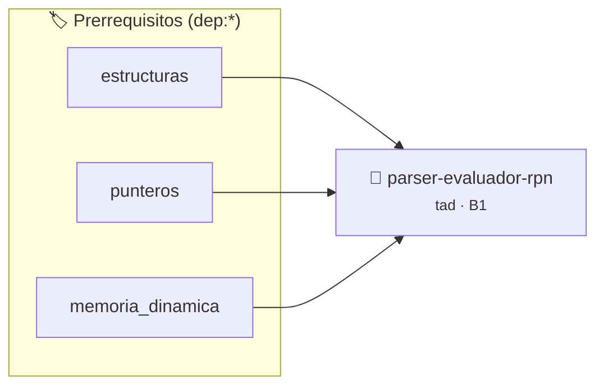

# Evaluador de Expresiones en Notación Polaca Inversa (RPN)
> **ID:** `parser-evaluador-rpn`
 · **Tema:** `tad`
 · **Bloom:** B1 (Recordar)
 · **Carga:** ~10 min
>
> **🏷️ Prerrequisitos temáticos (tags):** `dep:estructuras`, `dep:punteros`, `dep:memoria_dinamica`
>
> **Etiquetas conceptuales:** `tad`, `pila`, `rpn`, `parsing`, `aritmetica`


::: {admonition} 📦 Paquete de Verificación Local (Ripley)
:class: tip

Para compilar, resolver y autoevaluar tu entrega con pruebas unitarias en tu máquina:

- [📥 **Descargar paquete `parser-evaluador-rpn.ripkg`**](../../paquetes/parser-evaluador-rpn.ripkg)

Ejecución con el asistente de cátedra:
```bash
ripley run parser-evaluador-rpn.ripkg
```
:::


### 🗺️ Itinerario Pedagógico




## 📖 Consigna

# Evaluador de Expresiones en Notación Polaca Inversa (RPN)

## 1. Consigna
Implementar un evaluador de expresiones aritméticas escritas en Notación Polaca Inversa (RPN / Postfija) utilizando un TAD Pila.

El programa debe leer líneas con expresiones RPN donde los tokens están separados por espacios.
Operadores binarios soportados: `+`, `-`, `*`, `/`.

Para cada línea leída:
- Si la expresión es válida y queda un único elemento final en la pila, imprime `RES: <valor>`.
- Si hay división por cero, imprime `ERROR: DIV_ZERO`.
- Si la sintaxis es inválida (faltan operandos o sobran valores al final), imprime `ERROR: SINTAXIS`.
- El comando `EXIT` termina el programa.


## 📋 Prototipos y Cabecera (`parser-evaluador-rpn.h`)

```{code-block} c
#ifndef EJERCICIO_PARSER_EVALUADOR_RPN_H
#define EJERCICIO_PARSER_EVALUADOR_RPN_H

#include <stddef.h>
#include <stdbool.h>
#include <stdint.h>

/* Operación rpn_init */
void rpn_init(PilaRPN *p);
/* Operación rpn_push */
int rpn_push(PilaRPN *p, long v);
/* Operación rpn_pop */
int rpn_pop(PilaRPN *p, long *out);
/* Operación evaluar_linea */
void evaluar_linea(char *linea);

#endif /* EJERCICIO_PARSER_EVALUADOR_RPN_H */
```


## ⚙️ Especificación de Funciones

| Función | Retorno | Parámetros | Descripción |
| :--- | :--- | :--- | :--- |

| `rpn_init` | `void` | `PilaRPN *p` | Operación rpn_init |

| `rpn_push` | `int` | `PilaRPN *p, long v` | Operación rpn_push |

| `rpn_pop` | `int` | `PilaRPN *p, long *out` | Operación rpn_pop |

| `evaluar_linea` | `void` | `char *linea` | Operación evaluar_linea |


## 💡 Pistas Progresivas

````{tab-set}

```{tab-item} Pista 1
Tokenizá la entrada por espacios.
```

```{tab-item} Pista 2
Si el token es un operador (+, -, *, /), desapilá dos operandos, calculá op(b, a) y apilá el resultado.
```

```{tab-item} Pista 3
Si es un número, convertilo con strtol() o atoi() y apilalo en la pila de evaluación.
```

````


## 🧪 Casos de Prueba

| Prueba Unitaria | Función Objetivo | Verificación |
| :--- | :--- | :--- |

| **test_rpn_init_1** | `rpn_init` | `/* Verificación unitaria de rpn_init */ assert(true);` |

| **test_rpn_push_2** | `rpn_push` | `/* Verificación unitaria de rpn_push */ assert(true);` |


## ✓ Solución Modelo de Cátedra

```{dropdown} 🔍 Revelar solución canónica en C
:open: false

```{code-block} c
/*
 * Evaluador de Expresiones en Notacion Polaca Inversa (RPN)
 * Catedra Programacion I - UNRN
 */

#include <ctype.h>
#include <stdio.h>
#include <stdlib.h>
#include <string.h>

#define MAX_PILA 256

typedef struct
{
    long datos[MAX_PILA];
    int tope;
} PilaRPN;

void rpn_init(PilaRPN *p)
{
    p->tope = 0;
}

int rpn_push(PilaRPN *p, long v)
{
    if (p->tope >= MAX_PILA)
    {
        return 0;
    }
    p->datos[p->tope++] = v;
    return 1;
}

int rpn_pop(PilaRPN *p, long *out)
{
    if (p->tope <= 0)
    {
        return 0;
    }
    *out = p->datos[--p->tope];
    return 1;
}

void evaluar_linea(char *linea)
{
    PilaRPN p;
    rpn_init(&p);

    char *token = strtok(linea, " \t\r\n");
    int error_div_zero = 0;
    int error_sintaxis = 0;

    while (token != NULL)
    {
        if (strcmp(token, "+") == 0 || strcmp(token, "-") == 0 ||
            strcmp(token, "*") == 0 || strcmp(token, "/") == 0)
        {
            long a = 0;
            long b = 0;
            if (!rpn_pop(&p, &a) || !rpn_pop(&p, &b))
            {
                error_sintaxis = 1;
                break;
            }
            if (strcmp(token, "+") == 0)
            {
                rpn_push(&p, b + a);
            }
            else if (strcmp(token, "-") == 0)
            {
                rpn_push(&p, b - a);
            }
            else if (strcmp(token, "*") == 0)
            {
                rpn_push(&p, b * a);
            }
            else if (strcmp(token, "/") == 0)
            {
                if (a == 0)
                {
                    error_div_zero = 1;
                    break;
                }
                rpn_push(&p, b / a);
            }
        }
        else
        {
            char *endptr = NULL;
            long val = strtol(token, &endptr, 10);
            if (endptr == token)
            {
                error_sintaxis = 1;
                break;
            }
            if (!rpn_push(&p, val))
            {
                error_sintaxis = 1;
                break;
            }
        }
        token = strtok(NULL, " \t\r\n");
    }

    if (error_div_zero)
    {
        printf("ERROR: DIV_ZERO\n");
    }
    else if (error_sintaxis || p.tope != 1)
    {
        printf("ERROR: SINTAXIS\n");
    }
    else
    {
        printf("RES: %ld\n", p.datos[0]);
    }
}

int main(void)
{
    char linea[1024] = {0};

    while (fgets(linea, sizeof(linea), stdin) != NULL)
    {
        if (strncmp(linea, "EXIT", 4) == 0 && (linea[4] == '\n' || linea[4] == '\0' || linea[4] == '\r'))
        {
            break;
        }
        if (linea[0] == '\n' || linea[0] == '\r')
        {
            continue;
        }
        evaluar_linea(linea);
    }

    return 0;
}
```
```
