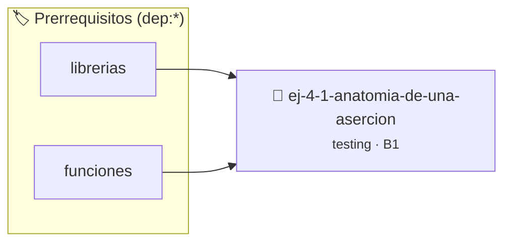

# Anatomía de una aserción
> **ID:** `ej-4-1-anatomia-de-una-asercion` · **Unidad:** 5 (Ingeniería de Software y Calidad en C)
 · **Tema:** `testing` / `aserciones_defensivas`
 · **Bloom:** B1 (Recordar) · **Dificultad:** Inicial
 · **Carga:** ~10 min · **Tipo:** Concepto
>
> **🏷️ Prerrequisitos temáticos (tags):** `dep:librerias`, `dep:funciones`
>
> **Etiquetas conceptuales:** `aserciones`, `fundamentos`, `asercion`, `testing`, `anatomia`


::: {admonition} 📦 Paquete de Verificación Local (Ripley)
:class: tip

Para compilar, resolver y autoevaluar tu entrega con pruebas unitarias en tu máquina:

- [📥 **Descargar paquete `ej-4-1-anatomia-de-una-asercion.ripkg`**](../../paquetes/ej-4-1-anatomia-de-una-asercion.ripkg)

Ejecución con el asistente de cátedra:
```bash
ripley run ej-4-1-anatomia-de-una-asercion.ripkg
```
:::


### 🗺️ Itinerario Pedagógico




## 📖 Consigna

:::{exercise}
:label: ej-test-anatomia
Analizá el siguiente código y respondé:
1. ¿Qué biblioteca estándar se debe incluir para utilizar la macro `assert`?
2. ¿Qué ocurre exactamente en tiempo de ejecución si la condición evaluada
   resulta verdadera (`true`)?
3. ¿Qué ocurre si la condición resulta falsa (`false`)?

```{code-block} c
:linenos:
#include <assert.h>

int cuadrado(int n)
{
    return n * n;
}

int main(void)
{
    assert(cuadrado(4) == 16);
    assert(cuadrado(-3) == 9);
    return 0;
}

```

-   **[*plus ultra*]:** Explicar qué información diagnóstica imprime `assert` en
    la consola al fallar (archivo, línea, expresión y función).
-   **[*plus ultra*]:** Investigar qué efecto produce la macro `#define NDEBUG`
    colocada antes de `#include <assert.h>`.

:::

:::{solution} ej-test-anatomia
:class: dropdown
1. Se incluye `<assert.h>`.
2. Si la condición es `true`, el programa continúa su ejecución normal sin
   ninguna interrupción ni mensaje.
3. Si la condición es `false`, la macro `assert` aborta inmediatamente el
   programa con `SIGABRT` e imprime en `stderr` el nombre del archivo, el número
   de línea, la función y el texto exacto de la condición que falló.

:::

---

### 📋 Contrato de las Funciones

```c
/*
 * Operación cuadrado
 * Precondiciones: Parámetros dentro del dominio válido de la operación.
 * Postcondiciones: Retorna el valor procesado.
 */
int cuadrado(int n);

```

### 🧪 Ejemplos de Ejecución

::::{tab-set}
:::{tab-item} Valor positivo
```text
Entrada: 1
Salida / Retorno: 2
```
:::
::::

### ⚠️ Precondiciones y Casos Borde

1. **Valores fuera de rango:** Verificar siempre que los datos de entrada cumplan con los rangos admisibles antes de operar.
6. **Casos vacíos o neutros:** Contemplar adecuadamente entradas con longitud cero o valores neutros según corresponda.

### 🎯 Criterios de Aceptación

- [ ] El código compila limpiamente bajo estándar C11 sin warnings con flags estrictos (`-Wall -Wextra -Werror`).
- [ ] Se satisfacen todas las pruebas unitarias y casos de prueba provistos.
- [ ] Las funciones validan exhaustivamente sus precondiciones y gestionan casos borde de forma robusta.


## 📋 Prototipos y Cabecera (`ej-4-1-anatomia-de-una-asercion.h`)

```{code-block} c
#ifndef EJERCICIO_EJ_4_1_ANATOMIA_DE_UNA_ASERCION_H
#define EJERCICIO_EJ_4_1_ANATOMIA_DE_UNA_ASERCION_H

#include <stddef.h>
#include <stdbool.h>
#include <stdint.h>

/* Operación cuadrado */
int cuadrado(int n);

#endif /* EJERCICIO_EJ_4_1_ANATOMIA_DE_UNA_ASERCION_H */
```


## ⚙️ Especificación de Funciones

| Función | Retorno | Parámetros | Descripción |
| :--- | :--- | :--- | :--- |

| `cuadrado` | `int` | `int n` | Operación cuadrado |


## 🧪 Casos de Prueba

| Prueba Unitaria | Función Objetivo | Verificación |
| :--- | :--- | :--- |

| **test_cuadrado_1** | `cuadrado` | `/* Verificación unitaria de cuadrado */ int res = cuadrado(1); (void)res; assert(true);` |


## ✓ Solución Modelo de Cátedra

```{dropdown} 🔍 Revelar solución canónica en C
:open: false

```{code-block} c
#include <assert.h>

int cuadrado(int n)
{
    return n * n;
}

int main(void)
{
    assert(cuadrado(4) == 16);
    assert(cuadrado(-3) == 9);
    return 0;
}
```
```
