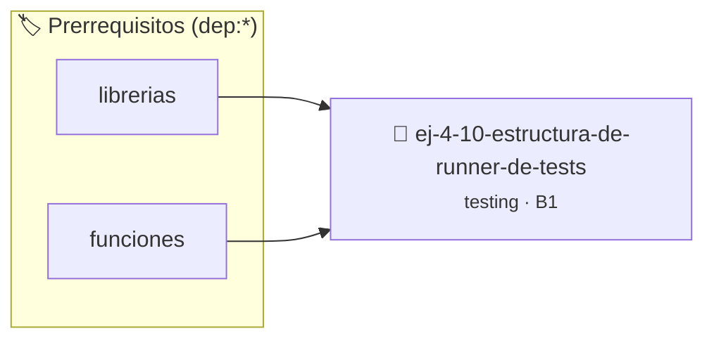

# Estructura de Runner de Tests sin bibliotecas
> **ID:** `ej-4-10-estructura-de-runner-de-tests`
 · **Tema:** `testing`
 · **Bloom:** B1 (Recordar)
 · **Carga:** ~10 min
>
> **🏷️ Prerrequisitos temáticos (tags):** `dep:librerias`, `dep:funciones`
>
> **Etiquetas conceptuales:** `aserciones`, `fundamentos`, `runner`, `testing`, `bibliotecas`


::: {admonition} 📦 Paquete de Verificación Local (Ripley)
:class: tip

Para compilar, resolver y autoevaluar tu entrega con pruebas unitarias en tu máquina:

- [📥 **Descargar paquete `ej-4-10-estructura-de-runner-de-tests.ripkg`**](../../paquetes/ej-4-10-estructura-de-runner-de-tests.ripkg)

Ejecución con el asistente de cátedra:
```bash
ripley run ej-4-10-estructura-de-runner-de-tests.ripkg
```
:::


### 🗺️ Itinerario Pedagógico




## 📖 Consigna

### Ejercicio 4.10 - Estructura de Runner de Tests sin bibliotecas ⭐⭐☆☆☆

:::{exercise}
:label: ej-test-runner-basico
Implementá un pequeño ejecutor de pruebas en C con retorno de conteos en `main`
para contabilizar pruebas ejecutadas y aprobadas sin usar variables globales.

-   **[*plus ultra*]:** Mostrar un resumen final con el total de tests exitosos.
-   **[*plus ultra*]:** Asegurar que el código de salida del programa sea 0 si
    todos pasan y 1 si alguno falla.

:::
<!-- {exercise} -->

:::{solution} ej-test-runner-basico
:class: dropdown
```{code-block} c
:linenos:
#include <assert.h>
#include <stdio.h>

int test_cuadrado_positivo(void)
{
    assert(2 * 2 == 4);
    return 1;
}

int test_cuadrado_cero(void)
{
    assert(0 * 0 == 0);
    return 1;
}

int main(void)
{
    int pasados = 0;
    int totales = 0;

    totales++;
    pasados += test_cuadrado_positivo();

    totales++;
    pasados += test_cuadrado_cero();

    printf("Resultados: %d/%d tests aprobados.\n", pasados, totales);
    return (pasados == totales) ? 0 : 1;
}

```
<!-- {code-block} c -->

:::
<!-- {solution} ej-test-runner-basico -->

---

## 2. Variables Globales y Efectos Colaterales


## 📋 Prototipos y Cabecera (`ej-4-10-estructura-de-runner-de-tests.h`)

```{code-block} c
#ifndef EJERCICIO_EJ_4_10_ESTRUCTURA_DE_RUNNER_DE_TESTS_H
#define EJERCICIO_EJ_4_10_ESTRUCTURA_DE_RUNNER_DE_TESTS_H

#include <stddef.h>
#include <stdbool.h>
#include <stdint.h>

/* Operación test_cuadrado_positivo */
int test_cuadrado_positivo(void);
/* Operación test_cuadrado_cero */
int test_cuadrado_cero(void);

#endif /* EJERCICIO_EJ_4_10_ESTRUCTURA_DE_RUNNER_DE_TESTS_H */
```


## ⚙️ Especificación de Funciones

| Función | Retorno | Parámetros | Descripción |
| :--- | :--- | :--- | :--- |

| `test_cuadrado_positivo` | `int` | `void` | Operación test_cuadrado_positivo |

| `test_cuadrado_cero` | `int` | `void` | Operación test_cuadrado_cero |


## 💡 Pistas Progresivas

````{tab-set}

```{tab-item} Pista 1
Diseñá una macro o función de aserción que contabilice tests aprobados y fallidos sin abortar abruptamente.
```

```{tab-item} Pista 2
Imprimí un resumen claro con el nombre del test, estado (PASS/FAIL) y total de pruebas ejecutadas.
```

```{tab-item} Pista 3
Retorná un código de salida no nulo si al menos una prueba falló para integrar con pipelines CI.
```

````


## 🧪 Casos de Prueba

| Prueba Unitaria | Función Objetivo | Verificación |
| :--- | :--- | :--- |

| **test_test_cuadrado_positivo_1** | `test_cuadrado_positivo` | `/* Verificación unitaria de test_cuadrado_positivo */ int r = test_cuadrado_positivo(); (void)r; assert(true);` |

| **test_test_cuadrado_cero_2** | `test_cuadrado_cero` | `/* Verificación unitaria de test_cuadrado_cero */ int r = test_cuadrado_cero(); (void)r; assert(true);` |


## ✓ Solución Modelo de Cátedra

```{dropdown} 🔍 Revelar solución canónica en C
:open: false

```{code-block} c
#include <assert.h>
#include <stdio.h>

int test_cuadrado_positivo(void)
{
    assert(2 * 2 == 4);
    return 1;
}

int test_cuadrado_cero(void)
{
    assert(0 * 0 == 0);
    return 1;
}

int main(void)
{
    int pasados = 0;
    int totales = 0;

    totales++;
    pasados += test_cuadrado_positivo();

    totales++;
    pasados += test_cuadrado_cero();

    printf("Resultados: %d/%d tests aprobados.\n", pasados, totales);
    return (pasados == totales) ? 0 : 1;
}
```
```
