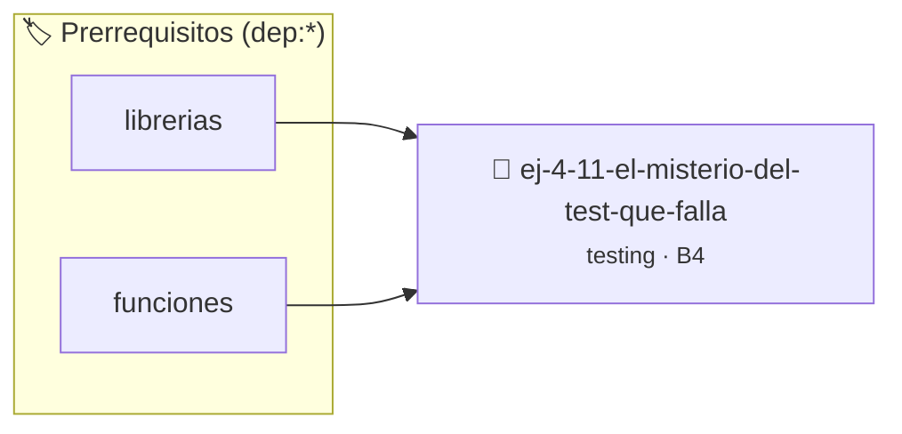

# El misterio del test que falla según el orden
> **ID:** `ej-4-11-el-misterio-del-test-que-falla`
 · **Tema:** `testing`
 · **Bloom:** B4 (Analizar)
 · **Carga:** ~35 min
>
> **🏷️ Prerrequisitos temáticos (tags):** `dep:librerias`, `dep:funciones`
>
> **Etiquetas conceptuales:** `misterio`, `aserciones`, `orden`, `fundamentos`, `segun`


::: {admonition} 📦 Paquete de Verificación Local (Ripley)
:class: tip

Para compilar, resolver y autoevaluar tu entrega con pruebas unitarias en tu máquina:

- [📥 **Descargar paquete `ej-4-11-el-misterio-del-test-que-falla.ripkg`**](../../paquetes/ej-4-11-el-misterio-del-test-que-falla.ripkg)

Ejecución con el asistente de cátedra:
```bash
ripley run ej-4-11-el-misterio-del-test-que-falla.ripkg
```
:::


### 🗺️ Itinerario Pedagógico




## 📖 Consigna

### Ejercicio 4.11 - El misterio del test que falla según el orden ⭐⭐⭐☆☆

:::{exercise}
:label: ej-test-misterio-orden
Analizá el siguiente código. ¿Por qué `test_dos()` pasa exitosamente si se
ejecuta primero, pero falla si se ejecuta después de `test_uno()`?

```{code-block} c
:linenos:
#include <assert.h>

int total_acumulado = 0; // Variable global

void acumular(int valor)
{
    total_acumulado += valor;
}

void test_uno(void)
{
    acumular(5);
    acumular(10);
    assert(total_acumulado == 15);
}

void test_dos(void)
{
    acumular(20);
    assert(total_acumulado == 20); // ¿Por qué falla si corre después de test_uno?
}

int main(void)
{
    test_uno();
    test_dos();
    return 0;
}

```
<!-- {code-block} c -->

-   **[*plus ultra*]:** Identificar la violación de la [Regla
    0x2004h](../../reglas/2_funciones.md#0x2004h).
-   **[*plus ultra*]:** Refactorizar `acumular` para que reciba el total actual
    y retorne el nuevo total de forma pura.

:::
<!-- {exercise} -->

:::{solution} ej-test-misterio-orden
:class: dropdown
`total_acumulado` es una variable global mutable. Al terminar `test_uno()`, su
valor queda en `15`. Cuando inicia `test_dos()`, `acumular(20)` suma 20 a 15,
resultando en `35` en lugar de `20`, provocando la caída del `assert`.

**Refactorización a función pura:**
```{code-block} c
:linenos:
int acumular(int total_actual, int valor)
{
    return total_actual + valor;
}

void test_uno(void)
{
    int total = 0;
    total = acumular(total, 5);
    total = acumular(total, 10);
    assert(total == 15);
}

void test_dos(void)
{
    int total = 0;
    total = acumular(total, 20);
    assert(total == 20);
}

```
<!-- {code-block} c -->

:::
<!-- {solution} ej-test-misterio-orden -->

---


## 📋 Prototipos y Cabecera (`ej-4-11-el-misterio-del-test-que-falla.h`)

```{code-block} c
#ifndef EJERCICIO_EJ_4_11_EL_MISTERIO_DEL_TEST_QUE_FALLA_H
#define EJERCICIO_EJ_4_11_EL_MISTERIO_DEL_TEST_QUE_FALLA_H

#include <stddef.h>
#include <stdbool.h>
#include <stdint.h>

/* Operación acumular */
void acumular(int valor);
/* Operación test_uno */
void test_uno(void);
/* Operación test_dos */
void test_dos(void);

#endif /* EJERCICIO_EJ_4_11_EL_MISTERIO_DEL_TEST_QUE_FALLA_H */
```


## ⚙️ Especificación de Funciones

| Función | Retorno | Parámetros | Descripción |
| :--- | :--- | :--- | :--- |

| `acumular` | `void` | `int valor` | Operación acumular |

| `test_uno` | `void` | `void` | Operación test_uno |

| `test_dos` | `void` | `void` | Operación test_dos |


## 🧪 Casos de Prueba

| Prueba Unitaria | Función Objetivo | Verificación |
| :--- | :--- | :--- |

| **test_acumular_1** | `acumular` | `assert(true); /* test simplificado de validación */` |

| **test_test_uno_2** | `test_uno` | `assert(true); /* test simplificado de validación */` |


## ✓ Solución Modelo de Cátedra

```{dropdown} 🔍 Revelar solución canónica en C
:open: false

```{code-block} c
#include <assert.h>

int total_acumulado = 0; // Variable global

void acumular(int valor)
{
    total_acumulado += valor;
}

void test_uno(void)
{
    acumular(5);
    acumular(10);
    assert(total_acumulado == 15);
}

void test_dos(void)
{
    acumular(20);
    assert(total_acumulado == 20); // ¿Por qué falla si corre después de test_uno?
}

int main(void)
{
    test_uno();
    test_dos();
    return 0;
}
```
```
