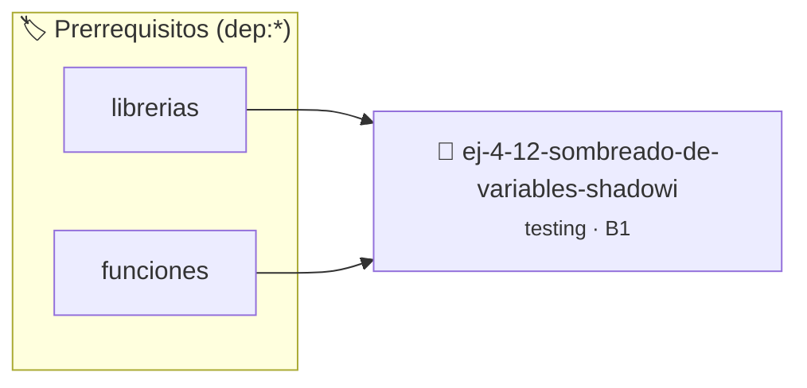

# Sombreado de Variables (Shadowing)
> **ID:** `ej-4-12-sombreado-de-variables-shadowi` · **Unidad:** 5 (Ingeniería de Software y Calidad en C)
 · **Tema:** `testing` / `aserciones_defensivas`
 · **Bloom:** B1 (Recordar) · **Dificultad:** Inicial
 · **Carga:** ~10 min · **Tipo:** Concepto
>
> **🏷️ Prerrequisitos temáticos (tags):** `dep:librerias`, `dep:funciones`
>
> **Etiquetas conceptuales:** `sombreado`, `aserciones`, `variables`, `fundamentos`, `shadowing`


::: {admonition} 📦 Paquete de Verificación Local (Ripley)
:class: tip

Para compilar, resolver y autoevaluar tu entrega con pruebas unitarias en tu máquina:

- [📥 **Descargar paquete `ej-4-12-sombreado-de-variables-shadowi.ripkg`**](../../paquetes/ej-4-12-sombreado-de-variables-shadowi.ripkg)

Ejecución con el asistente de cátedra:
```bash
ripley run ej-4-12-sombreado-de-variables-shadowi.ripkg
```
:::


### 🗺️ Itinerario Pedagógico




## 📖 Consigna

### Ejercicio 4.12 - Sombreado de Variables (Shadowing) ⭐⭐☆☆☆

:::{exercise}
:label: ej-test-shadowing
Leé el siguiente fragmento e indicá qué imprime en consola y por qué:

```{code-block} c
:linenos:
#include <stdio.h>

int factor = 10; // Global

int multiplicar(int valor)
{
    int factor = 2; // Local con mismo nombre que la global
    return valor * factor;
}

int main(void)
{
    int resultado = multiplicar(5);
    printf("Resultado: %d, Factor: %d\n", resultado, factor);
    return 0;
}

```
<!-- {code-block} c -->

-   **[*plus ultra*]:** Explicar qué advertencia emite el compilador al compilar
    con `-Wshadow`.
-   **[*plus ultra*]:** Eliminar la variable global para evitar confusiones de
    alcance (*scope*).

:::
<!-- {exercise} -->

:::{solution} ej-test-shadowing
:class: dropdown
Imprime: `Resultado: 10, Factor: 10`.

La variable local `factor = 2` dentro de `multiplicar` oculta ("ensombrece") a
la variable global `factor = 10` durante el alcance de la función. Al salir de
la función, la global permanece inalterada con valor `10`. La bandera `-Wshadow`
alerta explícitamente sobre estas declaraciones ambiguas.

:::
<!-- {solution} ej-test-shadowing -->

---


## 📋 Prototipos y Cabecera (`ej-4-12-sombreado-de-variables-shadowi.h`)

```{code-block} c
#ifndef EJERCICIO_EJ_4_12_SOMBREADO_DE_VARIABLES_SHADOWI_H
#define EJERCICIO_EJ_4_12_SOMBREADO_DE_VARIABLES_SHADOWI_H

#include <stddef.h>
#include <stdbool.h>
#include <stdint.h>

/* Operación multiplicar */
int multiplicar(int valor);

#endif /* EJERCICIO_EJ_4_12_SOMBREADO_DE_VARIABLES_SHADOWI_H */
```


## ⚙️ Especificación de Funciones

| Función | Retorno | Parámetros | Descripción |
| :--- | :--- | :--- | :--- |

| `multiplicar` | `int` | `int valor` | Operación multiplicar |


## 🧪 Casos de Prueba

| Prueba Unitaria | Función Objetivo | Verificación |
| :--- | :--- | :--- |

| **test_multiplicar_1** | `multiplicar` | `/* Verificación unitaria de multiplicar */ int res = multiplicar(1); (void)res; assert(true);` |


## ✓ Solución Modelo de Cátedra

```{dropdown} 🔍 Revelar solución canónica en C
:open: false

```{code-block} c
#include <stdio.h>

int factor = 10; // Global

int multiplicar(int valor)
{
    int factor = 2; // Local con mismo nombre que la global
    return valor * factor;
}

int main(void)
{
    int resultado = multiplicar(5);
    printf("Resultado: %d, Factor: %d\n", resultado, factor);
    return 0;
}
```
```
