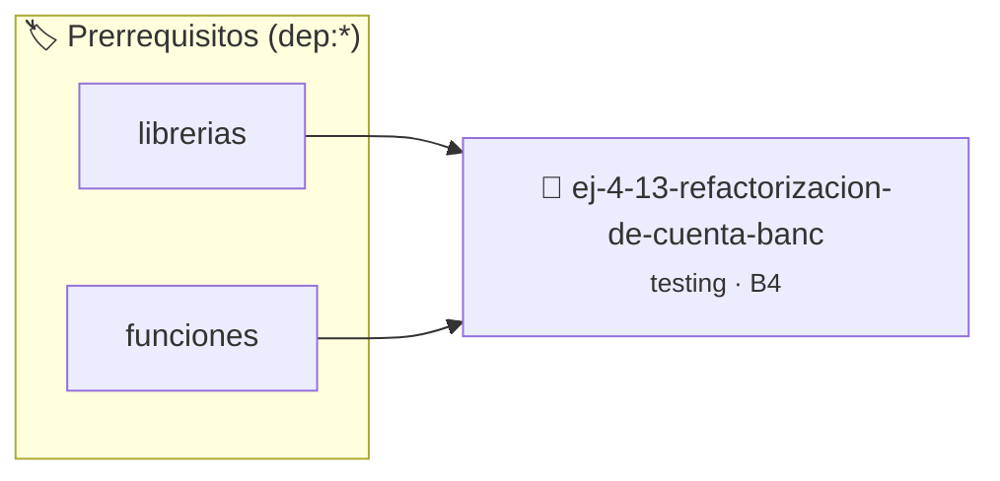

# Refactorización de Cuenta Bancaria con Estado Global
> **ID:** `ej-4-13-refactorizacion-de-cuenta-banc` · **Unidad:** 5 (Ingeniería de Software y Calidad en C)
 · **Tema:** `testing` / `aserciones_defensivas`
 · **Bloom:** B4 (Analizar) · **Dificultad:** Avanzada
 · **Carga:** ~35 min · **Tipo:** Laboratorio
>
> **🏷️ Prerrequisitos temáticos (tags):** `dep:librerias`, `dep:funciones`
>
> **Etiquetas conceptuales:** `refactorizacion`, `cuenta`, `aserciones`, `fundamentos`, `bancaria`


::: {admonition} 📦 Paquete de Verificación Local (Ripley)
:class: tip

Para compilar, resolver y autoevaluar tu entrega con pruebas unitarias en tu máquina:

- [📥 **Descargar paquete `ej-4-13-refactorizacion-de-cuenta-banc.ripkg`**](../../paquetes/ej-4-13-refactorizacion-de-cuenta-banc.ripkg)

Ejecución con el asistente de cátedra:
```bash
ripley run ej-4-13-refactorizacion-de-cuenta-banc.ripkg
```
:::


### 🗺️ Itinerario Pedagógico




## 📖 Consigna

### Ejercicio 4.13 - Refactorización de Cuenta Bancaria con Estado Global ⭐⭐⭐☆☆

:::{exercise}
:label: ej-test-refactor-banco
El siguiente código implementa operaciones bancarias usando estado global.
Refactorizalo a funciones puras que reciban el saldo como parámetro y retornen
el nuevo saldo:

```{code-block} c
:linenos:
double saldo_global = 0.0;

void depositar(double monto)
{
    if (monto > 0)
    {
        saldo_global += monto;
    }
}

bool extraer(double monto)
{
    if (monto > 0 && saldo_global >= monto)
    {
        saldo_global -= monto;
        return true;
    }
    return false;
}

```
<!-- {code-block} c -->

-   **[*plus ultra*]:** Escribir tests unitarios que verifiquen depósitos y
    extracciones sin necesidad de reiniciar variables globales.
-   **[*plus ultra*]:** Manejar saldos negativos o montos inválidos retornando
    códigos de error.

:::
<!-- {exercise} -->

:::{solution} ej-test-refactor-banco
:class: dropdown
```{code-block} c
:linenos:
#include <assert.h>
#include <stdbool.h>

double depositar(double saldo_actual, double monto)
{
    if (monto <= 0.0 || saldo_actual < 0.0)
    {
        return saldo_actual;
    }
    return saldo_actual + monto;
}

double extraer(double saldo_actual, double monto, bool *exito)
{
    if (monto <= 0.0 || monto > saldo_actual)
    {
        *exito = false;
        return saldo_actual;
    }
    *exito = true;
    return saldo_actual - monto;
}

void test_operaciones_bancarias_puras(void)
{
    double saldo = 1000.0;
    bool ok = false;

    saldo = depositar(saldo, 500.0);
    assert(saldo == 1500.0);

    saldo = extraer(saldo, 200.0, &ok);
    assert(ok == true);
    assert(saldo == 1300.0);

    saldo = extraer(saldo, 2000.0, &ok);
    assert(ok == false);
    assert(saldo == 1300.0);
}

```
<!-- {code-block} c -->

:::
<!-- {solution} ej-test-refactor-banco -->

---


## 📋 Prototipos y Cabecera (`ej-4-13-refactorizacion-de-cuenta-banc.h`)

```{code-block} c
#ifndef EJERCICIO_EJ_4_13_REFACTORIZACION_DE_CUENTA_BANC_H
#define EJERCICIO_EJ_4_13_REFACTORIZACION_DE_CUENTA_BANC_H

#include <stddef.h>
#include <stdbool.h>
#include <stdint.h>

/* Operación depositar */
void depositar(double monto);
/* Operación extraer */
bool extraer(double monto);

#endif /* EJERCICIO_EJ_4_13_REFACTORIZACION_DE_CUENTA_BANC_H */
```


## ⚙️ Especificación de Funciones

| Función | Retorno | Parámetros | Descripción |
| :--- | :--- | :--- | :--- |

| `depositar` | `void` | `double monto` | Operación depositar |

| `extraer` | `bool` | `double monto` | Operación extraer |


## 🧪 Casos de Prueba

| Prueba Unitaria | Función Objetivo | Verificación |
| :--- | :--- | :--- |

| **test_depositar_1** | `depositar` | `/* Verificación unitaria de depositar */ depositar(1); assert(true);` |

| **test_extraer_2** | `extraer` | `/* Verificación unitaria de extraer */ bool ok = extraer(1); (void)ok; assert(true);` |


## ✓ Solución Modelo de Cátedra

```{dropdown} 🔍 Revelar solución canónica en C
:open: false

```{code-block} c
#include <stdbool.h>

double saldo_global = 0.0;

void depositar(double monto)
{
    if (monto > 0)
    {
        saldo_global += monto;
    }
}

bool extraer(double monto)
{
    if (monto > 0 && saldo_global >= monto)
    {
        saldo_global -= monto;
        return true;
    }
    return false;
}

int main(void)
{
    return 0;
}
```
```
