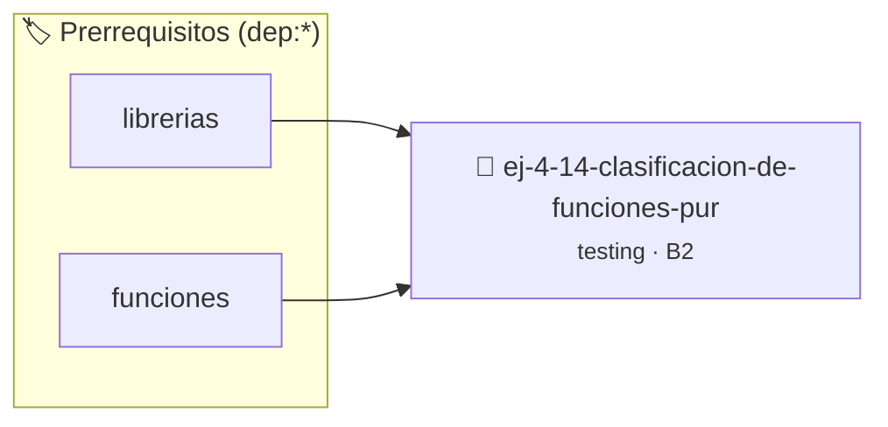

# Clasificación de funciones: Puras vs Impuras
> **ID:** `ej-4-14-clasificacion-de-funciones-pur` · **Unidad:** 5 (Ingeniería de Software y Calidad en C)
 · **Tema:** `testing` / `aserciones_defensivas`
 · **Bloom:** B2 (Comprender) · **Dificultad:** Inicial
 · **Carga:** ~15 min · **Tipo:** Laboratorio
>
> **🏷️ Prerrequisitos temáticos (tags):** `dep:librerias`, `dep:funciones`
>
> **Etiquetas conceptuales:** `aserciones`, `fundamentos`, `funciones`, `puras`, `impuras`


::: {admonition} 📦 Paquete de Verificación Local (Ripley)
:class: tip

Para compilar, resolver y autoevaluar tu entrega con pruebas unitarias en tu máquina:

- [📥 **Descargar paquete `ej-4-14-clasificacion-de-funciones-pur.ripkg`**](../../paquetes/ej-4-14-clasificacion-de-funciones-pur.ripkg)

Ejecución con el asistente de cátedra:
```bash
ripley run ej-4-14-clasificacion-de-funciones-pur.ripkg
```
:::


### 🗺️ Itinerario Pedagógico




## 📖 Consigna

:::{exercise}
:label: ej-test-puras-vs-impuras
Clasificá cada una de las siguientes funciones en **Pura** o **Impura**,
justificando en cada caso:

```{code-block} c
:linenos:
int g_contador = 0;

// Función 1
int duplicar(int x) {
    return x * 2;
}

// Función 2
int obtener_siguiente(void) {
    return ++g_contador;
}

// Función 3
int sumar_con_log(int a, int b) {
    printf("Sumando %d y %d\n", a, b);
    return a + b;
}

// Función 4
bool es_positivo(int n) {
    return n > 0;
}

```

-   **[*plus ultra*]:** Explicar por qué las funciones puras son triviales de
    testear en comparación con las funciones impuras.
-   **[*plus ultra*]:** Reformular `sumar_con_log` para cumplir con la [Regla
    0x2002h](../../reglas/2_funciones.md#0x2002h).

:::

:::{solution} ej-test-puras-vs-impuras
:class: dropdown
1. **`duplicar` (Pura):** Para el mismo valor de entrada siempre devuelve el
   mismo resultado y no produce ningún efecto secundario.
2. **`obtener_siguiente` (Impura):** Modifica y depende de la variable global
   `g_contador`. Llamadas sucesivas devuelven valores distintos.
3. **`sumar_con_log` (Impura):** Produce un efecto secundario en la consola
   mediante `printf`.
4. **`es_positivo` (Pura):** Cálculo determinístico basado únicamente en su
   parámetro.

:::

---

### 📋 Contrato de las Funciones

```c
/*
 * Operación duplicar
 * Precondiciones: Parámetros dentro del dominio válido de la operación.
 * Postcondiciones: Retorna el valor procesado.
 */
int duplicar(int x);

/*
 * Operación obtener_siguiente
 * Precondiciones: Parámetros dentro del dominio válido de la operación.
 * Postcondiciones: Retorna el valor procesado.
 */
int obtener_siguiente(void);

/*
 * Operación sumar_con_log
 * Precondiciones: Parámetros dentro del dominio válido de la operación.
 * Postcondiciones: Retorna el valor procesado.
 */
int sumar_con_log(int a, int b);

/*
 * Operación es_positivo
 * Precondiciones: Parámetros dentro del dominio válido de la operación.
 * Postcondiciones: Retorna el valor procesado.
 */
bool es_positivo(int n);

```

### 🧪 Ejemplos de Ejecución

::::{tab-set}
:::{tab-item} Valor positivo
```text
Entrada: 1
Salida / Retorno: 2
```
:::
::::

### ⚠️ Precondiciones y Casos Borde

1. **Valores fuera de rango:** Verificar siempre que los datos de entrada cumplan con los rangos admisibles antes de operar.
6. **Casos vacíos o neutros:** Contemplar adecuadamente entradas con longitud cero o valores neutros según corresponda.

### 🎯 Criterios de Aceptación

- [ ] El código compila limpiamente bajo estándar C11 sin warnings con flags estrictos (`-Wall -Wextra -Werror`).
- [ ] Se satisfacen todas las pruebas unitarias y casos de prueba provistos.
- [ ] Las funciones validan exhaustivamente sus precondiciones y gestionan casos borde de forma robusta.


## 📋 Prototipos y Cabecera (`ej-4-14-clasificacion-de-funciones-pur.h`)

```{code-block} c
#ifndef EJERCICIO_EJ_4_14_CLASIFICACION_DE_FUNCIONES_PUR_H
#define EJERCICIO_EJ_4_14_CLASIFICACION_DE_FUNCIONES_PUR_H

#include <stddef.h>
#include <stdbool.h>
#include <stdint.h>

/* Operación duplicar */
int duplicar(int x);
/* Operación obtener_siguiente */
int obtener_siguiente(void);
/* Operación sumar_con_log */
int sumar_con_log(int a, int b);
/* Operación es_positivo */
bool es_positivo(int n);

#endif /* EJERCICIO_EJ_4_14_CLASIFICACION_DE_FUNCIONES_PUR_H */
```


## ⚙️ Especificación de Funciones

| Función | Retorno | Parámetros | Descripción |
| :--- | :--- | :--- | :--- |

| `duplicar` | `int` | `int x` | Operación duplicar |

| `obtener_siguiente` | `int` | `void` | Operación obtener_siguiente |

| `sumar_con_log` | `int` | `int a, int b` | Operación sumar_con_log |

| `es_positivo` | `bool` | `int n` | Operación es_positivo |


## 🧪 Casos de Prueba

| Prueba Unitaria | Función Objetivo | Verificación |
| :--- | :--- | :--- |

| **test_duplicar_1** | `duplicar` | `/* Verificación unitaria de duplicar */ int res = duplicar(1); (void)res; assert(true);` |

| **test_obtener_siguiente_2** | `obtener_siguiente` | `/* Verificación unitaria de obtener_siguiente */ int r = obtener_siguiente(); (void)r; assert(true);` |


## ✓ Solución Modelo de Cátedra

```{dropdown} 🔍 Revelar solución canónica en C
:open: false

```{code-block} c
#include <stdio.h>
#include <stdbool.h>

int g_contador = 0;

// Función 1
int duplicar(int x) {
    return x * 2;
}

// Función 2
int obtener_siguiente(void) {
    return ++g_contador;
}

// Función 3
int sumar_con_log(int a, int b) {
    printf("Sumando %d y %d\n", a, b);
    return a + b;
}

// Función 4
bool es_positivo(int n) {
    return n > 0;
}

int main(void)
{
    return 0;
}
```
```
