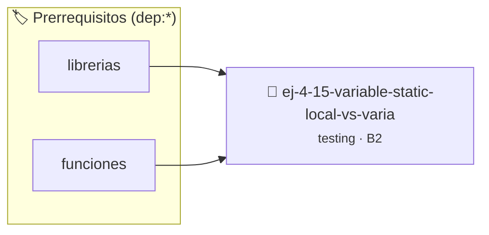

# Variable `static` local vs Variable Global
> **ID:** `ej-4-15-variable-static-local-vs-varia` · **Unidad:** 5 (Ingeniería de Software y Calidad en C)
 · **Tema:** `testing` / `aserciones_defensivas`
 · **Bloom:** B2 (Comprender) · **Dificultad:** Inicial
 · **Carga:** ~15 min · **Tipo:** Laboratorio
>
> **🏷️ Prerrequisitos temáticos (tags):** `dep:librerias`, `dep:funciones`
>
> **Etiquetas conceptuales:** `aserciones`, `fundamentos`, `local`, `static`, `global`


::: {admonition} 📦 Paquete de Verificación Local (Ripley)
:class: tip

Para compilar, resolver y autoevaluar tu entrega con pruebas unitarias en tu máquina:

- [📥 **Descargar paquete `ej-4-15-variable-static-local-vs-varia.ripkg`**](../../paquetes/ej-4-15-variable-static-local-vs-varia.ripkg)

Ejecución con el asistente de cátedra:
```bash
ripley run ej-4-15-variable-static-local-vs-varia.ripkg
```
:::


### 🗺️ Itinerario Pedagógico




## 📖 Consigna

### Ejercicio 4.15 - Variable `static` local vs Variable Global ⭐⭐⭐☆☆

:::{exercise}
:label: ej-test-static-local
Analizá el siguiente código. ¿Qué valores retorna en las sucesivas llamadas?
¿Por qué una variable `static` local también genera problemas para el testing
unitario independiente?

```{code-block} c
:linenos:
int contador_llamadas(void)
{
    static int veces = 0;
    veces++;
    return veces;
}

```
<!-- {code-block} c -->

-   **[*plus ultra*]:** Explicar la diferencia de alcance (*scope*) y tiempo de
    vida (*lifetime*) entre una variable global y una variable local `static`.
-   **[*plus ultra*]:** Escribir una versión reseteable o pasar el contador por
    parámetro.

:::
<!-- {exercise} -->

:::{solution} ej-test-static-local
:class: dropdown
La primera llamada retorna `1`, la segunda `2`, la tercera `3`, etc.

Aunque su alcance está restringido a la función, su tiempo de vida es durante
toda la ejecución del programa. Esto retiene estado mutable entre pruebas,
imposibilitando correr tests unitarios aislados y repetibles sin reiniciar el
binario.

:::
<!-- {solution} ej-test-static-local -->

---


## 📋 Prototipos y Cabecera (`ej-4-15-variable-static-local-vs-varia.h`)

```{code-block} c
#ifndef EJERCICIO_EJ_4_15_VARIABLE_STATIC_LOCAL_VS_VARIA_H
#define EJERCICIO_EJ_4_15_VARIABLE_STATIC_LOCAL_VS_VARIA_H

#include <stddef.h>
#include <stdbool.h>
#include <stdint.h>

/* Operación contador_llamadas */
int contador_llamadas(void);

#endif /* EJERCICIO_EJ_4_15_VARIABLE_STATIC_LOCAL_VS_VARIA_H */
```


## ⚙️ Especificación de Funciones

| Función | Retorno | Parámetros | Descripción |
| :--- | :--- | :--- | :--- |

| `contador_llamadas` | `int` | `void` | Operación contador_llamadas |


## 🧪 Casos de Prueba

| Prueba Unitaria | Función Objetivo | Verificación |
| :--- | :--- | :--- |

| **test_contador_llamadas_1** | `contador_llamadas` | `/* Verificación unitaria de contador_llamadas */ int r = contador_llamadas(); (void)r; assert(true);` |


## ✓ Solución Modelo de Cátedra

```{dropdown} 🔍 Revelar solución canónica en C
:open: false

```{code-block} c
int contador_llamadas(void)
{
    static int veces = 0;
    veces++;
    return veces;
}

int main(void)
{
    return 0;
}
```
```
