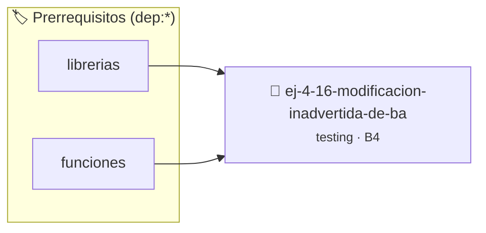

# Modificación inadvertida de bandera global
> **ID:** `ej-4-16-modificacion-inadvertida-de-ba` · **Unidad:** 5 (Ingeniería de Software y Calidad en C)
 · **Tema:** `testing` / `aserciones_defensivas`
 · **Bloom:** B4 (Analizar) · **Dificultad:** Avanzada
 · **Carga:** ~35 min · **Tipo:** Laboratorio
>
> **🏷️ Prerrequisitos temáticos (tags):** `dep:librerias`, `dep:funciones`
>
> **Etiquetas conceptuales:** `aserciones`, `fundamentos`, `bandera`, `global`, `inadvertida`


::: {admonition} 📦 Paquete de Verificación Local (Ripley)
:class: tip

Para compilar, resolver y autoevaluar tu entrega con pruebas unitarias en tu máquina:

- [📥 **Descargar paquete `ej-4-16-modificacion-inadvertida-de-ba.ripkg`**](../../paquetes/ej-4-16-modificacion-inadvertida-de-ba.ripkg)

Ejecución con el asistente de cátedra:
```bash
ripley run ej-4-16-modificacion-inadvertida-de-ba.ripkg
```
:::


### 🗺️ Itinerario Pedagógico




## 📖 Consigna

:::{exercise}
:label: ej-test-bandera-global
Descubrí el bug en este programa donde dos funciones manipulan la misma variable
global `hay_error`:

```{code-block} c
:linenos:
#include <stdbool.h>
#include <stdio.h>

bool hay_error = false;

void validar_rango(int x)
{
    if (x < 0 || x > 100)
    {
        hay_error = true;
    }
}

void validar_paridad(int x)
{
    if (x % 2 != 0)
    {
        hay_error = true;
    }
    else
    {
        hay_error = false; // ¡Peligro!
    }
}

```

-   **[*plus ultra*]:** ¿Qué ocurre si se llama `validar_rango(-5)` seguido de
    `validar_paridad(4)`?
-   **[*plus ultra*]:** Refactorizar ambas funciones para que retornen un `bool`
    independiente.

:::

:::{solution} ej-test-bandera-global
:class: dropdown
`validar_rango(-5)` detecta el error y pone `hay_error = true`. Pero luego
`validar_paridad(4)` como `4` es par, ejecuta la rama `else` y pone `hay_error =
false`, **borrando el error detectado previamente**.

**Refactorización:**
```{code-block} c
:linenos:
bool es_rango_valido(int x)
{
    return (x >= 0 && x <= 100);
}

bool es_par(int x)
{
    return (x % 2 == 0);
}

```

:::

---

### 📋 Contrato de las Funciones

```c
/*
 * Operación validar_rango
 * Precondiciones: Parámetros dentro del dominio válido de la operación.
 * Postcondiciones: Retorna el valor procesado.
 */
void validar_rango(int x);

/*
 * Operación validar_paridad
 * Precondiciones: Parámetros dentro del dominio válido de la operación.
 * Postcondiciones: Retorna el valor procesado.
 */
void validar_paridad(int x);

```

### 🧪 Ejemplos de Ejecución

::::{tab-set}
:::{tab-item} Valor positivo
```text
Entrada: 1
Salida / Retorno: 2
```
:::
:::{tab-item} Valor positivo
```text
Entrada: 1
Salida / Retorno: 2
```
:::
::::

### ⚠️ Precondiciones y Casos Borde

1. **Valores fuera de rango:** Verificar siempre que los datos de entrada cumplan con los rangos admisibles antes de operar.
6. **Casos vacíos o neutros:** Contemplar adecuadamente entradas con longitud cero o valores neutros según corresponda.

### 🎯 Criterios de Aceptación

- [ ] El código compila limpiamente bajo estándar C11 sin warnings con flags estrictos (`-Wall -Wextra -Werror`).
- [ ] Se satisfacen todas las pruebas unitarias y casos de prueba provistos.
- [ ] Las funciones validan exhaustivamente sus precondiciones y gestionan casos borde de forma robusta.


## 📋 Prototipos y Cabecera (`ej-4-16-modificacion-inadvertida-de-ba.h`)

```{code-block} c
#ifndef EJERCICIO_EJ_4_16_MODIFICACION_INADVERTIDA_DE_BA_H
#define EJERCICIO_EJ_4_16_MODIFICACION_INADVERTIDA_DE_BA_H

#include <stddef.h>
#include <stdbool.h>
#include <stdint.h>

/* Operación validar_rango */
void validar_rango(int x);
/* Operación validar_paridad */
void validar_paridad(int x);

#endif /* EJERCICIO_EJ_4_16_MODIFICACION_INADVERTIDA_DE_BA_H */
```


## ⚙️ Especificación de Funciones

| Función | Retorno | Parámetros | Descripción |
| :--- | :--- | :--- | :--- |

| `validar_rango` | `void` | `int x` | Operación validar_rango |

| `validar_paridad` | `void` | `int x` | Operación validar_paridad |


## 🧪 Casos de Prueba

| Prueba Unitaria | Función Objetivo | Verificación |
| :--- | :--- | :--- |

| **test_validar_rango_1** | `validar_rango` | `/* Verificación unitaria de validar_rango */ validar_rango(1); assert(true);` |

| **test_validar_paridad_2** | `validar_paridad` | `/* Verificación unitaria de validar_paridad */ validar_paridad(1); assert(true);` |


## ✓ Solución Modelo de Cátedra

```{dropdown} 🔍 Revelar solución canónica en C
:open: false

```{code-block} c
#include <stdbool.h>
#include <stdio.h>

bool hay_error = false;

void validar_rango(int x)
{
    if (x < 0 || x > 100)
    {
        hay_error = true;
    }
}

void validar_paridad(int x)
{
    if (x % 2 != 0)
    {
        hay_error = true;
    }
    else
    {
        hay_error = false; // ¡Peligro!
    }
}

int main(void)
{
    return 0;
}
```
```
