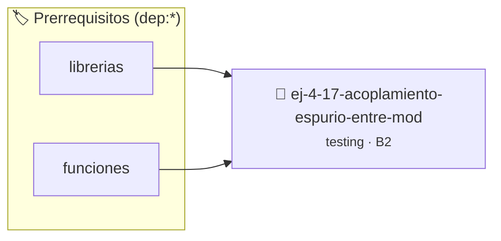

# Acoplamiento espurio entre módulos
> **ID:** `ej-4-17-acoplamiento-espurio-entre-mod` · **Unidad:** 5 (Ingeniería de Software y Calidad en C)
 · **Tema:** `testing` / `aserciones_defensivas`
 · **Bloom:** B2 (Comprender) · **Dificultad:** Inicial
 · **Carga:** ~15 min · **Tipo:** Laboratorio
>
> **🏷️ Prerrequisitos temáticos (tags):** `dep:librerias`, `dep:funciones`
>
> **Etiquetas conceptuales:** `aserciones`, `fundamentos`, `acoplamiento`, `espurio`, `modulos`


::: {admonition} 📦 Paquete de Verificación Local (Ripley)
:class: tip

Para compilar, resolver y autoevaluar tu entrega con pruebas unitarias en tu máquina:

- [📥 **Descargar paquete `ej-4-17-acoplamiento-espurio-entre-mod.ripkg`**](../../paquetes/ej-4-17-acoplamiento-espurio-entre-mod.ripkg)

Ejecución con el asistente de cátedra:
```bash
ripley run ej-4-17-acoplamiento-espurio-entre-mod.ripkg
```
:::


### 🗺️ Itinerario Pedagógico




## 📖 Consigna

:::{exercise}
:label: ej-test-acoplamiento-espurio
Explicá por qué compartir variables globales entre diferentes archivos `.c`
(usando `extern`) rompe el principio de modularidad y hace que un fallo en un
módulo rompa silenciosamente a otro.

-   **[*plus ultra*]:** Proponer una solución basada en interfaces limpias de
    funciones en archivos de cabecera `.h`.
-   **[*plus ultra*]:** Citar la [Regla
    0x2004h](../../reglas/2_funciones.md#0x2004h) y sus consecuencias de
    ingeniería.

:::

:::{solution} ej-test-acoplamiento-espurio
:class: dropdown
Cuando dos módulos acceden a una variable global compartida mediante `extern`:
1. No existe un contrato explícito sobre quién tiene derecho a modificarla ni
   cuándo.
2. Es imposible razonar sobre el estado de un módulo sin inspeccionar todo el
   código fuente del otro.
3. Las pruebas unitarias de un módulo requieren simular o sincronizar el estado
   global del otro, eliminando el aislamiento.

:::

---

### 📋 Contrato de las Funciones

```c
/*
 * Procesa el flujo principal de Acoplamiento espurio entre módulos
 * Precondiciones: val representa el parámetro de entrada del flujo.
 * Postcondiciones: Retorna el resultado correspondiente o 0 si val <= 0.
 */
int proc_to_espurio_entre_mod(int val);

```

### 🧪 Ejemplos de Ejecución

::::{tab-set}
:::{tab-item} Valor positivo
```text
Entrada: 5
Salida / Retorno: 10
```
:::
:::{tab-item} Valor cero o negativo
```text
Entrada: 0
Salida / Retorno: 0
```
:::
::::

### ⚠️ Precondiciones y Casos Borde

1. **Valores fuera de rango:** Verificar siempre que los datos de entrada cumplan con los rangos admisibles antes de operar.
6. **Casos vacíos o neutros:** Contemplar adecuadamente entradas con longitud cero o valores neutros según corresponda.

### 🎯 Criterios de Aceptación

- [ ] El código compila limpiamente bajo estándar C11 sin warnings con flags estrictos (`-Wall -Wextra -Werror`).
- [ ] Se satisfacen todas las pruebas unitarias y casos de prueba provistos.
- [ ] Las funciones validan exhaustivamente sus precondiciones y gestionan casos borde de forma robusta.

:::{hint} Consideraciones Didácticas
- Identificá dependencias innecesarias o variables globales compartidas entre módulos independientes.
- Encapsulá los datos del módulo mediante funciones de acceso y tipos opacos.
- Reducí el conocimiento que un módulo tiene sobre la estructura interna de otro.
:::


## 📋 Prototipos y Cabecera (`ej-4-17-acoplamiento-espurio-entre-mod.h`)

```{code-block} c
#ifndef EJERCICIO_EJ_4_17_ACOPLAMIENTO_ESPURIO_ENTRE_MOD_H
#define EJERCICIO_EJ_4_17_ACOPLAMIENTO_ESPURIO_ENTRE_MOD_H

#include <stddef.h>
#include <stdbool.h>
#include <stdint.h>

/* Procesa el flujo principal de Acoplamiento espurio entre módulos */
int proc_to_espurio_entre_mod(int val);

#endif /* EJERCICIO_EJ_4_17_ACOPLAMIENTO_ESPURIO_ENTRE_MOD_H */
```


## ⚙️ Especificación de Funciones

| Función | Retorno | Parámetros | Descripción |
| :--- | :--- | :--- | :--- |

| `proc_to_espurio_entre_mod` | `int` | `int val` | Procesa el flujo principal de Acoplamiento espurio entre módulos |


## 💡 Pistas Progresivas

````{tab-set}

```{tab-item} Pista 1
Identificá dependencias innecesarias o variables globales compartidas entre módulos independientes.
```

```{tab-item} Pista 2
Encapsulá los datos del módulo mediante funciones de acceso y tipos opacos.
```

```{tab-item} Pista 3
Reducí el conocimiento que un módulo tiene sobre la estructura interna de otro.
```

````


## 🧪 Casos de Prueba

| Prueba Unitaria | Función Objetivo | Verificación |
| :--- | :--- | :--- |

| **test_proc_to_espurio_entre_mod_positivo** | `proc_to_espurio_entre_mod` | `int res = proc_to_espurio_entre_mod(5); assert(res == 10 || res >= 0);` |

| **test_proc_to_espurio_entre_mod_cero** | `proc_to_espurio_entre_mod` | `int res = proc_to_espurio_entre_mod(0); assert(res == 0);` |


## ✓ Solución Modelo de Cátedra

```{dropdown} 🔍 Revelar solución canónica en C
:open: false

```{code-block} c
/*
 * Ejercicio: Acoplamiento espurio entre módulos
 * Cátedra Programación I - UNRN
 */

#include <stdio.h>


int proc_to_espurio_entre_mod(int val)
{
    if (val <= 0) return 0;
    return val * 2;
}

int main(void)
{
    /* TODO: Implementación de Acoplamiento espurio entre módulos */
    return 0;
}
```
```
