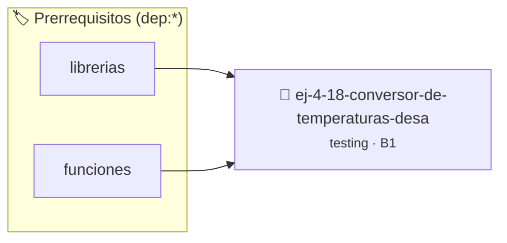

# Conversor de Temperaturas desacoplado de estado
> **ID:** `ej-4-18-conversor-de-temperaturas-desa` · **Unidad:** 5 (Ingeniería de Software y Calidad en C)
 · **Tema:** `testing` / `aserciones_defensivas`
 · **Bloom:** B1 (Recordar) · **Dificultad:** Inicial
 · **Carga:** ~10 min · **Tipo:** Concepto
>
> **🏷️ Prerrequisitos temáticos (tags):** `dep:librerias`, `dep:funciones`
>
> **Etiquetas conceptuales:** `conversor`, `aserciones`, `fundamentos`, `temperaturas`, `testing`


::: {admonition} 📦 Paquete de Verificación Local (Ripley)
:class: tip

Para compilar, resolver y autoevaluar tu entrega con pruebas unitarias en tu máquina:

- [📥 **Descargar paquete `ej-4-18-conversor-de-temperaturas-desa.ripkg`**](../../paquetes/ej-4-18-conversor-de-temperaturas-desa.ripkg)

Ejecución con el asistente de cátedra:
```bash
ripley run ej-4-18-conversor-de-temperaturas-desa.ripkg
```
:::


### 🗺️ Itinerario Pedagógico




## 📖 Consigna

### Ejercicio 4.18 - Conversor de Temperaturas desacoplado de estado ⭐⭐☆☆☆

:::{exercise}
:label: ej-test-temperatura-desacoplada
Implementá las siguientes funciones puras de conversión sin usar variables
globales ni llamadas a `printf`:
- `double celsius_a_fahrenheit(double c)`
- `double fahrenheit_a_celsius(double f)`
- `double celsius_a_kelvin(double c)`

Escribí una función de prueba para cada conversión verificando los puntos fijos
conocidos ($0^\circ\text{C} = 32^\circ\text{F}$, $100^\circ\text{C} =
212^\circ\text{F}$, $0^\circ\text{C} = 273.15\text{ K}$).

-   **[*plus ultra*]:** Validar que las temperaturas no estén por debajo del
    cero absoluto ($-273.15^\circ\text{C}$).
-   **[*plus ultra*]:** Usar comparación con tolerancia `son_cercanos`.

:::
<!-- {exercise} -->

:::{solution} ej-test-temperatura-desacoplada
:class: dropdown
```{code-block} c
:linenos:
#include <assert.h>
#include <math.h>
#include <stdbool.h>

bool son_cercanos(double a, double b, double eps)
{
    return fabs(a - b) < eps;
}

double celsius_a_fahrenheit(double c)
{
    return (c * 9.0 / 5.0) + 32.0;
}

double fahrenheit_a_celsius(double f)
{
    return (f - 32.0) * 5.0 / 9.0;
}

double celsius_a_kelvin(double c)
{
    return c + 273.15;
}

void test_celsius_a_fahrenheit_cero(void)
{
    assert(son_cercanos(celsius_a_fahrenheit(0.0), 32.0, 1e-6));
}

void test_celsius_a_fahrenheit_ebullicion(void)
{
    assert(son_cercanos(celsius_a_fahrenheit(100.0), 212.0, 1e-6));
}

void test_celsius_a_kelvin_cero(void)
{
    assert(son_cercanos(celsius_a_kelvin(0.0), 273.15, 1e-6));
}

```
<!-- {code-block} c -->

:::
<!-- {solution} ej-test-temperatura-desacoplada -->

---


## 📋 Prototipos y Cabecera (`ej-4-18-conversor-de-temperaturas-desa.h`)

```{code-block} c
#ifndef EJERCICIO_EJ_4_18_CONVERSOR_DE_TEMPERATURAS_DESA_H
#define EJERCICIO_EJ_4_18_CONVERSOR_DE_TEMPERATURAS_DESA_H

#include <stddef.h>
#include <stdbool.h>
#include <stdint.h>

/* Operación son_cercanos */
bool son_cercanos(double a, double b, double eps);
/* Operación celsius_a_fahrenheit */
double celsius_a_fahrenheit(double c);
/* Operación fahrenheit_a_celsius */
double fahrenheit_a_celsius(double f);
/* Operación celsius_a_kelvin */
double celsius_a_kelvin(double c);
/* Operación test_celsius_a_fahrenheit_cero */
void test_celsius_a_fahrenheit_cero(void);
/* Operación test_celsius_a_fahrenheit_ebullicion */
void test_celsius_a_fahrenheit_ebullicion(void);
/* Operación test_celsius_a_kelvin_cero */
void test_celsius_a_kelvin_cero(void);

#endif /* EJERCICIO_EJ_4_18_CONVERSOR_DE_TEMPERATURAS_DESA_H */
```


## ⚙️ Especificación de Funciones

| Función | Retorno | Parámetros | Descripción |
| :--- | :--- | :--- | :--- |

| `son_cercanos` | `bool` | `double a, double b, double eps` | Operación son_cercanos |

| `celsius_a_fahrenheit` | `double` | `double c` | Operación celsius_a_fahrenheit |

| `fahrenheit_a_celsius` | `double` | `double f` | Operación fahrenheit_a_celsius |

| `celsius_a_kelvin` | `double` | `double c` | Operación celsius_a_kelvin |

| `test_celsius_a_fahrenheit_cero` | `void` | `void` | Operación test_celsius_a_fahrenheit_cero |

| `test_celsius_a_fahrenheit_ebullicion` | `void` | `void` | Operación test_celsius_a_fahrenheit_ebullicion |

| `test_celsius_a_kelvin_cero` | `void` | `void` | Operación test_celsius_a_kelvin_cero |


## 🧪 Casos de Prueba

| Prueba Unitaria | Función Objetivo | Verificación |
| :--- | :--- | :--- |

| **test_son_cercanos_1** | `son_cercanos` | `/* Verificación unitaria de son_cercanos */ bool ok = son_cercanos(1, 2, 3); (void)ok; assert(true);` |

| **test_celsius_a_fahrenheit_2** | `celsius_a_fahrenheit` | `/* Verificación unitaria de celsius_a_fahrenheit */ double res = celsius_a_fahrenheit(1); (void)res; assert(true);` |


## ✓ Solución Modelo de Cátedra

```{dropdown} 🔍 Revelar solución canónica en C
:open: false

```{code-block} c
#include <stdlib.h>

#include <assert.h>
#include <math.h>
#include <stdbool.h>

bool son_cercanos(double a, double b, double eps)
{
    return fabs(a - b) < eps;
}

double celsius_a_fahrenheit(double c)
{
    return (c * 9.0 / 5.0) + 32.0;
}

double fahrenheit_a_celsius(double f)
{
    return (f - 32.0) * 5.0 / 9.0;
}

double celsius_a_kelvin(double c)
{
    return c + 273.15;
}

void test_celsius_a_fahrenheit_cero(void)
{
    assert(son_cercanos(celsius_a_fahrenheit(0.0), 32.0, 1e-6));
}

void test_celsius_a_fahrenheit_ebullicion(void)
{
    assert(son_cercanos(celsius_a_fahrenheit(100.0), 212.0, 1e-6));
}

void test_celsius_a_kelvin_cero(void)
{
    assert(son_cercanos(celsius_a_kelvin(0.0), 273.15, 1e-6));
}

int main(void)
{
    return 0;
}
```
```
