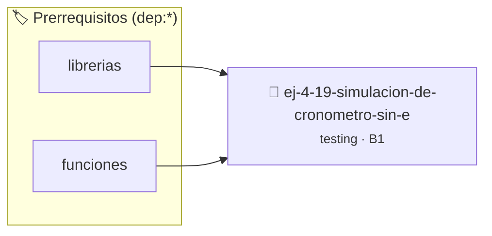

# Simulación de cronómetro sin estado global
> **ID:** `ej-4-19-simulacion-de-cronometro-sin-e` · **Unidad:** 5 (Ingeniería de Software y Calidad en C)
 · **Tema:** `testing` / `aserciones_defensivas`
 · **Bloom:** B1 (Recordar) · **Dificultad:** Inicial
 · **Carga:** ~10 min · **Tipo:** Concepto
>
> **🏷️ Prerrequisitos temáticos (tags):** `dep:librerias`, `dep:funciones`
>
> **Etiquetas conceptuales:** `cronometro`, `aserciones`, `simulacion`, `fundamentos`, `global`


::: {admonition} 📦 Paquete de Verificación Local (Ripley)
:class: tip

Para compilar, resolver y autoevaluar tu entrega con pruebas unitarias en tu máquina:

- [📥 **Descargar paquete `ej-4-19-simulacion-de-cronometro-sin-e.ripkg`**](../../paquetes/ej-4-19-simulacion-de-cronometro-sin-e.ripkg)

Ejecución con el asistente de cátedra:
```bash
ripley run ej-4-19-simulacion-de-cronometro-sin-e.ripkg
```
:::


### 🗺️ Itinerario Pedagógico




## 📖 Consigna

### Ejercicio 4.19 - Simulación de cronómetro sin estado global ⭐⭐⭐☆☆

:::{exercise}
:label: ej-test-cronometro-puro
Diseñá funciones para manipular el tiempo acumulado en segundos representándolo
como un valor entero pasado por parámetro:
- `int tiempo_avanzar(int tiempo_actual, int segundos_delta)`
- `int tiempo_reiniciar(void)`
- `int tiempo_obtener_minutos(int tiempo_total)`
- `int tiempo_obtener_segundos(int tiempo_total)`

Escribí las pruebas unitarias que validen avances sucesivos.

-   **[*plus ultra*]:** Validar que `segundos_delta >= 0`.
-   **[*plus ultra*]:** Probar el avance cruzando la frontera de 60 segundos.

:::
<!-- {exercise} -->

:::{solution} ej-test-cronometro-puro
:class: dropdown
```{code-block} c
:linenos:
#include <assert.h>

int tiempo_avanzar(int tiempo_actual, int segundos_delta)
{
    if (segundos_delta < 0)
    {
        return tiempo_actual;
    }
    return tiempo_actual + segundos_delta;
}

int tiempo_reiniciar(void)
{
    return 0;
}

int tiempo_obtener_minutos(int tiempo_total)
{
    return tiempo_total / 60;
}

int tiempo_obtener_segundos(int tiempo_total)
{
    return tiempo_total % 60;
}

void test_cronometro_avance(void)
{
    int t = tiempo_reiniciar();
    t = tiempo_avanzar(t, 45);
    t = tiempo_avanzar(t, 30);
    assert(t == 75);
    assert(tiempo_obtener_minutos(t) == 1);
    assert(tiempo_obtener_segundos(t) == 15);
}

```
<!-- {code-block} c -->

:::
<!-- {solution} ej-test-cronometro-puro -->

---


## 📋 Prototipos y Cabecera (`ej-4-19-simulacion-de-cronometro-sin-e.h`)

```{code-block} c
#ifndef EJERCICIO_EJ_4_19_SIMULACION_DE_CRONOMETRO_SIN_E_H
#define EJERCICIO_EJ_4_19_SIMULACION_DE_CRONOMETRO_SIN_E_H

#include <stddef.h>
#include <stdbool.h>
#include <stdint.h>

/* Operación tiempo_avanzar */
int tiempo_avanzar(int tiempo_actual, int segundos_delta);
/* Operación tiempo_reiniciar */
int tiempo_reiniciar(void);
/* Operación tiempo_obtener_minutos */
int tiempo_obtener_minutos(int tiempo_total);
/* Operación tiempo_obtener_segundos */
int tiempo_obtener_segundos(int tiempo_total);
/* Operación test_cronometro_avance */
void test_cronometro_avance(void);

#endif /* EJERCICIO_EJ_4_19_SIMULACION_DE_CRONOMETRO_SIN_E_H */
```


## ⚙️ Especificación de Funciones

| Función | Retorno | Parámetros | Descripción |
| :--- | :--- | :--- | :--- |

| `tiempo_avanzar` | `int` | `int tiempo_actual, int segundos_delta` | Operación tiempo_avanzar |

| `tiempo_reiniciar` | `int` | `void` | Operación tiempo_reiniciar |

| `tiempo_obtener_minutos` | `int` | `int tiempo_total` | Operación tiempo_obtener_minutos |

| `tiempo_obtener_segundos` | `int` | `int tiempo_total` | Operación tiempo_obtener_segundos |

| `test_cronometro_avance` | `void` | `void` | Operación test_cronometro_avance |


## 🧪 Casos de Prueba

| Prueba Unitaria | Función Objetivo | Verificación |
| :--- | :--- | :--- |

| **test_tiempo_avanzar_1** | `tiempo_avanzar` | `/* Verificación unitaria de tiempo_avanzar */ int res = tiempo_avanzar(1, 2); (void)res; assert(true);` |

| **test_tiempo_reiniciar_2** | `tiempo_reiniciar` | `/* Verificación unitaria de tiempo_reiniciar */ int r = tiempo_reiniciar(); (void)r; assert(true);` |


## ✓ Solución Modelo de Cátedra

```{dropdown} 🔍 Revelar solución canónica en C
:open: false

```{code-block} c
#include <assert.h>

int tiempo_avanzar(int tiempo_actual, int segundos_delta)
{
    if (segundos_delta < 0)
    {
        return tiempo_actual;
    }
    return tiempo_actual + segundos_delta;
}

int tiempo_reiniciar(void)
{
    return 0;
}

int tiempo_obtener_minutos(int tiempo_total)
{
    return tiempo_total / 60;
}

int tiempo_obtener_segundos(int tiempo_total)
{
    return tiempo_total % 60;
}

void test_cronometro_avance(void)
{
    int t = tiempo_reiniciar();
    t = tiempo_avanzar(t, 45);
    t = tiempo_avanzar(t, 30);
    assert(t == 75);
    assert(tiempo_obtener_minutos(t) == 1);
    assert(tiempo_obtener_segundos(t) == 15);
}

int main(void)
{
    return 0;
}
```
```
