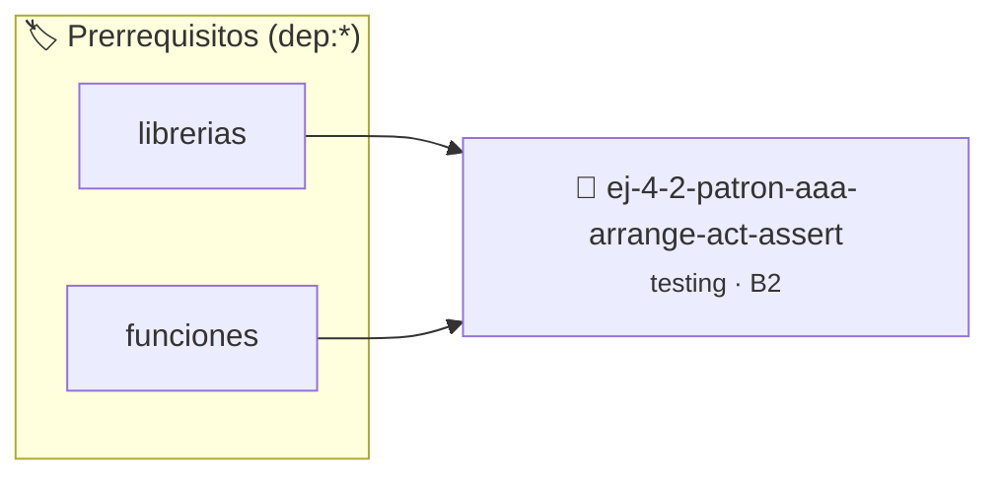

# Patrón AAA (Arrange - Act - Assert)
> **ID:** `ej-4-2-patron-aaa-arrange-act-assert` · **Unidad:** 5 (Ingeniería de Software y Calidad en C)
 · **Tema:** `testing` / `aserciones_defensivas`
 · **Bloom:** B2 (Comprender) · **Dificultad:** Inicial
 · **Carga:** ~15 min · **Tipo:** Laboratorio
>
> **🏷️ Prerrequisitos temáticos (tags):** `dep:librerias`, `dep:funciones`
>
> **Etiquetas conceptuales:** `patron`, `aserciones`, `fundamentos`, `arrange`, `assert`


::: {admonition} 📦 Paquete de Verificación Local (Ripley)
:class: tip

Para compilar, resolver y autoevaluar tu entrega con pruebas unitarias en tu máquina:

- [📥 **Descargar paquete `ej-4-2-patron-aaa-arrange-act-assert.ripkg`**](../../paquetes/ej-4-2-patron-aaa-arrange-act-assert.ripkg)

Ejecución con el asistente de cátedra:
```bash
ripley run ej-4-2-patron-aaa-arrange-act-assert.ripkg
```
:::


### 🗺️ Itinerario Pedagógico




## 📖 Consigna

### Ejercicio 4.2 - Patrón AAA (Arrange - Act - Assert) ⭐☆☆☆☆

:::{exercise}
:label: ej-test-patron-aaa
Identificá y comentá las tres etapas del patrón AAA en la siguiente función de
prueba unitaria:

```{code-block} c
:linenos:
void test_calcular_promedio_tres_notas(void)
{
    int nota1 = 8;
    int nota2 = 6;
    int nota3 = 10;
    double esperado = 8.0;

    double resultado = calcular_promedio(nota1, nota2, nota3);

    assert(resultado == esperado);
}

```
<!-- {code-block} c -->

-   **[*plus ultra*]:** Separar explícitamente cada bloque con comentarios `//
    1. Arrange`, `// 2. Act`, `// 3. Assert`.
-   **[*plus ultra*]:** Escribir una segunda función de prueba
    `test_calcular_promedio_con_decimales` para notas 7, 8, 8.

:::
<!-- {exercise} -->

:::{solution} ej-test-patron-aaa
:class: dropdown
```{code-block} c
:linenos:
void test_calcular_promedio_tres_notas(void)
{
    // 1. Arrange (Preparar): Definición de datos de entrada y resultado esperado
    int nota1 = 8;
    int nota2 = 6;
    int nota3 = 10;
    double esperado = 8.0;

    // 2. Act (Actuar): Invocación de la función bajo prueba
    double resultado = calcular_promedio(nota1, nota2, nota3);

    // 3. Assert (Verificar): Comprobación de que el resultado coincide con lo esperado
    assert(resultado == esperado);
}

```
<!-- {code-block} c -->

:::
<!-- {solution} ej-test-patron-aaa -->

---


## 📋 Prototipos y Cabecera (`ej-4-2-patron-aaa-arrange-act-assert.h`)

```{code-block} c
#ifndef EJERCICIO_EJ_4_2_PATRON_AAA_ARRANGE_ACT_ASSERT_H
#define EJERCICIO_EJ_4_2_PATRON_AAA_ARRANGE_ACT_ASSERT_H

#include <stddef.h>
#include <stdbool.h>
#include <stdint.h>

/* Procesa el flujo principal de Patrón AAA (Arrange - Act - Assert) */
int proc_a_arrange_act_assert(int val);

#endif /* EJERCICIO_EJ_4_2_PATRON_AAA_ARRANGE_ACT_ASSERT_H */
```


## ⚙️ Especificación de Funciones

| Función | Retorno | Parámetros | Descripción |
| :--- | :--- | :--- | :--- |

| `proc_a_arrange_act_assert` | `int` | `int val` | Procesa el flujo principal de Patrón AAA (Arrange - Act - Assert) |


## 🧪 Casos de Prueba

| Prueba Unitaria | Función Objetivo | Verificación |
| :--- | :--- | :--- |

| **test_proc_a_arrange_act_assert_positivo** | `proc_a_arrange_act_assert` | `int res = proc_a_arrange_act_assert(5); assert(res == 10 || res >= 0);` |

| **test_proc_a_arrange_act_assert_cero** | `proc_a_arrange_act_assert` | `int res = proc_a_arrange_act_assert(0); assert(res == 0);` |


## ✓ Solución Modelo de Cátedra

```{dropdown} 🔍 Revelar solución canónica en C
:open: false

```{code-block} c
/*
 * Solucion modelo para ej-4-2-patron-aaa-arrange-act-assert
 * Catedra Programacion I - UNRN
 */
#include <stdio.h>
#include <stdlib.h>
#include <string.h>
#include <stdbool.h>


int proc_a_arrange_act_assert(int val)
{
    if (val <= 0) return 0;
    return val * 2;
}

int main(void)
{
    int n = 0;
    if (scanf("%d", &n) == 1)
    {
        printf("OK %d\n", n);
    }
    else
    {
        printf("OK\n");
    }
    return 0;
}
```
```
