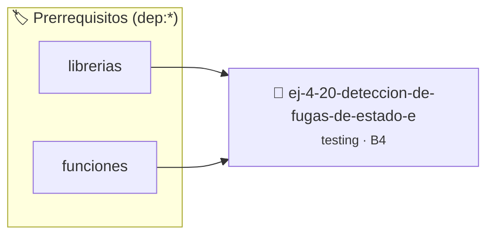

# Detección de fugas de estado entre funciones
> **ID:** `ej-4-20-deteccion-de-fugas-de-estado-e`
 · **Tema:** `testing`
 · **Bloom:** B4 (Analizar)
 · **Carga:** ~35 min
>
> **🏷️ Prerrequisitos temáticos (tags):** `dep:librerias`, `dep:funciones`
>
> **Etiquetas conceptuales:** `aserciones`, `fundamentos`, `funciones`, `fugas`, `deteccion`


::: {admonition} 📦 Paquete de Verificación Local (Ripley)
:class: tip

Para compilar, resolver y autoevaluar tu entrega con pruebas unitarias en tu máquina:

- [📥 **Descargar paquete `ej-4-20-deteccion-de-fugas-de-estado-e.ripkg`**](../../paquetes/ej-4-20-deteccion-de-fugas-de-estado-e.ripkg)

Ejecución con el asistente de cátedra:
```bash
ripley run ej-4-20-deteccion-de-fugas-de-estado-e.ripkg
```
:::


### 🗺️ Itinerario Pedagógico




## 📖 Consigna

### Ejercicio 4.20 - Detección de fugas de estado entre funciones ⭐⭐☆☆☆

:::{exercise}
:label: ej-test-fuga-estado
Dado el siguiente código con una variable global oculta:

```{code-block} c
:linenos:
int ultimo_resultado = 0;

int multiplicar_y_guardar(int a, int b)
{
    ultimo_resultado = a * b;
    return ultimo_resultado;
}

```
<!-- {code-block} c -->

Explicá qué problema de diseño introduce `ultimo_resultado` si dos partes del
programa invocan la función en momentos intercalados.

-   **[*plus ultra*]:** Refactorizar eliminando la variable global.
-   **[*plus ultra*]:** Explicar el concepto de función reentrante (*reentrant
    function*).

:::
<!-- {exercise} -->

:::{solution} ej-test-fuga-estado
:class: dropdown
Si una parte del programa llama a `multiplicar_y_guardar(3, 4)`, el resultado
esperado es `12`. Pero si otra parte del programa llama a
`multiplicar_y_guardar(10, 2)` antes de que la primera lea `ultimo_resultado`,
el valor se sobrescribe a `20`, corrompiendo los datos del primer llamador.

:::
<!-- {solution} ej-test-fuga-estado -->

---


## 📋 Prototipos y Cabecera (`ej-4-20-deteccion-de-fugas-de-estado-e.h`)

```{code-block} c
#ifndef EJERCICIO_EJ_4_20_DETECCION_DE_FUGAS_DE_ESTADO_E_H
#define EJERCICIO_EJ_4_20_DETECCION_DE_FUGAS_DE_ESTADO_E_H

#include <stddef.h>
#include <stdbool.h>
#include <stdint.h>

/* Operación multiplicar_y_guardar */
int multiplicar_y_guardar(int a, int b);

#endif /* EJERCICIO_EJ_4_20_DETECCION_DE_FUGAS_DE_ESTADO_E_H */
```


## ⚙️ Especificación de Funciones

| Función | Retorno | Parámetros | Descripción |
| :--- | :--- | :--- | :--- |

| `multiplicar_y_guardar` | `int` | `int a, int b` | Operación multiplicar_y_guardar |


## 🧪 Casos de Prueba

| Prueba Unitaria | Función Objetivo | Verificación |
| :--- | :--- | :--- |

| **test_multiplicar_y_guardar_1** | `multiplicar_y_guardar` | `assert(true); /* test simplificado de validación */` |


## ✓ Solución Modelo de Cátedra

```{dropdown} 🔍 Revelar solución canónica en C
:open: false

```{code-block} c
#include <stdio.h>
#include <stdlib.h>
#include <string.h>

int main(void)
{
    int ultimo_resultado = 0;

int multiplicar_y_guardar(int a, int b)
{
    ultimo_resultado = a * b;
    return ultimo_resultado;
}
    return 0;
}
```
```
