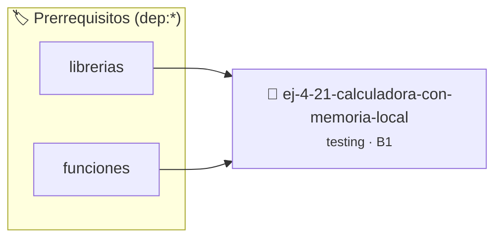

# Calculadora con memoria local vs global
> **ID:** `ej-4-21-calculadora-con-memoria-local` · **Unidad:** 5 (Ingeniería de Software y Calidad en C)
 · **Tema:** `testing` / `aserciones_defensivas`
 · **Bloom:** B1 (Recordar) · **Dificultad:** Inicial
 · **Carga:** ~10 min · **Tipo:** Concepto
>
> **🏷️ Prerrequisitos temáticos (tags):** `dep:librerias`, `dep:funciones`
>
> **Etiquetas conceptuales:** `aserciones`, `fundamentos`, `local`, `memoria`, `global`


::: {admonition} 📦 Paquete de Verificación Local (Ripley)
:class: tip

Para compilar, resolver y autoevaluar tu entrega con pruebas unitarias en tu máquina:

- [📥 **Descargar paquete `ej-4-21-calculadora-con-memoria-local.ripkg`**](../../paquetes/ej-4-21-calculadora-con-memoria-local.ripkg)

Ejecución con el asistente de cátedra:
```bash
ripley run ej-4-21-calculadora-con-memoria-local.ripkg
```
:::


### 🗺️ Itinerario Pedagógico




## 📖 Consigna

### Ejercicio 4.21 - Calculadora con memoria local vs global ⭐⭐⭐☆☆

:::{exercise}
:label: ej-test-calculadora-memoria
Implementá una calculadora donde el valor acumulado en memoria sea una variable
local gestionada en `main` o en las pruebas, utilizando funciones puras:
- `double calc_sumar(double acumulador, double valor)`
- `double calc_restar(double acumulador, double valor)`
- `double calc_multiplicar(double acumulador, double valor)`
- `double calc_dividir(double acumulador, double valor, bool *ok)`

Escribí pruebas unitarias para cada operación y una prueba para una secuencia de
operaciones combinadas.

-   **[*plus ultra*]:** Validar división por cero poniendo `*ok = false`.
-   **[*plus ultra*]:** Verificar que el acumulador original no se altere si la
    división falla.

:::
<!-- {exercise} -->

:::{solution} ej-test-calculadora-memoria
:class: dropdown
```{code-block} c
:linenos:
#include <assert.h>
#include <stdbool.h>

double calc_sumar(double acumulador, double valor)
{
    return acumulador + valor;
}

double calc_restar(double acumulador, double valor)
{
    return acumulador - valor;
}

double calc_multiplicar(double acumulador, double valor)
{
    return acumulador * valor;
}

double calc_dividir(double acumulador, double valor, bool *ok)
{
    if (valor == 0.0)
    {
        *ok = false;
        return acumulador;
    }
    *ok = true;
    return acumulador / valor;
}

void test_secuencia_calculadora(void)
{
    double acc = 0.0;
    bool ok = false;

    acc = calc_sumar(acc, 50.0);
    acc = calc_multiplicar(acc, 2.0);
    acc = calc_restar(acc, 20.0);
    acc = calc_dividir(acc, 4.0, &ok);

    assert(ok == true);
    assert(acc == 20.0);
}

```
<!-- {code-block} c -->

:::
<!-- {solution} ej-test-calculadora-memoria -->

---


## 📋 Prototipos y Cabecera (`ej-4-21-calculadora-con-memoria-local.h`)

```{code-block} c
#ifndef EJERCICIO_EJ_4_21_CALCULADORA_CON_MEMORIA_LOCAL_H
#define EJERCICIO_EJ_4_21_CALCULADORA_CON_MEMORIA_LOCAL_H

#include <stddef.h>
#include <stdbool.h>
#include <stdint.h>

/* Operación calc_sumar */
double calc_sumar(double acumulador, double valor);
/* Operación calc_restar */
double calc_restar(double acumulador, double valor);
/* Operación calc_multiplicar */
double calc_multiplicar(double acumulador, double valor);
/* Operación calc_dividir */
double calc_dividir(double acumulador, double valor, bool *ok);
/* Operación test_secuencia_calculadora */
void test_secuencia_calculadora(void);

#endif /* EJERCICIO_EJ_4_21_CALCULADORA_CON_MEMORIA_LOCAL_H */
```


## ⚙️ Especificación de Funciones

| Función | Retorno | Parámetros | Descripción |
| :--- | :--- | :--- | :--- |

| `calc_sumar` | `double` | `double acumulador, double valor` | Operación calc_sumar |

| `calc_restar` | `double` | `double acumulador, double valor` | Operación calc_restar |

| `calc_multiplicar` | `double` | `double acumulador, double valor` | Operación calc_multiplicar |

| `calc_dividir` | `double` | `double acumulador, double valor, bool *ok` | Operación calc_dividir |

| `test_secuencia_calculadora` | `void` | `void` | Operación test_secuencia_calculadora |


## 🧪 Casos de Prueba

| Prueba Unitaria | Función Objetivo | Verificación |
| :--- | :--- | :--- |

| **test_calc_sumar_1** | `calc_sumar` | `/* Verificación unitaria de calc_sumar */ double res = calc_sumar(1, 2); (void)res; assert(true);` |

| **test_calc_restar_2** | `calc_restar` | `/* Verificación unitaria de calc_restar */ double res = calc_restar(1, 2); (void)res; assert(true);` |


## ✓ Solución Modelo de Cátedra

```{dropdown} 🔍 Revelar solución canónica en C
:open: false

```{code-block} c
#include <assert.h>
#include <stdbool.h>

double calc_sumar(double acumulador, double valor)
{
    return acumulador + valor;
}

double calc_restar(double acumulador, double valor)
{
    return acumulador - valor;
}

double calc_multiplicar(double acumulador, double valor)
{
    return acumulador * valor;
}

double calc_dividir(double acumulador, double valor, bool *ok)
{
    if (valor == 0.0)
    {
        *ok = false;
        return acumulador;
    }
    *ok = true;
    return acumulador / valor;
}

void test_secuencia_calculadora(void)
{
    double acc = 0.0;
    bool ok = false;

    acc = calc_sumar(acc, 50.0);
    acc = calc_multiplicar(acc, 2.0);
    acc = calc_restar(acc, 20.0);
    acc = calc_dividir(acc, 4.0, &ok);

    assert(ok == true);
    assert(acc == 20.0);
}

int main(void)
{
    return 0;
}
```
```
