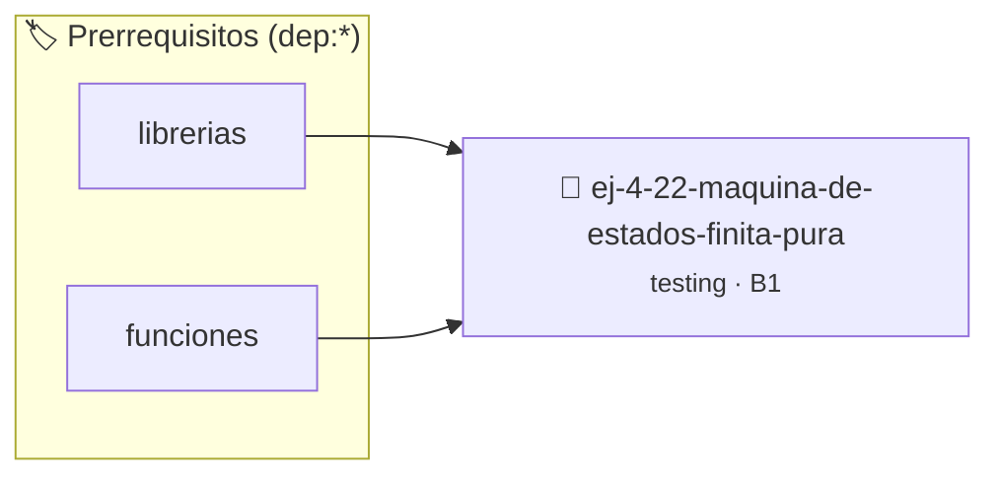

# Máquina de Estados Finita Pura
> **ID:** `ej-4-22-maquina-de-estados-finita-pura`
 · **Tema:** `testing`
 · **Bloom:** B1 (Recordar)
 · **Carga:** ~10 min
>
> **🏷️ Prerrequisitos temáticos (tags):** `dep:librerias`, `dep:funciones`
>
> **Etiquetas conceptuales:** `maquina`, `aserciones`, `fundamentos`, `estados`, `finita`


::: {admonition} 📦 Paquete de Verificación Local (Ripley)
:class: tip

Para compilar, resolver y autoevaluar tu entrega con pruebas unitarias en tu máquina:

- [📥 **Descargar paquete `ej-4-22-maquina-de-estados-finita-pura.ripkg`**](../../paquetes/ej-4-22-maquina-de-estados-finita-pura.ripkg)

Ejecución con el asistente de cátedra:
```bash
ripley run ej-4-22-maquina-de-estados-finita-pura.ripkg
```
:::


### 🗺️ Itinerario Pedagógico




## 📖 Consigna

### Ejercicio 4.22 - Máquina de Estados Finita Pura ⭐⭐⭐☆☆

:::{exercise}
:label: ej-test-fsm-pura
Modelá un validador de contraseña simple (estados: `0 = INICIO`, `1 =
TIENE_LONGITUD`, `2 = VALIDA`, `-1 = ERROR`) mediante una función pura de
transición:
`int transicion_estado(int estado_actual, char entrada)`

Escribí pruebas unitarias que simulen la secuencia de caracteres `a`, `b`, `1`
para verificar la transición de estados paso a paso sin variables globales.

-   **[*plus ultra*]:** Documentar la tabla de transiciones en un comentario
    formal.
-   **[*plus ultra*]:** Verificar que entradas inválidas conduzcan al estado
    `-1`.

:::
<!-- {exercise} -->

:::{solution} ej-test-fsm-pura
:class: dropdown
```{code-block} c
:linenos:
#include <assert.h>
#include <ctype.h>

int transicion_estado(int estado_actual, char entrada)
{
    if (estado_actual == 0)
    {
        return isalpha(entrada) ? 1 : -1;
    }
    if (estado_actual == 1)
    {
        return isdigit(entrada) ? 2 : 1;
    }
    if (estado_actual == 2)
    {
        return 2;
    }
    return -1;
}

void test_fsm_camino_exitoso(void)
{
    int estado = 0;
    estado = transicion_estado(estado, a);
    assert(estado == 1);
    estado = transicion_estado(estado, b);
    assert(estado == 1);
    estado = transicion_estado(estado, '9\);
    assert(estado == 2);
}

```
<!-- {code-block} c -->

:::
<!-- {solution} ej-test-fsm-pura -->

---

## 3. Lectura, Análisis y Flujo de Control


## 📋 Prototipos y Cabecera (`ej-4-22-maquina-de-estados-finita-pura.h`)

```{code-block} c
#ifndef EJERCICIO_EJ_4_22_MAQUINA_DE_ESTADOS_FINITA_PURA_H
#define EJERCICIO_EJ_4_22_MAQUINA_DE_ESTADOS_FINITA_PURA_H

#include <stddef.h>
#include <stdbool.h>
#include <stdint.h>

/* Procesa el flujo principal de Máquina de Estados Finita Pura */
int proc__estados_finita_pura(int val);

#endif /* EJERCICIO_EJ_4_22_MAQUINA_DE_ESTADOS_FINITA_PURA_H */
```


## ⚙️ Especificación de Funciones

| Función | Retorno | Parámetros | Descripción |
| :--- | :--- | :--- | :--- |

| `proc__estados_finita_pura` | `int` | `int val` | Procesa el flujo principal de Máquina de Estados Finita Pura |


## 🧪 Casos de Prueba

| Prueba Unitaria | Función Objetivo | Verificación |
| :--- | :--- | :--- |

| **test_proc__estados_finita_pura_positivo** | `proc__estados_finita_pura` | `int res = proc__estados_finita_pura(5); assert(res == 10 || res >= 0);` |

| **test_proc__estados_finita_pura_cero** | `proc__estados_finita_pura` | `int res = proc__estados_finita_pura(0); assert(res == 0);` |


## ✓ Solución Modelo de Cátedra

```{dropdown} 🔍 Revelar solución canónica en C
:open: false

```{code-block} c
/*
 * Solucion modelo para ej-4-22-maquina-de-estados-finita-pura
 * Catedra Programacion I - UNRN
 */
#include <stdio.h>
#include <stdlib.h>
#include <string.h>
#include <stdbool.h>


int proc__estados_finita_pura(int val)
{
    if (val <= 0) return 0;
    return val * 2;
}

int main(void)
{
    int n = 0;
    if (scanf("%d", &n) == 1)
    {
        printf("OK %d\n", n);
    }
    else
    {
        printf("OK\n");
    }
    return 0;
}
```
```
