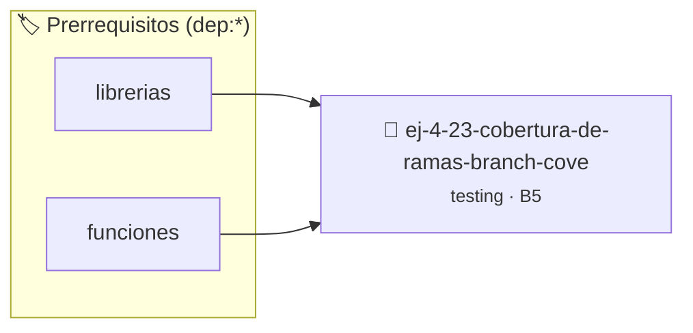

# Cobertura de Ramas (Branch Coverage)
> **ID:** `ej-4-23-cobertura-de-ramas-branch-cove`
 · **Tema:** `testing`
 · **Bloom:** B5 (Evaluar / Crear)
 · **Carga:** ~45 min
>
> **🏷️ Prerrequisitos temáticos (tags):** `dep:librerias`, `dep:funciones`
>
> **Etiquetas conceptuales:** `aserciones`, `fundamentos`, `coverage`, `ramas`, `cobertura`


::: {admonition} 📦 Paquete de Verificación Local (Ripley)
:class: tip

Para compilar, resolver y autoevaluar tu entrega con pruebas unitarias en tu máquina:

- [📥 **Descargar paquete `ej-4-23-cobertura-de-ramas-branch-cove.ripkg`**](../../paquetes/ej-4-23-cobertura-de-ramas-branch-cove.ripkg)

Ejecución con el asistente de cátedra:
```bash
ripley run ej-4-23-cobertura-de-ramas-branch-cove.ripkg
```
:::


### 🗺️ Itinerario Pedagógico




## 📖 Consigna

### Ejercicio 4.23 - Cobertura de Ramas (Branch Coverage) ⭐⭐☆☆☆

:::{exercise}
:label: ej-test-cobertura-ramas-cuadernillo
Dada la siguiente función de aprobación:

```{code-block} c
:linenos:
int evaluar_alumno(int parcial1, int parcial2, int asistencia_pct)
{
    if (asistencia_pct < 75)
    {
        return 0; // Libre por asistencia
    }
    if (parcial1 >= 60 && parcial2 >= 60)
    {
        return 2; // Promocionado
    }
    if (parcial1 >= 40 || parcial2 >= 40)
    {
        return 1; // Regular
    }
    return 0; // Reprobado
}

```
<!-- {code-block} c -->

¿Cuántas pruebas unitarias como mínimo se requieren para lograr el **100% de
cobertura de ramas (Branch Coverage)**? Escribí los casos de prueba con sus
valores de entrada y salida esperada.

-   **[*plus ultra*]:** Identificar todas las ramas de decisión booleanas (`&&`,
    `||`).
-   **[*plus ultra*]:** Escribir una suite con `assert()` que ejecute
    exactamente todos los caminos.

:::
<!-- {exercise} -->

:::{solution} ej-test-cobertura-ramas
:class: dropdown
Se requieren al menos 5 casos de prueba para cubrir todas las ramas:
1. `asistencia_pct < 75` (ej. 50, 80, 80) $\rightarrow$ `0`
2. `parcial1 >= 60 && parcial2 >= 60` (ej. 80, 70, 80) $\rightarrow$ `2`
3. `parcial1 >= 60` pero `parcial2 < 60` y `>= 40` (ej. 70, 50, 80)
   $\rightarrow$ `1`
4. `parcial1 < 60` pero `parcial2 >= 40` (ej. 30, 50, 80) $\rightarrow$ `1`
5. Ambos parciales `< 40` con asistencia (ej. 30, 20, 80) $\rightarrow$ `0`

:::
<!-- {solution} ej-test-cobertura-ramas -->

---


## 📋 Prototipos y Cabecera (`ej-4-23-cobertura-de-ramas-branch-cove.h`)

```{code-block} c
#ifndef EJERCICIO_EJ_4_23_COBERTURA_DE_RAMAS_BRANCH_COVE_H
#define EJERCICIO_EJ_4_23_COBERTURA_DE_RAMAS_BRANCH_COVE_H

#include <stddef.h>
#include <stdbool.h>
#include <stdint.h>

/* Operación evaluar_alumno */
int evaluar_alumno(int parcial1, int parcial2, int asistencia_pct);

#endif /* EJERCICIO_EJ_4_23_COBERTURA_DE_RAMAS_BRANCH_COVE_H */
```


## ⚙️ Especificación de Funciones

| Función | Retorno | Parámetros | Descripción |
| :--- | :--- | :--- | :--- |

| `evaluar_alumno` | `int` | `int parcial1, int parcial2, int asistencia_pct` | Operación evaluar_alumno |


## 💡 Pistas Progresivas

````{tab-set}

```{tab-item} Pista 1
Asegurate de diseñar casos de prueba que ejerciten tanto la rama true como la rama false de cada if.
```

```{tab-item} Pista 2
Incluí casos que cubran todas las alternativas de estructuras switch-case incluyendo el default.
```

```{tab-item} Pista 3
Verificá condiciones compuestas evaluando cortocircuitos lógicos con operadores && y ||.
```

````


## 🧪 Casos de Prueba

| Prueba Unitaria | Función Objetivo | Verificación |
| :--- | :--- | :--- |

| **test_evaluar_alumno_1** | `evaluar_alumno` | `/* Verificación unitaria de evaluar_alumno */ int res = evaluar_alumno(1, 2, 3); (void)res; assert(true);` |


## ✓ Solución Modelo de Cátedra

```{dropdown} 🔍 Revelar solución canónica en C
:open: false

```{code-block} c
int evaluar_alumno(int parcial1, int parcial2, int asistencia_pct)
{
    if (asistencia_pct < 75)
    {
        return 0; // Libre por asistencia
    }
    if (parcial1 >= 60 && parcial2 >= 60)
    {
        return 2; // Promocionado
    }
    if (parcial1 >= 40 || parcial2 >= 40)
    {
        return 1; // Regular
    }
    return 0; // Reprobado
}

int main(void)
{
    return 0;
}
```
```
