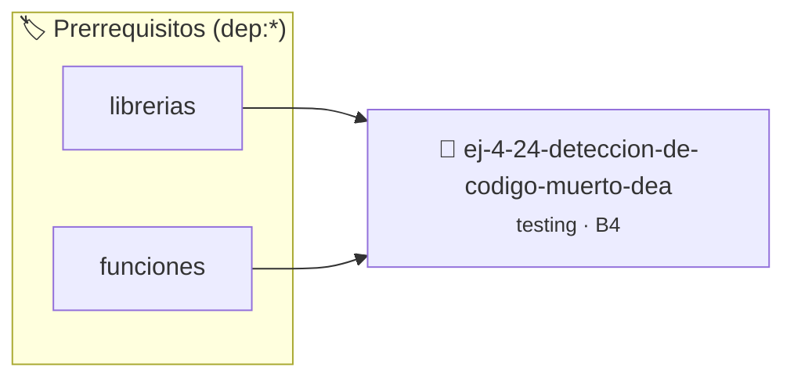

# Detección de Código Muerto (Dead Code)
> **ID:** `ej-4-24-deteccion-de-codigo-muerto-dea` · **Unidad:** 5 (Ingeniería de Software y Calidad en C)
 · **Tema:** `testing` / `aserciones_defensivas`
 · **Bloom:** B4 (Analizar) · **Dificultad:** Avanzada
 · **Carga:** ~35 min · **Tipo:** Laboratorio
>
> **🏷️ Prerrequisitos temáticos (tags):** `dep:librerias`, `dep:funciones`
>
> **Etiquetas conceptuales:** `code`, `aserciones`, `fundamentos`, `muerto`, `deteccion`


::: {admonition} 📦 Paquete de Verificación Local (Ripley)
:class: tip

Para compilar, resolver y autoevaluar tu entrega con pruebas unitarias en tu máquina:

- [📥 **Descargar paquete `ej-4-24-deteccion-de-codigo-muerto-dea.ripkg`**](../../paquetes/ej-4-24-deteccion-de-codigo-muerto-dea.ripkg)

Ejecución con el asistente de cátedra:
```bash
ripley run ej-4-24-deteccion-de-codigo-muerto-dea.ripkg
```
:::


### 🗺️ Itinerario Pedagógico




## 📖 Consigna

### Ejercicio 4.24 - Detección de Código Muerto (Dead Code) ⭐⭐☆☆☆

:::{exercise}
:label: ej-test-dead-code
Analizá la siguiente función e identificá qué bloque de código es **código
muerto** (nunca podrá ejecutarse bajo ninguna circunstancia):

```{code-block} c
:linenos:
int calcular_tarifa(int edad)
{
    if (edad < 0)
    {
        return -1;
    }
    if (edad >= 0 && edad <= 12)
    {
        return 50;
    }
    if (edad > 12)
    {
        return 100;
    }
    // ¿Puede ejecutarse esta línea alguna vez?
    return 0;
}

```
<!-- {code-block} c -->

-   **[*plus ultra*]:** Simplificar la estructura lógica eliminando
    redundancias.
-   **[*plus ultra*]:** Escribir pruebas unitarias que demuestren que la versión
    simplificada produce los mismos resultados.

:::
<!-- {exercise} -->

:::{solution} ej-test-dead-code
:class: dropdown
La línea `return 0;` al final es **código muerto** porque los tres bloques `if`
anteriores cubren exhaustivamente todos los números enteros posibles ($
ext{edad} < 0$, $0 \le  ext{edad} \le 12$, $    ext{edad} > 12$).

**Versión refactorizada y limpia:**
```{code-block} c
:linenos:
int calcular_tarifa(int edad)
{
    if (edad < 0)
    {
        return -1;
    }
    if (edad <= 12)
    {
        return 50;
    }
    return 100;
}

```
<!-- {code-block} c -->

:::
<!-- {solution} ej-test-dead-code -->

---


## 📋 Prototipos y Cabecera (`ej-4-24-deteccion-de-codigo-muerto-dea.h`)

```{code-block} c
#ifndef EJERCICIO_EJ_4_24_DETECCION_DE_CODIGO_MUERTO_DEA_H
#define EJERCICIO_EJ_4_24_DETECCION_DE_CODIGO_MUERTO_DEA_H

#include <stddef.h>
#include <stdbool.h>
#include <stdint.h>

/* Operación calcular_tarifa */
int calcular_tarifa(int edad);

#endif /* EJERCICIO_EJ_4_24_DETECCION_DE_CODIGO_MUERTO_DEA_H */
```


## ⚙️ Especificación de Funciones

| Función | Retorno | Parámetros | Descripción |
| :--- | :--- | :--- | :--- |

| `calcular_tarifa` | `int` | `int edad` | Operación calcular_tarifa |


## 💡 Pistas Progresivas

````{tab-set}

```{tab-item} Pista 1
Buscá bloques de código inalcanzables ubicados después de sentencias return, break o goto incondicionales.
```

```{tab-item} Pista 2
Identificá ramas condicionales cuyas condiciones sean tautologías o contradicciones constantes.
```

```{tab-item} Pista 3
Eliminá funciones o variables declaradas que nunca son referenciadas en el programa.
```

````


## 🧪 Casos de Prueba

| Prueba Unitaria | Función Objetivo | Verificación |
| :--- | :--- | :--- |

| **test_calcular_tarifa_1** | `calcular_tarifa` | `/* Verificación unitaria de calcular_tarifa */ int res = calcular_tarifa(1); (void)res; assert(true);` |


## ✓ Solución Modelo de Cátedra

```{dropdown} 🔍 Revelar solución canónica en C
:open: false

```{code-block} c
int calcular_tarifa(int edad)
{
    if (edad < 0)
    {
        return -1;
    }
    if (edad >= 0 && edad <= 12)
    {
        return 50;
    }
    if (edad > 12)
    {
        return 100;
    }
    // ¿Puede ejecutarse esta línea alguna vez?
    return 0;
}

int main(void)
{
    return 0;
}
```
```
