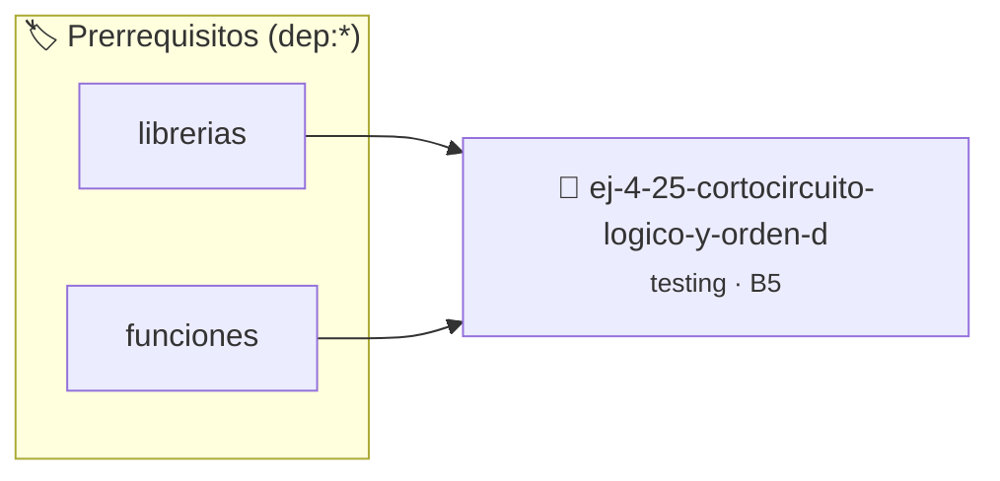

# Cortocircuito Lógico y Orden de Evaluación
> **ID:** `ej-4-25-cortocircuito-logico-y-orden-d` · **Unidad:** 5 (Ingeniería de Software y Calidad en C)
 · **Tema:** `testing` / `registro_eventos`
 · **Bloom:** B5 (Evaluar / Crear) · **Dificultad:** Desafio
 · **Carga:** ~45 min · **Tipo:** Desafio
>
> **🏷️ Prerrequisitos temáticos (tags):** `dep:librerias`, `dep:funciones`
>
> **Etiquetas conceptuales:** `cortocircuito`, `aserciones`, `orden`, `fundamentos`, `evaluacion`


::: {admonition} 📦 Paquete de Verificación Local (Ripley)
:class: tip

Para compilar, resolver y autoevaluar tu entrega con pruebas unitarias en tu máquina:

- [📥 **Descargar paquete `ej-4-25-cortocircuito-logico-y-orden-d.ripkg`**](../../paquetes/ej-4-25-cortocircuito-logico-y-orden-d.ripkg)

Ejecución con el asistente de cátedra:
```bash
ripley run ej-4-25-cortocircuito-logico-y-orden-d.ripkg
```
:::


### 🗺️ Itinerario Pedagógico




## 📖 Consigna

:::{exercise}
:label: ej-test-cortocircuito
Analizá el comportamiento de las operaciones con cortocircuito lógico (`&&` y
`||`). ¿Qué imprime el siguiente código y por qué la función `incrementar` no
siempre es invocada?

```{code-block} c
:linenos:
#include <stdio.h>

int llamadas = 0;

int incrementar(void)
{
    llamadas++;
    return 1;
}

int main(void)
{
    int a = 0;
    if (a != 0 && incrementar())
    {
        printf("Rama 1\n");
    }
    printf("Llamadas tras primer if: %d\n", llamadas);

    int b = 1;
    if (b == 1 || incrementar())
    {
        printf("Rama 2\n");
    }
    printf("Llamadas tras segundo if: %d\n", llamadas);
    return 0;
}

```

-   **[*plus ultra*]:** Explicar por qué es peligroso colocar funciones con
    efectos secundarios dentro de condiciones compuestas.
-   **[*plus ultra*]:** Escribir aserciones que verifiquen el valor final de
    `llamadas`.

:::

:::{solution} ej-test-cortocircuito
:class: dropdown
Imprime:
```
Llamadas tras primer if: 0
Rama 2
Llamadas tras segundo if: 0
```
- En `a != 0 && incrementar()`, como `a != 0` es falso, el operador `&&` evalúa
  a falso sin evaluar la segunda parte.
- En `b == 1 || incrementar()`, como `b == 1` es verdadero, el operador `||`
  evalúa a verdadero sin evaluar la segunda parte.
En ningún caso se ejecuta `incrementar()`.

:::

---

### 📋 Contrato de las Funciones

```c
/*
 * Operación incrementar
 * Precondiciones: Parámetros dentro del dominio válido de la operación.
 * Postcondiciones: Retorna el valor procesado.
 */
int incrementar(void);

```

### 🧪 Ejemplos de Ejecución

::::{tab-set}
:::{tab-item} Caso general
```text
val = 10
Retorno esperado calculado
```
:::
:::{tab-item} Caso límite
```text
val = 0
Retorno 0 o manejo de borde
```
:::
::::

### ⚠️ Precondiciones y Casos Borde

1. **Valores fuera de rango:** Verificar siempre que los datos de entrada cumplan con los rangos admisibles antes de operar.
6. **Casos vacíos o neutros:** Contemplar adecuadamente entradas con longitud cero o valores neutros según corresponda.

### 🎯 Criterios de Aceptación

- [ ] El código compila limpiamente bajo estándar C11 sin warnings con flags estrictos (`-Wall -Wextra -Werror`).
- [ ] Se satisfacen todas las pruebas unitarias y casos de prueba provistos.
- [ ] Las funciones validan exhaustivamente sus precondiciones y gestionan casos borde de forma robusta.


## 📋 Prototipos y Cabecera (`ej-4-25-cortocircuito-logico-y-orden-d.h`)

```{code-block} c
#ifndef EJERCICIO_EJ_4_25_CORTOCIRCUITO_LOGICO_Y_ORDEN_D_H
#define EJERCICIO_EJ_4_25_CORTOCIRCUITO_LOGICO_Y_ORDEN_D_H

#include <stddef.h>
#include <stdbool.h>
#include <stdint.h>

/* Operación incrementar */
int incrementar(void);

#endif /* EJERCICIO_EJ_4_25_CORTOCIRCUITO_LOGICO_Y_ORDEN_D_H */
```


## ⚙️ Especificación de Funciones

| Función | Retorno | Parámetros | Descripción |
| :--- | :--- | :--- | :--- |

| `incrementar` | `int` | `void` | Operación incrementar |


## 🧪 Casos de Prueba

| Prueba Unitaria | Función Objetivo | Verificación |
| :--- | :--- | :--- |

| **test_incrementar_1** | `incrementar` | `/* Verificación unitaria de incrementar */ int r = incrementar(); (void)r; assert(true);` |


## ✓ Solución Modelo de Cátedra

```{dropdown} 🔍 Revelar solución canónica en C
:open: false

```{code-block} c
#include <stdio.h>

int llamadas = 0;

int incrementar(void)
{
    llamadas++;
    return 1;
}

int main(void)
{
    int a = 0;
    if (a != 0 && incrementar())
    {
        printf("Rama 1\n");
    }
    printf("Llamadas tras primer if: %d\n", llamadas);

    int b = 1;
    if (b == 1 || incrementar())
    {
        printf("Rama 2\n");
    }
    printf("Llamadas tras segundo if: %d\n", llamadas);
    return 0;
}
```
```
