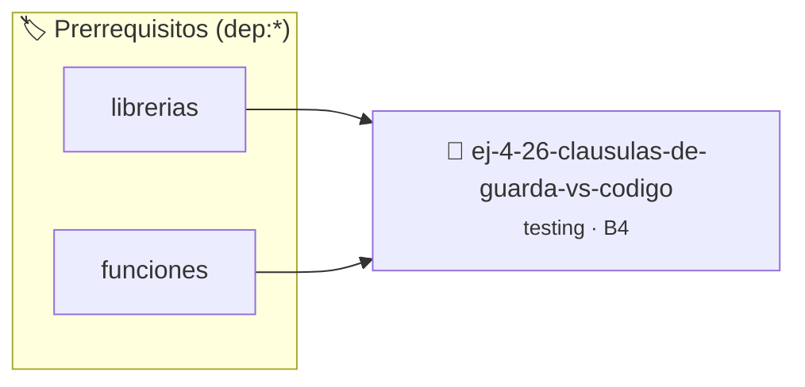

# Cláusulas de Guarda vs Código en Flecha
> **ID:** `ej-4-26-clausulas-de-guarda-vs-codigo` · **Unidad:** 5 (Ingeniería de Software y Calidad en C)
 · **Tema:** `testing` / `aserciones_defensivas`
 · **Bloom:** B4 (Analizar) · **Dificultad:** Avanzada
 · **Carga:** ~35 min · **Tipo:** Laboratorio
>
> **🏷️ Prerrequisitos temáticos (tags):** `dep:librerias`, `dep:funciones`
>
> **Etiquetas conceptuales:** `aserciones`, `clausulas`, `fundamentos`, `flecha`, `codigo`


::: {admonition} 📦 Paquete de Verificación Local (Ripley)
:class: tip

Para compilar, resolver y autoevaluar tu entrega con pruebas unitarias en tu máquina:

- [📥 **Descargar paquete `ej-4-26-clausulas-de-guarda-vs-codigo.ripkg`**](../../paquetes/ej-4-26-clausulas-de-guarda-vs-codigo.ripkg)

Ejecución con el asistente de cátedra:
```bash
ripley run ej-4-26-clausulas-de-guarda-vs-codigo.ripkg
```
:::


### 🗺️ Itinerario Pedagógico




## 📖 Consigna

:::{exercise}
:label: ej-test-guardas-vs-flecha
Refactorizá la siguiente función anidada aplicando **cláusulas de guarda** según
la [Regla 0x2001h](../../reglas/2_funciones.md#0x2001h):

```{code-block} c
:linenos:
int procesar_pedido(int cantidad, double precio_unitario, bool cliente_vip)
{
    int resultado = -1;
    if (cantidad > 0)
    {
        if (precio_unitario > 0.0)
        {
            if (cliente_vip)
            {
                resultado = (int)(cantidad * precio_unitario * 0.85);
            }
            else
            {
                resultado = (int)(cantidad * precio_unitario);
            }
        }
    }
    return resultado;
}

```

-   **[*plus ultra*]:** Comprobar que la función reduzca la sangría horizontal
    manteniendo exactamente el mismo comportamiento.
-   **[*plus ultra*]:** Escribir pruebas unitarias con `assert()` para cada
    salida prematura.

:::

:::{solution} ej-test-guardas-vs-flecha
:class: dropdown
```{code-block} c
:linenos:
#include <assert.h>
#include <stdbool.h>

int procesar_pedido(int cantidad, double precio_unitario, bool cliente_vip)
{
    if (cantidad <= 0 || precio_unitario <= 0.0)
    {
        return -1;
    }
    if (cliente_vip)
    {
        return (int)(cantidad * precio_unitario * 0.85);
    }
    return (int)(cantidad * precio_unitario);
}

void test_pedido_invalido_cantidad(void)
{
    assert(procesar_pedido(0, 10.0, false) == -1);
}

void test_pedido_invalido_precio(void)
{
    assert(procesar_pedido(5, -2.0, false) == -1);
}

void test_pedido_regular(void)
{
    assert(procesar_pedido(10, 10.0, false) == 100);
}

void test_pedido_vip(void)
{
    assert(procesar_pedido(10, 10.0, true) == 85);
}

```

:::

---

### 📋 Contrato de las Funciones

```c
/*
 * Operación procesar_pedido
 * Precondiciones: Parámetros dentro del dominio válido de la operación.
 * Postcondiciones: Retorna el valor procesado.
 */
int procesar_pedido(int cantidad, double precio_unitario, bool cliente_vip);

```

### 🧪 Ejemplos de Ejecución

::::{tab-set}
:::{tab-item} Caso general
```text
val = 10
Retorno esperado calculado
```
:::
:::{tab-item} Caso límite
```text
val = 0
Retorno 0 o manejo de borde
```
:::
::::

### ⚠️ Precondiciones y Casos Borde

1. **Valores fuera de rango:** Verificar siempre que los datos de entrada cumplan con los rangos admisibles antes de operar.
6. **Casos vacíos o neutros:** Contemplar adecuadamente entradas con longitud cero o valores neutros según corresponda.

### 🎯 Criterios de Aceptación

- [ ] El código compila limpiamente bajo estándar C11 sin warnings con flags estrictos (`-Wall -Wextra -Werror`).
- [ ] Se satisfacen todas las pruebas unitarias y casos de prueba provistos.
- [ ] Las funciones validan exhaustivamente sus precondiciones y gestionan casos borde de forma robusta.


## 📋 Prototipos y Cabecera (`ej-4-26-clausulas-de-guarda-vs-codigo.h`)

```{code-block} c
#ifndef EJERCICIO_EJ_4_26_CLAUSULAS_DE_GUARDA_VS_CODIGO_H
#define EJERCICIO_EJ_4_26_CLAUSULAS_DE_GUARDA_VS_CODIGO_H

#include <stddef.h>
#include <stdbool.h>
#include <stdint.h>

/* Operación procesar_pedido */
int procesar_pedido(int cantidad, double precio_unitario, bool cliente_vip);

#endif /* EJERCICIO_EJ_4_26_CLAUSULAS_DE_GUARDA_VS_CODIGO_H */
```


## ⚙️ Especificación de Funciones

| Función | Retorno | Parámetros | Descripción |
| :--- | :--- | :--- | :--- |

| `procesar_pedido` | `int` | `int cantidad, double precio_unitario, bool cliente_vip` | Operación procesar_pedido |


## 🧪 Casos de Prueba

| Prueba Unitaria | Función Objetivo | Verificación |
| :--- | :--- | :--- |

| **test_procesar_pedido_1** | `procesar_pedido` | `/* Verificación unitaria de procesar_pedido */ int res = procesar_pedido(1, 2, 3); (void)res; assert(true);` |


## ✓ Solución Modelo de Cátedra

```{dropdown} 🔍 Revelar solución canónica en C
:open: false

```{code-block} c
#include <stdbool.h>

int procesar_pedido(int cantidad, double precio_unitario, bool cliente_vip)
{
    int resultado = -1;
    if (cantidad > 0)
    {
        if (precio_unitario > 0.0)
        {
            if (cliente_vip)
            {
                resultado = (int)(cantidad * precio_unitario * 0.85);
            }
            else
            {
                resultado = (int)(cantidad * precio_unitario);
            }
        }
    }
    return resultado;
}

int main(void)
{
    return 0;
}
```
```
