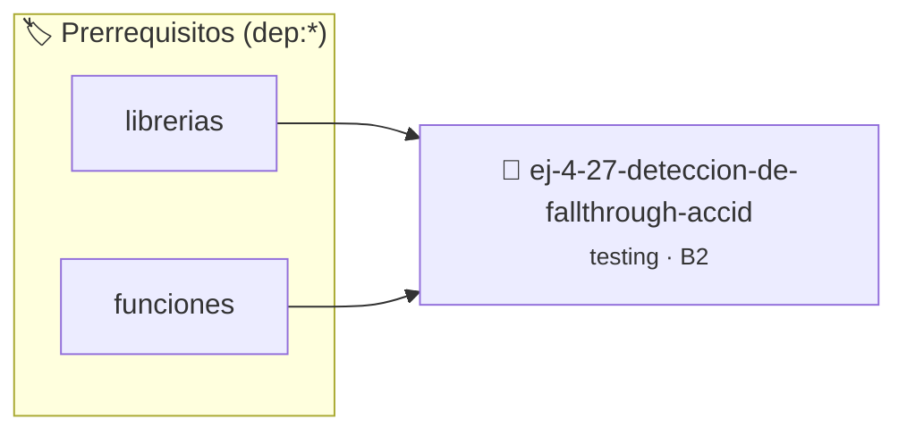

# Detección de Fallthrough accidental en switch
> **ID:** `ej-4-27-deteccion-de-fallthrough-accid` · **Unidad:** 5 (Ingeniería de Software y Calidad en C)
 · **Tema:** `testing` / `aserciones_defensivas`
 · **Bloom:** B2 (Comprender) · **Dificultad:** Inicial
 · **Carga:** ~15 min · **Tipo:** Laboratorio
>
> **🏷️ Prerrequisitos temáticos (tags):** `dep:librerias`, `dep:funciones`
>
> **Etiquetas conceptuales:** `aserciones`, `fallthrough`, `switch`, `fundamentos`, `accidental`


::: {admonition} 📦 Paquete de Verificación Local (Ripley)
:class: tip

Para compilar, resolver y autoevaluar tu entrega con pruebas unitarias en tu máquina:

- [📥 **Descargar paquete `ej-4-27-deteccion-de-fallthrough-accid.ripkg`**](../../paquetes/ej-4-27-deteccion-de-fallthrough-accid.ripkg)

Ejecución con el asistente de cátedra:
```bash
ripley run ej-4-27-deteccion-de-fallthrough-accid.ripkg
```
:::


### 🗺️ Itinerario Pedagógico




## 📖 Consigna

:::{exercise}
:label: ej-test-fallthrough-switch
Descubrí el bug en la siguiente función de cálculo de días de un mes y
corregilo:

```{code-block} c
:linenos:
int dias_del_mes(int mes)
{
    int dias = 0;
    switch (mes)
    {
        case 2:
            dias = 28;
        case 4:
        case 6:
        case 9:
        case 11:
            dias = 30;
        case 1:
        case 3:
        case 5:
        case 7:
        case 8:
        case 10:
        case 12:
            dias = 31;
        default:
            dias = -1;
    }
    return dias;
}

```

-   **[*plus ultra*]:** Explicar qué valor retornaría `dias_del_mes(2)` en el
    código original con bug.
-   **[*plus ultra*]:** Escribir una prueba unitaria que detecte el error.

:::

:::{solution} ej-test-fallthrough-switch
:class: dropdown
En el código original falta la instrucción `break;` al final de cada grupo de
casos. Por lo tanto, para cualquier mes, la ejecución continúa cayendo
(*fallthrough*) hasta el bloque `default`, retornando siempre `-1`.

**Solución:**
```{code-block} c
:linenos:
int dias_del_mes(int mes)
{
    switch (mes)
    {
        case 2:
            return 28;
        case 4:
        case 6:
        case 9:
        case 11:
            return 30;
        case 1:
        case 3:
        case 5:
        case 7:
        case 8:
        case 10:
        case 12:
            return 31;
        default:
            return -1;
    }
}

```

:::

---

### 📋 Contrato de las Funciones

```c
/*
 * Operación dias_del_mes
 * Precondiciones: Parámetros dentro del dominio válido de la operación.
 * Postcondiciones: Retorna el valor procesado.
 */
int dias_del_mes(int mes);

```

### 🧪 Ejemplos de Ejecución

::::{tab-set}
:::{tab-item} Valor positivo
```text
Entrada: 1
Salida / Retorno: 2
```
:::
::::

### ⚠️ Precondiciones y Casos Borde

1. **Valores fuera de rango:** Verificar siempre que los datos de entrada cumplan con los rangos admisibles antes de operar.
6. **Casos vacíos o neutros:** Contemplar adecuadamente entradas con longitud cero o valores neutros según corresponda.

### 🎯 Criterios de Aceptación

- [ ] El código compila limpiamente bajo estándar C11 sin warnings con flags estrictos (`-Wall -Wextra -Werror`).
- [ ] Se satisfacen todas las pruebas unitarias y casos de prueba provistos.
- [ ] Las funciones validan exhaustivamente sus precondiciones y gestionan casos borde de forma robusta.


## 📋 Prototipos y Cabecera (`ej-4-27-deteccion-de-fallthrough-accid.h`)

```{code-block} c
#ifndef EJERCICIO_EJ_4_27_DETECCION_DE_FALLTHROUGH_ACCID_H
#define EJERCICIO_EJ_4_27_DETECCION_DE_FALLTHROUGH_ACCID_H

#include <stddef.h>
#include <stdbool.h>
#include <stdint.h>

/* Operación dias_del_mes */
int dias_del_mes(int mes);

#endif /* EJERCICIO_EJ_4_27_DETECCION_DE_FALLTHROUGH_ACCID_H */
```


## ⚙️ Especificación de Funciones

| Función | Retorno | Parámetros | Descripción |
| :--- | :--- | :--- | :--- |

| `dias_del_mes` | `int` | `int mes` | Operación dias_del_mes |


## 🧪 Casos de Prueba

| Prueba Unitaria | Función Objetivo | Verificación |
| :--- | :--- | :--- |

| **test_dias_del_mes_1** | `dias_del_mes` | `/* Verificación unitaria de dias_del_mes */ int res = dias_del_mes(1); (void)res; assert(true);` |


## ✓ Solución Modelo de Cátedra

```{dropdown} 🔍 Revelar solución canónica en C
:open: false

```{code-block} c
int dias_del_mes(int mes)
{
    int dias = 0;
    switch (mes)
    {
        case 2:
            dias = 28;
        case 4:
        case 6:
        case 9:
        case 11:
            dias = 30;
        case 1:
        case 3:
        case 5:
        case 7:
        case 8:
        case 10:
        case 12:
            dias = 31;
        default:
            dias = -1;
    }
    return dias;
}

int main(void)
{
    return 0;
}
```
```
