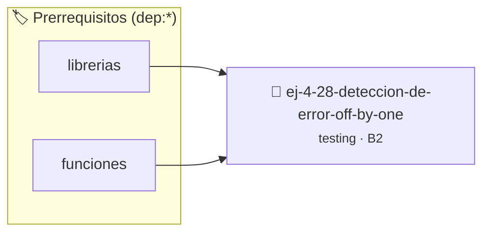

# Detección de Error Off-by-one en Lazos
> **ID:** `ej-4-28-deteccion-de-error-off-by-one` · **Unidad:** 5 (Ingeniería de Software y Calidad en C)
 · **Tema:** `testing` / `aserciones_defensivas`
 · **Bloom:** B2 (Comprender) · **Dificultad:** Inicial
 · **Carga:** ~15 min · **Tipo:** Laboratorio
>
> **🏷️ Prerrequisitos temáticos (tags):** `dep:librerias`, `dep:funciones`
>
> **Etiquetas conceptuales:** `aserciones`, `lazos`, `fundamentos`, `error`, `off-by-one`


::: {admonition} 📦 Paquete de Verificación Local (Ripley)
:class: tip

Para compilar, resolver y autoevaluar tu entrega con pruebas unitarias en tu máquina:

- [📥 **Descargar paquete `ej-4-28-deteccion-de-error-off-by-one.ripkg`**](../../paquetes/ej-4-28-deteccion-de-error-off-by-one.ripkg)

Ejecución con el asistente de cátedra:
```bash
ripley run ej-4-28-deteccion-de-error-off-by-one.ripkg
```
:::


### 🗺️ Itinerario Pedagógico




## 📖 Consigna

### Ejercicio 4.28 - Detección de Error Off-by-one en Lazos ⭐⭐☆☆☆

:::{exercise}
:label: ej-test-off-by-one
El siguiente algoritmo debe sumar los primeros $N$ números naturales ($1 + 2 +
\dots + N$). Descubrí el error en la condición del lazo:

```{code-block} c
:linenos:
int suma_primeros_n(int n)
{
    if (n <= 0)
    {
        return 0;
    }
    int total = 0;
    for (int i = 1; i < n; i++) // ¿Qué error hay acá?
    {
        total += i;
    }
    return total;
}

```
<!-- {code-block} c -->

-   **[*plus ultra*]:** Escribir un test unitario para `suma_primeros_n(4)` cuyo
    resultado esperado es `10`.
-   **[*plus ultra*]:** Corregir el lazo para que incluya al número $N$ usando
    `<=`.

:::
<!-- {exercise} -->

:::{solution} ej-test-off-by-one
:class: dropdown
El lazo utiliza `i < n`, lo que omite sumar el último valor $N$. Para $N=4$,
suma $1+2+3 = 6$ en lugar de $1+2+3+4 = 10$.

**Corrección:**
```{code-block} c
:linenos:
int suma_primeros_n(int n)
{
    if (n <= 0)
    {
        return 0;
    }
    int total = 0;
    for (int i = 1; i <= n; i++)
    {
        total += i;
    }
    return total;
}

```
<!-- {code-block} c -->

:::
<!-- {solution} ej-test-off-by-one -->

---


## 📋 Prototipos y Cabecera (`ej-4-28-deteccion-de-error-off-by-one.h`)

```{code-block} c
#ifndef EJERCICIO_EJ_4_28_DETECCION_DE_ERROR_OFF_BY_ONE_H
#define EJERCICIO_EJ_4_28_DETECCION_DE_ERROR_OFF_BY_ONE_H

#include <stddef.h>
#include <stdbool.h>
#include <stdint.h>

/* Operación suma_primeros_n */
int suma_primeros_n(int n);

#endif /* EJERCICIO_EJ_4_28_DETECCION_DE_ERROR_OFF_BY_ONE_H */
```


## ⚙️ Especificación de Funciones

| Función | Retorno | Parámetros | Descripción |
| :--- | :--- | :--- | :--- |

| `suma_primeros_n` | `int` | `int n` | Operación suma_primeros_n |


## 🧪 Casos de Prueba

| Prueba Unitaria | Función Objetivo | Verificación |
| :--- | :--- | :--- |

| **test_suma_primeros_n_1** | `suma_primeros_n` | `/* Verificación unitaria de suma_primeros_n */ int res = suma_primeros_n(1); (void)res; assert(true);` |


## ✓ Solución Modelo de Cátedra

```{dropdown} 🔍 Revelar solución canónica en C
:open: false

```{code-block} c
int suma_primeros_n(int n)
{
    if (n <= 0)
    {
        return 0;
    }
    int total = 0;
    for (int i = 1; i < n; i++) // ¿Qué error hay acá?
    {
        total += i;
    }
    return total;
}

int main(void)
{
    return 0;
}
```
```
