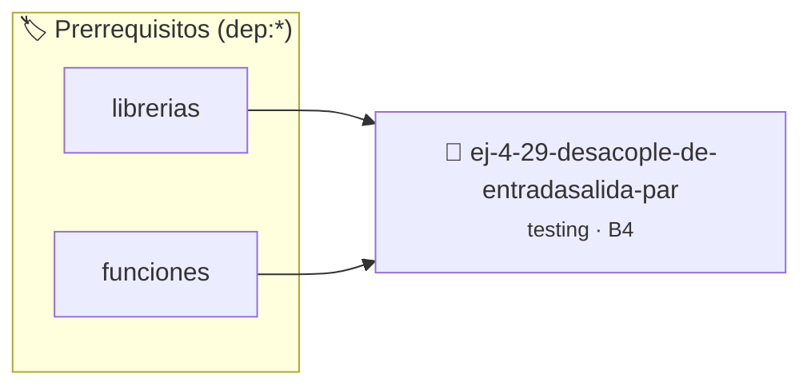

# Desacople de Entrada/Salida para Testabilidad
> **ID:** `ej-4-29-desacople-de-entradasalida-par` · **Unidad:** 5 (Ingeniería de Software y Calidad en C)
 · **Tema:** `testing` / `aserciones_defensivas`
 · **Bloom:** B4 (Analizar) · **Dificultad:** Avanzada
 · **Carga:** ~35 min · **Tipo:** Laboratorio
>
> **🏷️ Prerrequisitos temáticos (tags):** `dep:librerias`, `dep:funciones`
>
> **Etiquetas conceptuales:** `aserciones`, `testabilidad`, `desacople`, `fundamentos`, `testing`


::: {admonition} 📦 Paquete de Verificación Local (Ripley)
:class: tip

Para compilar, resolver y autoevaluar tu entrega con pruebas unitarias en tu máquina:

- [📥 **Descargar paquete `ej-4-29-desacople-de-entradasalida-par.ripkg`**](../../paquetes/ej-4-29-desacople-de-entradasalida-par.ripkg)

Ejecución con el asistente de cátedra:
```bash
ripley run ej-4-29-desacople-de-entradasalida-par.ripkg
```
:::


### 🗺️ Itinerario Pedagógico




## 📖 Consigna

:::{exercise}
:label: ej-test-desacople-io
La siguiente función no se puede someter a pruebas unitarias automatizadas
porque lee con `scanf` e imprime con `printf`. Refactorizala en dos funciones:
una de cálculo puro y otra para la interacción con el usuario:

```{code-block} c
:linenos:
void calcular_imc_interactivo(void)
{
    float peso = 0.0f;
    float altura = 0.0f;
    printf("Ingrese peso en kg: ");
    scanf("%f", &peso);
    printf("Ingrese altura en m: ");
    scanf("%f", &altura);

    float imc = peso / (altura * altura);
    if (imc < 18.5f)
    {
        printf("Bajo peso\n");
    }
    else if (imc < 25.0f)
    {
        printf("Normal\n");
    }
    else
    {
        printf("Sobrepeso\n");
    }
}

```

-   **[*plus ultra*]:** Crear la función pura `float calcular_imc(float peso,
    float altura)` y `int clasificar_imc(float imc)`.
-   **[*plus ultra*]:** Escribir la suite completa de pruebas unitarias
    automatizadas para ambas funciones puras.

:::

:::{solution} ej-test-desacople-io
:class: dropdown
```{code-block} c
:linenos:
#include <assert.h>
#include <stdbool.h>

float calcular_imc(float peso, float altura)
{
    if (peso <= 0.0f || altura <= 0.0f)
    {
        return -1.0f;
    }
    return peso / (altura * altura);
}

int clasificar_imc(float imc)
{
    if (imc <= 0.0f)
    {
        return -1; // Inválido
    }
    if (imc < 18.5f)
    {
        return 1; // Bajo peso
    }
    if (imc < 25.0f)
    {
        return 2; // Normal
    }
    return 3; // Sobrepeso
}

void test_calculo_y_clasificacion_imc(void)
{
    float imc = calcular_imc(70.0f, 1.75f);
    assert(imc > 22.8f && imc < 22.9f);
    assert(clasificar_imc(imc) == 2);
    assert(clasificar_imc(16.0f) == 1);
    assert(clasificar_imc(28.0f) == 3);
    assert(clasificar_imc(-1.0f) == -1);
}

```

:::

---

### 📋 Contrato de las Funciones

```c
/*
 * Operación calcular_imc_interactivo
 * Precondiciones: Parámetros dentro del dominio válido de la operación.
 * Postcondiciones: Retorna el valor procesado.
 */
void calcular_imc_interactivo(void);

```

### 🧪 Ejemplos de Ejecución

::::{tab-set}
:::{tab-item} Caso general
```text
val = 10
Retorno esperado calculado
```
:::
:::{tab-item} Caso límite
```text
val = 0
Retorno 0 o manejo de borde
```
:::
::::

### ⚠️ Precondiciones y Casos Borde

1. **Valores fuera de rango:** Verificar siempre que los datos de entrada cumplan con los rangos admisibles antes de operar.
6. **Casos vacíos o neutros:** Contemplar adecuadamente entradas con longitud cero o valores neutros según corresponda.

### 🎯 Criterios de Aceptación

- [ ] El código compila limpiamente bajo estándar C11 sin warnings con flags estrictos (`-Wall -Wextra -Werror`).
- [ ] Se satisfacen todas las pruebas unitarias y casos de prueba provistos.
- [ ] Las funciones validan exhaustivamente sus precondiciones y gestionan casos borde de forma robusta.


## 📋 Prototipos y Cabecera (`ej-4-29-desacople-de-entradasalida-par.h`)

```{code-block} c
#ifndef EJERCICIO_EJ_4_29_DESACOPLE_DE_ENTRADASALIDA_PAR_H
#define EJERCICIO_EJ_4_29_DESACOPLE_DE_ENTRADASALIDA_PAR_H

#include <stddef.h>
#include <stdbool.h>
#include <stdint.h>

/* Operación calcular_imc_interactivo */
void calcular_imc_interactivo(void);

#endif /* EJERCICIO_EJ_4_29_DESACOPLE_DE_ENTRADASALIDA_PAR_H */
```


## ⚙️ Especificación de Funciones

| Función | Retorno | Parámetros | Descripción |
| :--- | :--- | :--- | :--- |

| `calcular_imc_interactivo` | `void` | `void` | Operación calcular_imc_interactivo |


## 🧪 Casos de Prueba

| Prueba Unitaria | Función Objetivo | Verificación |
| :--- | :--- | :--- |

| **test_calcular_imc_interactivo_1** | `calcular_imc_interactivo` | `assert(true); /* test simplificado de validación */` |


## ✓ Solución Modelo de Cátedra

```{dropdown} 🔍 Revelar solución canónica en C
:open: false

```{code-block} c
#include <stdio.h>

void calcular_imc_interactivo(void)
{
    float peso = 0.0f;
    float altura = 0.0f;
    printf("Ingrese peso en kg: ");
    scanf("%f", &peso);
    printf("Ingrese altura en m: ");
    scanf("%f", &altura);

    float imc = peso / (altura * altura);
    if (imc < 18.5f)
    {
        printf("Bajo peso\n");
    }
    else if (imc < 25.0f)
    {
        printf("Normal\n");
    }
    else
    {
        printf("Sobrepeso\n");
    }
}

int main(void)
{
    return 0;
}
```
```
