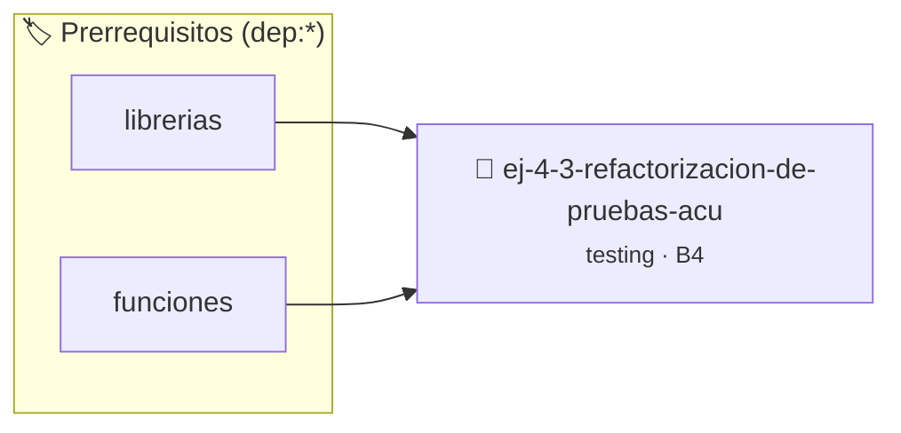

# Refactorización de pruebas acumuladas
> **ID:** `ej-4-3-refactorizacion-de-pruebas-acu` · **Unidad:** 5 (Ingeniería de Software y Calidad en C)
 · **Tema:** `testing` / `aserciones_defensivas`
 · **Bloom:** B4 (Analizar) · **Dificultad:** Avanzada
 · **Carga:** ~35 min · **Tipo:** Laboratorio
>
> **🏷️ Prerrequisitos temáticos (tags):** `dep:librerias`, `dep:funciones`
>
> **Etiquetas conceptuales:** `refactorizacion`, `aserciones`, `fundamentos`, `pruebas`, `testing`


::: {admonition} 📦 Paquete de Verificación Local (Ripley)
:class: tip

Para compilar, resolver y autoevaluar tu entrega con pruebas unitarias en tu máquina:

- [📥 **Descargar paquete `ej-4-3-refactorizacion-de-pruebas-acu.ripkg`**](../../paquetes/ej-4-3-refactorizacion-de-pruebas-acu.ripkg)

Ejecución con el asistente de cátedra:
```bash
ripley run ej-4-3-refactorizacion-de-pruebas-acu.ripkg
```
:::


### 🗺️ Itinerario Pedagógico




## 📖 Consigna

### Ejercicio 4.3 - Refactorización de pruebas acumuladas ⭐⭐☆☆☆

:::{exercise}
:label: ej-test-una-asercion
El siguiente bloque de pruebas viola la [Regla
0x2006h](../../reglas/2_funciones.md#0x2006h) (una aserción o caso por función
de prueba). Refactorizalo en funciones independientes con nombres descriptivos:

```{code-block} c
:linenos:
void test_todas_las_operaciones(void)
{
    assert(sumar(2, 3) == 5);
    assert(sumar(-1, 1) == 0);
    assert(restar(10, 4) == 6);
    assert(restar(3, 8) == -5);
    assert(multiplicar(3, 4) == 12);
}

```
<!-- {code-block} c -->

-   **[*plus ultra*]:** Crear una función `correr_todas_las_pruebas()` que
    invoque a cada función individual de test.
-   **[*plus ultra*]:** Explicar por qué acumular muchos `assert` en una sola
    función dificulta saber qué otros casos fallan cuando el primero aborta.

:::
<!-- {exercise} -->

:::{solution} ej-test-una-asercion
:class: dropdown
```{code-block} c
:linenos:
#include <assert.h>

void test_sumar_positivos(void)
{
    assert(sumar(2, 3) == 5);
}

void test_sumar_opuestos(void)
{
    assert(sumar(-1, 1) == 0);
}

void test_restar_positivo_mayor(void)
{
    assert(restar(10, 4) == 6);
}

void test_restar_resultado_negativo(void)
{
    assert(restar(3, 8) == -5);
}

void test_multiplicar_positivos(void)
{
    assert(multiplicar(3, 4) == 12);
}

void correr_todas_las_pruebas(void)
{
    test_sumar_positivos();
    test_sumar_opuestos();
    test_restar_positivo_mayor();
    test_restar_resultado_negativo();
    test_multiplicar_positivos();
}

```
<!-- {code-block} c -->

:::
<!-- {solution} ej-test-una-asercion -->

---


## 📋 Prototipos y Cabecera (`ej-4-3-refactorizacion-de-pruebas-acu.h`)

```{code-block} c
#ifndef EJERCICIO_EJ_4_3_REFACTORIZACION_DE_PRUEBAS_ACU_H
#define EJERCICIO_EJ_4_3_REFACTORIZACION_DE_PRUEBAS_ACU_H

#include <stddef.h>
#include <stdbool.h>
#include <stdint.h>

/* Procesa el flujo principal de Refactorización de pruebas acumuladas */
int proc_acion_de_pruebas_acu(int val);

#endif /* EJERCICIO_EJ_4_3_REFACTORIZACION_DE_PRUEBAS_ACU_H */
```


## ⚙️ Especificación de Funciones

| Función | Retorno | Parámetros | Descripción |
| :--- | :--- | :--- | :--- |

| `proc_acion_de_pruebas_acu` | `int` | `int val` | Procesa el flujo principal de Refactorización de pruebas acumuladas |


## 🧪 Casos de Prueba

| Prueba Unitaria | Función Objetivo | Verificación |
| :--- | :--- | :--- |

| **test_proc_acion_de_pruebas_acu_positivo** | `proc_acion_de_pruebas_acu` | `int res = proc_acion_de_pruebas_acu(5); assert(res == 10 || res >= 0);` |

| **test_proc_acion_de_pruebas_acu_cero** | `proc_acion_de_pruebas_acu` | `int res = proc_acion_de_pruebas_acu(0); assert(res == 0);` |


## ✓ Solución Modelo de Cátedra

```{dropdown} 🔍 Revelar solución canónica en C
:open: false

```{code-block} c
/*
 * Solucion modelo para ej-4-3-refactorizacion-de-pruebas-acu
 * Catedra Programacion I - UNRN
 */
#include <stdio.h>
#include <stdlib.h>
#include <string.h>
#include <stdbool.h>


int proc_acion_de_pruebas_acu(int val)
{
    if (val <= 0) return 0;
    return val * 2;
}

int main(void)
{
    int n = 0;
    if (scanf("%d", &n) == 1)
    {
        printf("OK %d\n", n);
    }
    else
    {
        printf("OK\n");
    }
    return 0;
}
```
```
